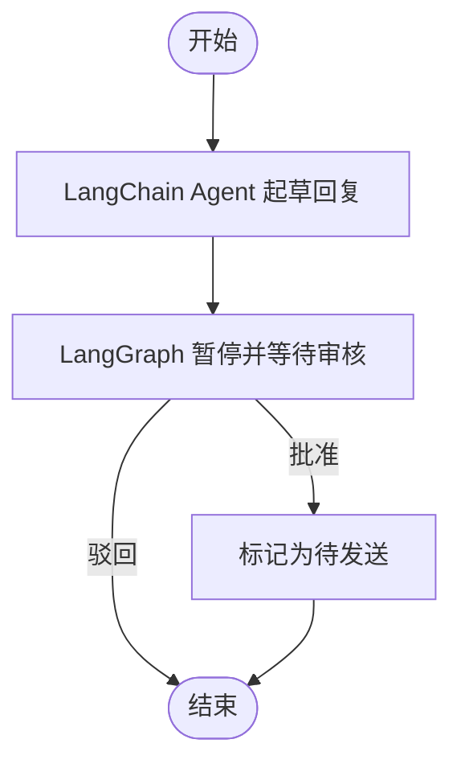

# LangChain 和 LangGraph：有什么区别，又如何配合？

## 一句话结论

**LangChain 的 `create_agent` 帮你搭好「模型调用 → 按需执行工具 → 模型继续判断」的循环；LangGraph 让你定义整个任务的状态和执行路径。** `create_agent` 本身就运行在 LangGraph 上；当默认循环不够用时，可以把这个 Agent 放进自己定义的 LangGraph 工作流，只让模型决定适合它决定的事。

## 1. 两者解决的是不同层次的问题

以下以 Python v1 API 为例。

| 维度 | LangChain | LangGraph |
| --- | --- | --- |
| 核心职责 | 提供模型与工具的集成，以及开箱即用的 Agent 循环 | 提供有状态的工作流编排和执行运行时 |
| 常用入口 | `create_agent(model, tools, middleware=...)` | `StateGraph(State)`，定义节点与边后 `compile()` |
| 需要你定义什么 | 用什么模型、允许用哪些工具、如何提示模型、在哪些环节加中间件 | 状态有哪些字段、每个节点读写什么、下一步走哪条边 |
| 怎么持久化 | Agent 可以配置 Checkpointer，底层由 LangGraph 保存状态 | 为图配置 Checkpointer，自行决定在哪里暂停、恢复后如何分支 |

最容易产生的误解是「LangChain 只能线性执行，LangGraph 才能循环」。实际上，`create_agent` 默认就有循环：模型提出工具调用，框架执行工具，再把结果交还给模型；模型不再请求工具时，循环结束。差别在于**谁来设计控制流**：用 `create_agent`，你复用框架提供的循环；用 `StateGraph`，你定义自己的节点和路由。

## 2. 两者怎么相辅相成？

它们有两个方向的组合关系：

1. **LangChain 向下复用 LangGraph 的运行时。** 只用 `create_agent` 也能配置检查点、流式输出和人工介入。如果只是要求「某个工具调用前要审核」，可以直接用 LangChain 的 [`HumanInTheLoopMiddleware`](https://docs.langchain.com/oss/python/langchain/human-in-the-loop)，不用为了加审批重写整个循环。
2. **自定义 LangGraph 向上复用 LangChain 的组件。** 图的一个节点可以调用单个模型，也可以运行整个 LangChain Agent；其他节点可以是普通 Python 函数、数据库查询或业务规则。不用 `create_agent` 也能用 LangGraph，模型调用甚至可以直接用供应商 SDK。

图和 Agent 的状态不同，可以用一个节点函数做转换：例如把父图的 `question` 转成 Agent 所需的 `messages`，再把 Agent 的最终文本写回父图的 `draft`。如果父子图共享兼容的状态字段，也可以把编译后的 Agent 直接作为[子图节点](https://docs.langchain.com/oss/python/langgraph/use-subgraphs)加入父图。

## 3. 一个具体例子：客服回复为什么要分两层？

用户问：「签收 10 天了，没拆封还能退货吗？」客服 Agent 可以决定何时查询政策、怎样组织回答，但有一条业务规则不能交给它决定：**草稿必须经人工批准，才能标记为待发送。**



这是两个不同尺度的流程：内层是 Agent 的模型与工具循环，负责「怎么写草稿」；外层是业务流程，负责「草稿能否进入待发送状态」。这里审核的是 **Agent 最后生成的文本**，而不是它在循环中发起的某次工具调用，所以把审核放在外层更直接。

下面的示例使用模拟退货政策，不实际发送任何消息。运行前安装 `langchain`、`langgraph` 和 `langchain-openai`，并配置 `OPENAI_API_KEY`。

```python
from typing import TypedDict

from langchain.agents import create_agent
from langgraph.checkpoint.memory import InMemorySaver
from langgraph.graph import END, START, StateGraph
from langgraph.types import Command, interrupt


def lookup_return_policy() -> str:
    """查询示例店铺的退货政策。"""
    return "未拆封商品可在签收后 14 天内申请退货。"


agent = create_agent(
    model="openai:gpt-4.1-mini",
    tools=[lookup_return_policy],
    system_prompt="回答退货问题前先查询政策，只起草回复，不承诺已办理。",
)


class TicketState(TypedDict, total=False):
    question: str
    draft: str
    status: str


def write_draft(state: TicketState) -> dict:
    result = agent.invoke({
        "messages": [{"role": "user", "content": state["question"]}],
    })
    return {"draft": result["messages"][-1].text}


def review(state: TicketState) -> dict:
    approved = interrupt({"draft": state["draft"]})
    return {"status": "approved" if approved is True else "rejected"}


def mark_ready(state: TicketState) -> dict:
    return {"status": "ready_to_send"}


builder = StateGraph(TicketState)
builder.add_node("write_draft", write_draft)
builder.add_node("review", review)
builder.add_node("mark_ready", mark_ready)
builder.add_edge(START, "write_draft")
builder.add_edge("write_draft", "review")
builder.add_conditional_edges(
    "review", lambda state: state["status"],
    {"approved": "mark_ready", "rejected": END},
)
builder.add_edge("mark_ready", END)
workflow = builder.compile(checkpointer=InMemorySaver())

config = {"configurable": {"thread_id": "ticket-42"}}
paused = workflow.invoke({"question": "签收 10 天了，没拆封还能退货吗？"}, config)
print(paused["__interrupt__"][0].value["draft"])

# 第二次调用模拟审核员的决定；传 False 则直接结束，状态为 rejected。
result = workflow.invoke(Command(resume=True), config)
print(result["status"])  # ready_to_send
```

第一次调用停在 `review`，检查点里已经有草稿。第二次用同一个 `thread_id` 恢复，`review` 会从节点开头重新执行，但已完成的 `write_draft` 不会因这次恢复而重跑。示例用的 `InMemorySaver` 只能在当前进程中保存状态；需要跨进程或重启后恢复时，应换用持久化 Checkpointer。如果将「标记为待发送」改成实际投递，发送接口还要做幂等：**检查点不会自动保证外部操作只发生一次。** 具体语义见[暂停与恢复](/daily/2026/08/2026-08-31-daily-langgraph-interrupt-resume)。

## 4. 实际项目怎么选？

| 你的需求 | 可以从这里起步 |
| --- | --- |
| 固定流程，例如「查一次资料 → 调一次模型 → 返回结果」 | 普通函数或直接调用模型即可，未必需要 Agent 或图 |
| 让模型按需选择只读工具，调用若干次后给出回答 | LangChain `create_agent`；先用中间件处理模型与工具循环内的策略 |
| 明确规定多阶段流程，例如「草稿 → 审核 → 批准或驳回」，而且需要暂停恢复 | 用 LangGraph 编排外层业务；仅在需要模型自主选择工具的节点里嵌入 LangChain Agent |

一个实用的判断标准是：**如果下一步能由业务规则确定，就把规则写成代码或图的条件边；如果下一步需要理解自然语言、判断要查什么资料，再把决定交给 Agent。**

## 延伸阅读

- [LangChain 官方文档：Agents](https://docs.langchain.com/oss/python/langchain/agents)
- [LangGraph 官方文档：Graph API](https://docs.langchain.com/oss/python/langgraph/graph-api)
- [LangGraph 官方文档：Persistence](https://docs.langchain.com/oss/python/langgraph/persistence)
- [站内笔记：Loop、Planning 与 Graph](/notes/agent-engineering/03-agent-loop-planning-graph)
