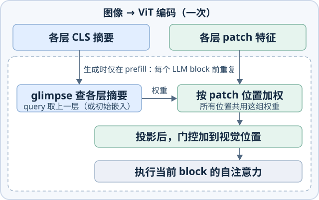

# DGP：让语言模型的每一层按需读取视觉特征

> 把一张菜单交给多模态模型，读清小字、对齐菜名和价格、最后做加法，未必需要同一种视觉表示。DGP（Dynamic Gated Pathways，动态门控路径）保留视觉编码器的各层特征，让语言模型的每一层根据当前状态重新加权，再把融合结果补进已有视觉位置。在 LLaVA-1.5-7B 上，它的 11 项指标均高于原基线，其中图像版 ScienceQA 提升 4.2 分、MM-Vet 提升 3.3 分，参数增加 5.29%。消融支持「权重分给哪一层有用」，但还没有单独证明视觉层与语言层都接满才有效。

## 论文信息

| 项目 | 内容 |
| --- | --- |
| 原文 | *Where to Connect? Boosting MLLMs via Dynamic Gated Pathways across ALL ViT and LLM Layers* |
| 作者 | Yingying Yan、Jiaqi Tang、Wei Wei、Qianzhou Wang、Lei Zhang、Jianmin Chen、Yuyang Xia、Botong Geng、Jinjian Wu、Qifeng Chen（西北工业大学、香港科技大学） |
| 发表 | NeurIPS 2026；本文按 arXiv v1（2026-11-04）研读 |
| 资源 | [arXiv](https://arxiv.org/abs/2611.06844v1) · [PDF](https://arxiv.org/pdf/2611.06844v1) · [HTML](https://arxiv.org/html/2611.06844v1) · [官方代码](https://github.com/YingyingYan1/DGP) |

## 1. 一道菜单题：什么时候还需要看图？

论文[原图 4](https://arxiv.org/html/2611.06844v1#S4.F4)给了一道很直观的题：**各买一份 Funghi 和 Prosciutto 披萨，要付多少钱？** LLaVA-1.5 把两项价格都读成了 7.50 欧元，还额外加了一份题目没点的 Calzone，最后答 26.40 欧元。DGP 的输出分别读出 6.90 和 7.90 欧元，合计 14.80 欧元。这个例子里，加法不是难点；难的是先读出数字，再把数字和题目指定的菜名配对。

以 LLaVA-1.5 为例，视觉 Transformer（ViT）把图像切成小块，逐层更新每块的表示。语言模型（LLM）则只在输入端拿到 ViT 倒数第二层的小块特征，经投影后与文字一起处理。后续 LLM 层依然可以通过自注意力读取视觉位置，并非看不见图；它们缺少的是**直接读取原始 ViT 其他层输出的路径**。如果某处笔画或版面关系在这份表示里不够清楚，LLM 无法回到较早的 ViT 层再取一份特征。

浅层有时更保留局部纹理，深层有时更突出物体或场景语义；[原图 1](https://arxiv.org/html/2611.06844v1#S1.F1)用 ViT 内部的注意力分布说明这种差异。这不是「浅层一定擅长 OCR、深层一定负责推理」的分工定律。对菜单题，论文也没有报告该样本的真实逐层权重，不能根据正确答案倒推出哪个层读到了哪一个数字。

## 2. DGP 改了两件事：连接范围和谁来分配权重

| 接法 | 哪些视觉特征送到哪里？ | 放回菜单题 |
| --- | --- | --- |
| 固定单层（LLaVA-1.5） | 取一层 ViT 输出，放入 LLM 输入序列 | 后续都以同一份初始菜单表示为起点 |
| 输入端融合（如 Dense Connector、TGIF） | 多层特征先融合，再把统一的表示交给 LLM；TGIF 可随提问改变这一次融合 | 能按问题制备一份表示，但后续没有独立的视觉层读取接口 |
| 分层注入（如 DeepStack） | 在不同 LLM 深度注入各自对应的视觉特征组；也有方法在预选路径上动态门控 | 可以在中间补视觉信息，但候选层或注入点受设计约束 |
| DGP | 每个 LLM block 执行前都能从全部 ViT 层软融合一份特征 | 某一层可以偏向小字线索，另一层可以偏向版面和对象关系；不要求人工指定对应深度 |

连接策略对照：根据 Yan 等人的论文原图 2 和 §2 整理。

**连接范围**决定每层「能读什么」。7B 配置里有 24 个 ViT block、32 个 LLM block，对应 $24\times32=768$ 个候选层对；不过一层只得到一份融合后的视觉张量，不会把 24 组 token 全部拼进上下文。**输入条件路由**决定「这次多读哪一层」。和 TGIF 相比，DGP 把输入端的一次条件融合变成逐层融合；和已在选定注入点用 LLM 状态动态门控的 CLI 相比，DGP 的区别在于把两侧的候选范围扩到全层。论文[原图 2](https://arxiv.org/html/2611.06844v1#S1.F2)把这两个设计维度画在了一起。

## 3. 方法详解：先用摘要决定读哪层，再融合原始小块特征

DGP 逐层注入流程：根据 Yan 等人的论文 §3、原图 3 与附录 A 自绘。

对照论文[原图 3](https://arxiv.org/html/2611.06844v1#S3.F3)，(A) 看哪些路径连得上、结果写回哪里；(B) 看路由器如何生成权重。最容易混淆的是两路视觉信息：**各层的 CLS 摘要用于决定读哪一层，各层的 patch 特征才是实际融合的内容。**

### 3.1 编码图像，保留两套视觉输入

用 $k$ 表示 ViT 层号、$l$ 表示 LLM block 号。对 $336\times336$ 图像，CLIP-ViT-L/14 以 $14\times14$ 为小块，得到 $24\times24=576$ 个 patch。ViT 第 $k$ 层输出包括一条全图汇总向量 $c^{(k)}$（CLS）和一张小块特征矩阵 $P^{(k)}\in\mathbb R^{576\times1024}$。图像只跑一次 ViT，24 层的输出在此次输入处理中供后续路由复用。

DGP **保留初始单层输入**：第 23 个 ViT block（倒数第二层）的 patch 先经原有输入投影，得到 $576\times4096$ 的视觉 token，放入 Vicuna-7B 的输入序列。与此同时，24 层的 CLS 与原始 patch 都留给逐层注入。训练时，在首个监督答案 token 前插入可学习的 **glimpse token**；推理时将它放到提示词末尾。因果掩码允许 glimpse 在自注意力里读取前面的图像与问题，但不允许它偷看后面的标准答案。

### 3.2 每个 block 开始前，生成一组融合权重

记 $H_{l-1}$ 为第 $l$ 个 block 的输入（$H_0$ 是初始嵌入）。路由 query $q_l=H_{l-1}[g]$ 取 glimpse 位置 $g$ 的向量。每层 CLS 先投影到 LLM 的 4096 维空间，再加上可学习的 ViT 层号嵌入 $e_k$，堆成 $24\times4096$ 的键和值。下面按附录 A 的执行顺序合写式 (4)–(5)，把归一化与激活封装进路由 MLP：

$$
\begin{aligned}
K=V &= \operatorname{Stack}_{k=1}^{L_v}\bigl(\widetilde c^{(k)}+e_k\bigr),\\
r_l &= q_l+\operatorname{MHA}_{\mathrm{shared}}(q_l,K,V),\\
\omega_l &= \operatorname{softmax}\bigl(\operatorname{Router}_l(r_l)\bigr).
\end{aligned}
$$

这里 $L_v=24$。多头跨注意力（MHA）在所有 LLM 层之间共享参数，用同一套接口比较视觉摘要；随后每个 block 自有一个路由 MLP，将 $r_l$ 映射成 24 个分数，再归一化为权重，满足 $\sum_k\omega_{l,k}=1$。**跨注意力里的注意力分数不是最终融合权重**；真正用于加权的是 MLP 之后这组 $\omega_l$。第一个 block 的 query 此时还是 glimpse 的初始嵌入，尚未经过自注意力读取提问；从第二个 block 起，query 才包含前一层吸收的上下文。

### 3.3 按位置融合，再做门控残差

同一张图在不同 ViT block 中使用同一组 patch 位置。DGP 拿第 $i$ 个位置在所有层的向量做加权，不会把菜单左上角的数字和右下角的数字混在一起。相同的 $\omega_l$ 用于这层的**所有**位置，因此这是按视觉深度路由，不是给每个 patch 单独选层。

$$
\begin{aligned}
\widetilde P_l &= \sum_{k=1}^{L_v}\omega_{l,k} P^{(k)},\\
Z_l &= \rho_l(\widetilde P_l),\\
H'_{l-1,v} &= H_{l-1,v}+\sigma(a_l)Z_l.
\end{aligned}
$$

式 (6)–(7) 对应三步：先得 $576\times1024$ 的融合矩阵，逐层投影器 $\rho_l$ 将其变为 $576\times4096$，最后只更新输入里的视觉位置 $v$。$\omega_l$ 会随输入变，$\gamma_l=\sigma(a_l)$ 则是训练得来的逐层标量，控制这份补充信号加多重。替换视觉片段后才执行第 $l$ 个 block 的自注意力，所以在**同一个 block** 中，位于图像后方的文本位置就能读到更新后的视觉信息。文本和 glimpse 没有被这次残差直接改写，它们通过自注意力接收信息。

### 3.4 用一格菜单走通计算

假设菜单上某个价格位置，在三层 ViT 的两个说明性通道里分别是 $(2,0)$、$(1,1)$、$(0,2)$。下面展示两个 LLM block 在 softmax 后的假想融合权重，不是菜单样本的实测值。

| 时点 | 三个 ViT 候选层的权重 | 该位置的融合结果 |
| --- | --- | --- |
| 一个更偏重局部信号的 block | $(0.7,0.2,0.1)$ | $(1.6,0.4)$ |
| 另一个更偏重高层信号的 block | $(0.1,0.3,0.6)$ | $(0.5,1.5)$ |

说明性算例：同一图像位置可在不同 LLM 深度得到不同的通道混合。

以第一行为例，若玩具投影取恒等映射、该位置原状态是 $(0.2,0.6)$、门值是 $0.3$，残差更新后得到 $(0.68,0.72)$。这并不直接给出“6.90 欧元”这几个 token；它把一份不同的视觉表示送进自注意力，语言模型再根据整段状态生成答案。回到真实菜单题，论文报告的输出确实是 $6.90+7.90=14.80$；上面的算例只解释证据通过哪个接口进入 LLM，不把两个通道解释成数字识别器。

### 3.5 训练和生成时，路由各做几次？

训练以答案有效位置的自回归交叉熵为主，另加一项正则：对每个 LLM 层，先在批次内求平均权重 $\bar\omega_l$，再在损失中减去它的熵。令 $L$ 为 LLM block 数、$\mathcal H(p)=-\sum_k p_k\log p_k$，原文式 (8) 可以写成：

$$
\mathcal L=\mathcal L_{\mathrm{AR}}
-\frac{\lambda}{L}\sum_{l=1}^{L}\mathcal H(\bar\omega_l).
$$

这鼓励**整个批次**覆盖不同的视觉层，不要求每条样本平均读所有层。例如两条样本各自近乎只选一层，分别趋近 $(1,0)$、$(0,1)$，批平均仍接近 $(0.5,0.5)$，其熵接近 $\ln 2$。预训练（PT）用 $\lambda=0.01$，监督微调（SFT）将它关掉，让路由能继续专门化。DGP 两个阶段都冻结 ViT、更新 LLM 和连接模块，各训练一轮。

在[官方 LLaVA/Vicuna 生成实现](https://github.com/YingyingYan1/DGP/blob/64e82c1960a8afc8ca6b3bd09369d1e415392f84/llava/model/language_model/llava_llama.py#L167-L224)中，**路由在 prefill（整段输入的首次前向）随深度计算；后续逐 token 生成复用 LLM 的键值缓存（KV cache）**，不会重新跑视觉编码或逐层融合。也就是说，换问题可以换路由，不同 block 可以选不同混合，但模型不会在写到答案中途重新决定该看哪一层 ViT。

<!-- 作者自检：数据流以附录 A 算法 1、表 5 和官方 commit 64e82c1960a8afc8ca6b3bd09369d1e415392f84 的 pre-hook 为准；图 3B/实现的 softmax 前 logits LayerNorm 未单列在式 (5)，本文将归一化包入 Router。 -->

## 4. 实验：增益是真的，归因要分开看

### 4.1 相对原版 LLaVA，哪些任务变好？

主实验用 CLIP-ViT-L/14-336 与 Vicuna-7B/13B，预训练用 LLaVA-558K、微调用 LLaVA-mixed-665K。表中均为论文原指标的分数，越高越好；括号是与同尺寸的 LLaVA-1.5 比较的绝对分差。

| 基准 | Vicuna-7B：基线 → DGP | Vicuna-13B：基线 → DGP |
| --- | ---: | ---: |
| ScienceQA 图像子集 | 66.8 → 71.0（+4.2） | 71.6 → 73.0（+1.4） |
| VizWiz（真实用户图像问答） | 50.0 → 53.1（+3.1） | 53.6 → 57.4（+3.8） |
| MM-Vet（综合多模态能力） | 30.5 → 33.8（+3.3） | 35.4 → 37.5（+2.1） |
| LLaVA-Wild（开放式问答） | 63.4 → 66.5（+3.1） | 70.7 → 70.0（−0.7） |
| POPE（对象幻觉探测） | 85.9 → 87.0（+1.1） | 85.9 → 87.6（+1.7） |

论文原表1：DGP 与同尺寸 LLaVA-1.5 的代表性结果摘录。

7B 对原基线是 11 项全升，13B 是 10 升 1 降。和同尺寸的多层融合方法横比，7B 在原表已有数字的 11 列中有 6 列领先，但例如 MMBench 低于 MMFuser（66.7 对 67.5），VizWiz 低于 IGVA（53.1 对 54.3）。此外，DGP 在 PT 就解冻语言模型，标准 LLaVA-1.5 的对齐预训练只更新连接器。论文没有报告把基线也按 DGP 的方式解冻、重训的同预算对照，不能把主表分差全部归于接线方式。

原表 2 还在 **Qwen3-VL-2B** 和 **LLaVA-NeXT** 上测试了 DGP。按论文统一的数据与训练轮数，两组的四项指标都提高；例如 MM-Vet 分别从 49.8 到 50.9、从 33.1 到 34.6。这支持方案能迁移到这两种配置，但不能由此推断它在 30B 以上模型、更多视觉编码器或任意现成权重上都会有效。

### 4.2 真正有用的是「接得多」，还是「权重分得对」？

| Vicuna-7B 配置 | ScienceQA 图像子集 | MM-Vet | LLaVA-Wild | POPE |
| --- | ---: | ---: | ---: | ---: |
| LLaVA-1.5 基线 | 66.8 | 30.5 | 63.4 | 85.9 |
| 24 层等权平均 | 64.3 | 25.3 | 56.3 | 77.2 |
| 门控路由，不加熵项 | 70.5 | 32.4 | 63.6 | 86.4 |
| 门控路由，加 PT 熵项 | 71.0 | 33.8 | 66.5 | 87.0 |

论文原表4：等权平均、门控路由和熵正则的消融摘录。

论文所测的 24 层等权方案有 10 项低于基线，说明让更多层参与并不足以改善结果。原表没有交代等权组是否保留相同的逐层投影和注入点。加熵正则比无熵版本的 11 项分数都高，但论文未报告多次训练的方差或路由坍塌发生率。更直接的证据是附录**表 12 的推理干预**：作者在训练好的 DGP-7B 上将每个路由向量按 ViT 层号反转（第 1 层和第 24 层的权重互换，以此类推），候选层与权重数值集合都保留，只改变二者的对应。11 项分数都下降，其中 LLaVA-Wild 从 66.5 降到 57.0。这说明学到的权重与视觉深度的对应关系有用。

不过，反转是对现有模型的扰动，不等价于训练一个好的静态路由器。现有消融没有在同一架构和配方下独立比较「输入无关但可学习的逐层权重」，也没有固定其他模块只减少 ViT 候选或 LLM 注入点。**全连接是否必要、输入条件带来的独立增益有多大，是两个还没被拆开验证的问题。**

### 4.3 权重图能解释到哪一步，代价又是什么？

论文[原图 5](https://arxiv.org/html/2611.06844v1#S4.F5)的热图横轴是 LLM block，纵轴是 ViT 层，颜色表示路由权重；其余子图分别看某几层的曲线、同一层跨基准的曲线，以及同一基准内的样本差异。以附录表 11 的 POPE 均值为例，LLM 第 3 层给 ViT 第 13 层 58.8% 的权重，第 19 层则给 ViT 前三层合计 56.0%。[原图 6](https://arxiv.org/html/2611.06844v1#S4.F6)固定图像只换问题，也能看到路由曲线改变。它们表明权重确实区分 LLM 深度和输入；但某层权重大不等于它对正确答案的因果贡献大，最终还要经过 patch 特征、逐层投影、残差系数与自注意力。

| 模型 | 参数量 | 生成 FLOPs | 峰值显存 |
| --- | ---: | ---: | ---: |
| 7B：基线 → DGP | 6,759.4 → 7,117.3 M（+5.29%） | 9,168.3 → 9,541.2 G（+4.07%） | 15.51 → 15.49 GB |
| 13B：基线 → DGP | 13,047.3 → 13,604.9 M（+4.27%） | 17,731.2 → 17,718.8 G（基本持平） | 27.34 → 28.47 GB（+4.13%） |

论文原表3：NVIDIA L40、batch size 1 下的端到端生成成本。

附录表 9 中，逐层路由 MLP 和投影器合计占新增参数约四分之三。全连接没有把 576 个视觉位置乘上 24，但逐层融合和投影有实际计算；生成 FLOPs 也不能替代首 token 时延、吞吐量或训练成本，论文未报告这些实测值。

<!-- 作者自检：主成绩、跨框架、成本与消融依次为 PDF 第 7、7、8、9 页；路由矩阵与反序干预见附录 E.2–E.3 表 11–12。表 12 的 Uniform 和 Last-2 行与表 4 相同，不当成额外独立复测。 -->

## 5. 我的理解与最值得补的实验

DGP 像是在**视觉深度**上做软专家混合：专家候选是既有 ViT 的各层表示，门控只改变表示的混合比例。它不像稀疏专家模型那样跳过没选中的视觉层；这些候选本来就来自同一次 ViT 前向。可以迁移的思路是：让使用特征的层参与决定怎样融合，而不是要求输入端提前为所有下游层选出一份表示。

我会先检验**逐层上下文 query 的整体贡献**。在 Vicuna-7B 上保留 24 层候选、32 个注入点和序列中的 glimpse 位置，只在路由分支用固定 query 替代 glimpse 的逐层状态。对照组依然能通过 CLS 随图像调整权重，但拿不到随深度更新的文本和视觉上下文。保持训练数据、冻结策略和步数一致，在 ScienceQA 图像子集、MM-Vet 和一组人工核对的「同图换问题」配对题上比较多种子结果。若完整 DGP 稳定占优，就支持逐层上下文这条路径有用；要单独归因到问题文本，还得控制视觉上下文。另一个实验是把注入点从 32 个减到间隔分布的 8 个，在匹配重训后比较分数与 batch 1 首 token 时延，检验稀疏注入是否能以较小的分数损失换来可测的时延收益。

## 延伸阅读

- [LLaVA-1.5：Improved Baselines with Visual Instruction Tuning](https://arxiv.org/abs/2310.03744)——先弄清视觉投影、输入序列和两阶段训练，再比较 DGP 新增了哪些路径。
- [Dense Connector for MLLMs](https://arxiv.org/abs/2405.13800)——看多层视觉特征如何在接入 LLM 前融合，以及拼接方向如何影响表示。
- [DeepStack](https://arxiv.org/abs/2406.04334)——对照另一种按 LLM 深度分组注入视觉 token 的思路，理解「多层注入」和「动态选层」是两个维度。
- [TGIF](https://arxiv.org/abs/2601.03100)——对比输入端的提问条件融合与 DGP 的逐层条件融合；也是 DGP 分阶段使用熵正则的直接参考。

文中流程图根据 Yingying Yan 等人的 [arXiv v1](https://arxiv.org/abs/2611.06844v1) 自绘；链接所指的论文原图由原作者提供，原稿采用 [arXiv 永久非独占分发许可](https://arxiv.org/licenses/nonexclusive-distrib/1.0/)。
