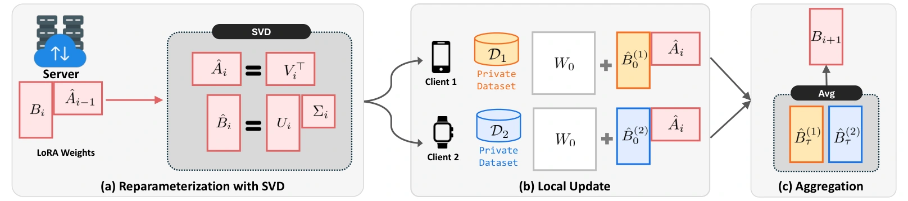
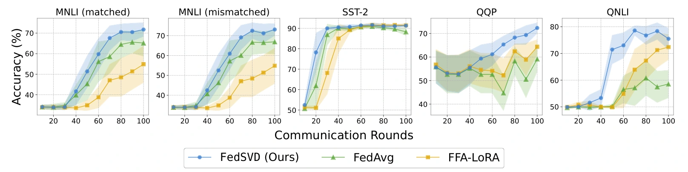
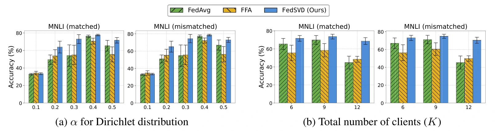

# FedSVD：用正交重参数化稳定差分隐私联邦 LoRA

> **一句话总结**：FedSVD 面向「数据留在各客户端、模型只能低成本微调、上传参数还需要差分隐私保护」的联邦学习场景。它让客户端只训练 LoRA 的 $B$ 矩阵，再由服务器对聚合后的 $BA$ 做奇异值分解：把正交的右奇异向量放进 $A$，把尺度留在 $B$，同时保持当前模型不变。这样继承了冻结 $A$ 对双边乘积噪声的规避，又改变了后续优化的坐标几何。在论文 $\epsilon=6,\delta=10^{-5}$ 的设置下，MNLI matched 准确率从 FFA-LoRA 的 **55.56% 提升至 71.68%**；主要代价是分解计算与参数同步。理解这篇论文的关键，是区分「参数基发生变化」「优化变得更合适」和「可学习子空间扩大」这三件事。

## 论文信息

| 项目 | 内容 |
| --- | --- |
| 原文标题 | FedSVD: Adaptive Orthogonalization for Private Federated Learning with LoRA |
| 作者 | Seanie Lee、Sangwoo Park、Dong Bok Lee、Dominik Wagner、Haebin Seong、Tobias Bocklet、Juho Lee、Sung Ju Hwang |
| 机构 | KAIST、Technische Hochschule Nürnberg Georg Simon Ohm、DeepAuto.ai |
| 发表 | NeurIPS 2025 |
| 官方论文 | [arXiv 页面](https://arxiv.org/abs/2505.12805) · [本文对应的 v2 PDF](https://arxiv.org/pdf/2505.12805v2) · [HTML 全文](https://arxiv.org/html/2505.12805v2) |
| 官方实现 | [seanie12/fed-svd](https://github.com/seanie12/fed-svd) |
| 研究主题 | 联邦参数高效微调、客户端侧差分隐私、低秩参数化与优化几何 |

<!--
作者自检：主版本 arXiv:2505.12805v2，修订于 2025-10-25，下载于 2026-10-21，共25页。
正文p1–10；附录A p14–16，B p16–17，C p17，D p17–18；p19–25为NeurIPS checklist。
本文只以该版本的主张、图号和数据为依据。原稿、完整提取文本、研读包、裁图脚本与例子验算保存在被忽略的原稿目录。
官方实现入口已核实，但未完成代码级复现，不把未核实的实现行为当作论文事实。
图形视觉输入在本环境不可用：裁图以PDF文字/图形坐标、图注、像素及浏览器加载检查为依据，不从曲线额外估读数值或颜色。
-->

## 1. 全文概览：把隐私训练与参数重整分开

普通 LoRA 用两个小矩阵的乘积近似权重更新：$W=W_0+BA$。在联邦学习中，各客户端本地训练适配器，服务器合并上传结果。再叠加 DP-SGD 后，问题不只是「多了一点高斯噪声」：如果 $A$、$B$ 都更新、都带噪，那么它们相乘会产生额外的噪声乘积项；两者分别平均，也未必等于各客户端完整更新的平均。

直接相关的 FFA-LoRA 因而选择固定共享的 $A$，只训练 $B$。这个选择让聚合对 $B$ 保持线性，也去掉了双边噪声相乘，但客户端始终在同一套随机投影坐标中优化。

FedSVD 在此基础上插入一个服务器步骤：

```text
共享当前 A、B
      ↓
客户端固定 A，只对 B 做本地训练；私有设置使用 DP-SGD
      ↓
上传已经私有化的 B，服务器按客户端数据量聚合
      ↓
对「聚合 B × 旧 A」做 SVD
      ↓
新 A = 正交右奇异向量；新 B = 左奇异向量 × 奇异值
      ↓
保持 BA 不变，进入下一轮训练
```

这里有两种性质不同的操作：

- **访问私有样本的训练**要裁剪、加噪，并计入隐私预算。
- **只处理已经私有化参数的重分解**属于后处理，本身不再消耗隐私预算。

主实验使用 RoBERTa-large，在五个分类数据集、六个评估列上比较非私有训练与两档隐私预算；另用 SmolLM-360M 在 HellaSwag 上验证。证据总体支持 FedSVD 在多数已测任务中比 FFA-LoRA 更有效，但并非每项任务都获益，也不能把分解步骤的加速等同于整个训练过程的加速。

## 2. 背景与贯穿场景：为什么冻结一个矩阵还不够

### 2.1 任务：多个机构协作微调，原始数据不离开本地

考虑两个机构，希望用各自的评论数据共同改进情感分类器。机构甲的正面评论较多，机构乙的负面评论较多；它们都不愿把完整文本交给服务器。

训练的输入是分散在各客户端的带标签文本，输出是一个共享的任务适配模型。服务器可以看到上传参数和聚合结果，但不能直接读取本地样本。**数据不上传并不自动保证隐私**：模型更新仍可能携带单条样本的信息，因此需要对上传前的训练机制加上差分隐私。

论文采用客户端本地执行 DP-SGD 的方式。其隐私邻接定义是「数据集相差一条记录」，因此这里保护的是**记录级隐私**；它不是「增删整个机构或一个用户的全部数据」意义上的客户端级、用户级隐私保证。

下文用一个二维、秩为 1 的玩具分类层贯穿计算。它只用于解释矩阵、裁剪和预测的关系，不是论文中的模型配置，也不代表真实文本对应的特征。

### 2.2 LoRA：先压缩输入，再映射到输出

对一个冻结权重层，写成：

$$
z=(W_0+BA)x,
\qquad
A\in\mathbb{R}^{r\times d_{\mathrm{in}}},
\quad
B\in\mathbb{R}^{d_{\mathrm{out}}\times r}.
$$

- $x\in\mathbb{R}^{d_{\mathrm{in}}}$ 是当前层输入，不一定是原始词向量。
- $A$ 把输入变成 $r$ 维特征 $Ax$。
- $B$ 将这组特征映射回输出空间，产生增量 $BAx$。
- $W_0$ 不训练；当 $r$ 很小时，可训练参数从 $d_{\mathrm{out}}d_{\mathrm{in}}$ 降为 $r(d_{\mathrm{in}}+d_{\mathrm{out}})$。

本文沿用原文省略 LoRA 缩放的记号。主实验的 rank 与 LoRA 缩放参数均为 8，通常的比例 $\alpha_{\mathrm{LoRA}}/r$ 因而为 1。

如果 $A$ 固定，模型能学习的是「如何使用 $Ax$」，而不是任意改变输入投影。例如，某个输入方向完全落在 $A$ 的零空间中，那么不论怎样训练 $B$，这一层的适配增量都无法感知该方向。

### 2.3 两种乘法问题：聚合误差与双边噪声

先看聚合。对两个等权客户端，完整局部更新的平均是：

$$
\frac{B_1A_1+B_2A_2}{2}.
$$

如果服务器分别平均两个因子，再计算乘积，得到的却是：

$$
\left(\frac{B_1+B_2}{2}\right)
\left(\frac{A_1+A_2}{2}\right)
=\frac{B_1A_1+B_1A_2+B_2A_1+B_2A_2}{4}.
$$

其中出现了跨客户端的交叉项。共享且冻结同一个 $A$ 后，情况变成：

$$
\left(\sum_k p_k B_k\right)A
=\sum_k p_k(B_kA),
\qquad \sum_k p_k=1.
$$

这消除了上述**因子分别平均带来的乘积不一致**，但不会消除 non-IID 数据和多步局部训练引起的一切客户端漂移。

再看隐私噪声。用 $\xi_A,\xi_B$ 表示加噪训练在参数中的扰动，忽略具体优化步的其他部分，原文式（5）的核心展开为：

$$
(B+\xi_B)(A+\xi_A)
=BA+\xi_BA+B\xi_A+\xi_B\xi_A.
$$

最后一项对两边扰动是二次的。只训练 $B$ 后：

$$
(B+\xi_B)A=BA+\xi_BA.
$$

**噪声没有消失，只是去掉了向 $A$ 注入噪声所带来的项，尤其是双边乘积项。** FFA-LoRA 已经实现了这一步；FedSVD 的新增问题是：在保留单边私有训练的前提下，能否重新整理投影参数，使下一阶段更好优化？

## 3. 核心贡献：同一个模型，可以用更合适的坐标训练

### 3.1 将客户端训练与服务器重参数化组合起来

在评论分类场景中，客户端只需维护 $B$ 的梯度与优化过程。服务器拿到各端已经私有化的 $B$ 后，不直接永久保留旧 $A$，而是对聚合更新做 SVD，重新分配两个因子的方向和尺度。

与 FFA-LoRA 的差异在于，$A$ 的数值不再全程固定；与同时训练两个矩阵的 LoRA 不同，$A$ 也没有通过本地私有梯度直接优化。这是论文最核心的算法组合，证据来自原文式（7）、算法 1 与主实验。

其代价是服务器需要执行分解，下一轮还必须让参与客户端使用一致的新参数。这个组合在原文实验中有效，但「重新分解」究竟改变了什么，需要进一步看正交性与子空间的区别。

### 3.2 把方向放进正交的 $A$，把尺度留在 $B$

同一个 $BA$ 可以有很多种表示。例如，对任意可逆矩阵 $Q$：

$$
BA=(BQ^{-1})(QA).
$$

它们给出相同的前向计算，却不一定在同一个学习率、同一个裁剪阈值、同一种参数噪声下走出相同的训练轨迹。

FedSVD 选择一种特定表示：$A$ 的行向量正交且长度为 1，所有奇异值尺度由 $B$ 承担。这样 $A$ 的谱范数固定为 1，条件数也为 1。原文进一步给出单层梯度范数上界，以及两层 ReLU 模型中的 Hessian 条件数界。

这项分析说明了**参数化几何为何可能影响私有训练**，但不是「所有随机初始化都更差」「真实 Transformer 的条件数必然下降」的普遍定理。

### 3.3 同时报告效果、近似成本与失效条件

论文除了主结果，还比较了固定随机正交初始化、PiSSA 初始化、非正交的周期重分解、分解频率和随机低秩 SVD。这些对照让读者能追问：收益来自正交化、初始化、周期操作，还是它们的组合？

实验也给出了明确边界：极端数据异质性下各方法仍会失败，低迭代数的近似分解在部分任务上会退化。因此，更稳妥的贡献判断是「给出一个有效且可分析的私有微调参数化方案」，而不是认定每个模块的独立收益都已被完全分离。

## 4. 方法详解：一轮训练究竟怎样执行

### 4.1 总体框架与状态



*图 1：FedSVD 的服务器重分解、本地更新与参数聚合。*

沿图中的三个部分阅读：

1. **左侧（a）重参数化**：服务器持有聚合后的 $B_i$ 和上一轮的 $\hat A_{i-1}$，先形成乘积，再通过 SVD 得到新的 $\hat B_i,\hat A_i$。
2. **中间（b）本地更新**：不同客户端拿到同一对参数；各自用本地数据训练 $B$，本轮 $A$ 保持不变。私有训练的裁剪和加噪发生在这里。
3. **右侧（c）聚合**：客户端上传训练后的 $B$，服务器将它们合为下一轮的 $B_{i+1}$，再回到左侧。

图中两个客户端用于说明消息流，主实验默认共有 6 个客户端、每轮选取 3 个。

为避免混淆，以下沿用「带帽的是重分解后参数」的记法，并省略层编号；真实模型的每个适配层分别执行对应操作。

| 符号 | 含义 | 形状或范围 |
| --- | --- | --- |
| $\hat A_i$ | 第 $i$ 轮共享、客户端不训练的输入投影 | $r\times d_{\mathrm{in}}$ |
| $\hat B_i$ | 第 $i$ 轮下发的可训练初值 | $d_{\mathrm{out}}\times r$ |
| $B^{(k)}_{i,t}$ | 客户端 $k$ 在本轮第 $t$ 步后的参数 | $d_{\mathrm{out}}\times r$ |
| $S_i$ | 本轮参与客户端集合 | $|S_i|=K'$ |
| $n_k$ | 客户端 $k$ 的训练样本数 | 正整数 |
| $B_{i+1}$ | 本轮局部训练结果的加权平均 | $d_{\mathrm{out}}\times r$ |
| $C,\sigma,b$ | 裁剪阈值、噪声乘数、批大小 | DP-SGD 配置 |

### 4.2 初始化与客户端 DP-SGD

算法 1 的初始化是：

$$
\hat B_0=0,
\qquad
\hat A_0\leftarrow\operatorname{KaimingUniform}.
$$

因此训练开始时 $\hat B_0\hat A_0=0$，模型仍等于预训练模型。**第 0 轮的 $A$ 并不已经正交**；论文是在后续聚合后才进行 SVD。

本轮客户端从 $B^{(k)}_{i,0}=\hat B_i$ 开始，固定 $\hat A_i$ 与 $W_0$。对每条本地样本计算损失，并求所有可训练 $B$ 参数的逐样本梯度 $G_j$。以下采用标准的「对梯度和加噪、再除以批大小」记号写清 DP-SGD：

$$
\bar G_j
=\frac{G_j}{\max(1,\|G_j\|_2/C)},
$$

$$
\widetilde G
=\frac{1}{b}\left[
\sum_{j=1}^{b}\bar G_j
+\mathcal N(0,\sigma^2C^2I)
\right],
\qquad
B\leftarrow B-\eta\widetilde G.
$$

这里将各层可训练参数展平后理解 $\|G_j\|_2$；对单个矩阵，它对应 Frobenius 范数。噪声在平均梯度上的标准差因此为 $\sigma C/b$，不能把梯度和与平均梯度的噪声尺度混用。

裁剪先限制一条样本对更新的影响，加噪再使相邻数据集的输出难以区分。上传的是经过多步这种机制得到的 $B$，不是原始逐样本梯度。服务器也不需要本地标签、原始文本或未加噪的中间梯度来执行 SVD。

<!-- 作者自检：此处用标准DP-SGD归一化形式解释机制，不宣称从正文还原了批大小、采样率或实现的全部噪声归一化细节。论文未报告可直接复算各配置隐私预算所需的完整b、q、σ数值。 -->

### 4.3 聚合：本轮所有 $B$ 都必须属于同一个坐标系

客户端 $k$ 本地训练 $\tau_k$ 步后上传 $B^{(k)}_{i,\tau_k}$。服务器按样本量计算：

$$
p_k=\frac{n_k}{\sum_{u\in S_i}n_u},
\qquad
B_{i+1}=\sum_{k\in S_i}p_kB^{(k)}_{i,\tau_k}.
$$

因为这一轮共享的是同一个 $\hat A_i$，所以：

$$
B_{i+1}\hat A_i
=\sum_{k\in S_i}p_k
\bigl(B^{(k)}_{i,\tau_k}\hat A_i\bigr).
$$

这一点比「上传的矩阵形状相同」更强：相同列编号还必须代表相同的低维特征。若客户端使用不同的 $A$ 基，即使两端各自的 $BA$ 都合理，直接平均它们的 $B$ 也可能没有意义。

### 4.4 SVD：保持乘积不变，重新分配方向与尺度

下一轮开始前，服务器形成：

$$
P_{i+1}=B_{i+1}\hat A_i
\in\mathbb R^{d_{\mathrm{out}}\times d_{\mathrm{in}}}.
$$

对它分解：

$$
P_{i+1}=U\Sigma V^\top,
\qquad
\hat B_{i+1}=U_r\Sigma_r,
\quad
\hat A_{i+1}=V_r^\top.
$$

其中 $U_r$ 为前 $r$ 个左奇异向量，$V_r$ 为前 $r$ 个右奇异向量，$\Sigma_r$ 包含相应奇异值。这就是原文式（7），只是将轮次平移以衔接前面的聚合过程。

为什么只保留 $r$ 个分量不会丢失当前模型？因为：

$$
\operatorname{rank}(P_{i+1})
=\operatorname{rank}(B_{i+1}\hat A_i)
\leq r.
$$

在精确 SVD 下，前 $r$ 个分量已经覆盖全部非零奇异值，因此：

$$
\hat B_{i+1}\hat A_{i+1}
=B_{i+1}\hat A_i.
$$

这不是把更高秩的更新压缩到 $r$，也不是在这一刻修正预测；**重分解前后是同一个函数，变化在下一轮如何训练它。** 同样，精确分解既然保留整个乘积，就不能被直接解释为把其中的 DP 噪声滤掉。

新的 $A$ 满足：

$$
\hat A\hat A^\top=I_r,
\qquad
\|\hat A\|_2=1,
\qquad
\kappa_2(\hat A)=1.
$$

这是**行正交**，并不意味着 $\hat A^\top\hat A=I_{d_{\mathrm{in}}}$；后者通常只是投影到一个 $r$ 维子空间的投影矩阵。

### 4.5 梯度：正交化改变了什么，没保证什么

设当前层输出梯度为：

$$
u=\frac{\partial\ell}{\partial z}
\in\mathbb R^{d_{\mathrm{out}}}.
$$

因为 $z=(W_0+B\hat A)x$，对 $B$ 的梯度是外积：

$$
\frac{\partial\ell}{\partial B}
=u(\hat Ax)^\top.
$$

外积的 Frobenius 范数满足：

$$
\left\|\frac{\partial\ell}{\partial B}\right\|_F
=\|u\|_2\|\hat Ax\|_2
\leq\|u\|_2\|\hat A\|_2\|x\|_2
=\|u\|_2\|x\|_2.
$$

原文式（8）的价值在于，$A$ 不再引入额外的任意谱尺度。若旧 $A$ 在某方向上放大输入，梯度就更容易超过固定裁剪阈值；消除这种放大可能减少裁剪失真。

但这个上界本身**不能证明正交化一定减少裁剪**。随机矩阵的谱范数取决于初始化尺度，并不总是大于 1；若原本的投影很小，正交化还可能增大梯度。噪声映射到有效权重时也受 $A$ 影响。因此，是否改善信噪比与最终准确率，还要结合具体参数化、学习率、裁剪和实验证据判断。

### 4.6 一个完整例子：从两端上传到最终分类

继续使用两个机构的情感分类场景，把其中一个适配层简化为二维二分类器。设第二类为正面，冻结权重和测试特征为：

$$
W_0=
\begin{bmatrix}
-1.8&0\\
-2.4&0
\end{bmatrix},
\qquad
x=\begin{bmatrix}1\\0\end{bmatrix}.
$$

以下矩阵与上传值都是说明性参数。真实系统由逐样本损失、裁剪与噪声产生上传值；这里直接给定这些结果，避免把一条样本的梯度误当作整个客户端的训练轨迹。

**第一步：聚合旧坐标中的 $B$。**

设本轮固定投影为 $A_{\mathrm{old}}=[3\quad4]$。两端数据量相等，上传的已私有化参数分别为：

$$
B_1=\begin{bmatrix}0.4\\0.8\end{bmatrix},
\quad
B_2=\begin{bmatrix}0.8\\0.8\end{bmatrix},
\quad
B_{\mathrm{agg}}=\frac{B_1+B_2}{2}
=\begin{bmatrix}0.6\\0.8\end{bmatrix}.
$$

因此当前适配更新为：

$$
P=B_{\mathrm{agg}}A_{\mathrm{old}}
=\begin{bmatrix}
1.8&2.4\\
2.4&3.2
\end{bmatrix}.
$$

**第二步：精确 SVD，模型保持不变。**

一组合法的秩 1 分解为：

$$
U_r=\begin{bmatrix}0.6\\0.8\end{bmatrix},
\quad \Sigma_r=[5],
\quad V_r^\top=[0.6\quad0.8].
$$

于是服务器下发：

$$
B_{\mathrm{new}}=\begin{bmatrix}3\\4\end{bmatrix},
\qquad A_{\mathrm{new}}=[0.6\quad0.8].
$$

读者可以直接相乘检查 $B_{\mathrm{new}}A_{\mathrm{new}}=P$。旧 $A$ 的谱范数是 5，新 $A$ 的谱范数是 1，但当前 logits 仍然是：

$$
(W_0+P)x=\begin{bmatrix}0\\0\end{bmatrix}.
$$

因此两类概率仍各为 0.5。SVD 本身没有把这条评论判得更正确。

**第三步：同一条训练样本，产生不同的参数梯度与裁剪。**

若这条样本的标签是正面，交叉熵在上述 logits 下给出：

$$
u=\begin{bmatrix}0.5\\-0.5\end{bmatrix}.
$$

代入外积公式：

| 状态 | $Ax$ | 对 $B$ 的梯度 | 梯度范数 | $C=2$ 时的裁剪结果 |
| --- | --- | --- | --- | --- |
| 旧参数化 | $3$ | $(1.5,-1.5)^\top$ | $3/\sqrt 2\approx2.12$ | $(\sqrt 2,-\sqrt 2)^\top$ |
| 新参数化 | $0.6$ | $(0.3,-0.3)^\top$ | $0.6/\sqrt 2\approx0.42$ | 无需裁剪 |

这个例子展示：**前向函数相同，不代表在参数坐标中触发同样的 DP 裁剪。** 它没有证明新参数化在所有尺度下都更好，也没有把加噪后的随机结果算成确定值。

**第四步：下一轮本地训练、上传、聚合，再产生预测。**

假设两端从新参数出发，完成下一轮本地私有训练后，分别上传：

$$
\widetilde B_1=\begin{bmatrix}2.8\\4.0\end{bmatrix},
\qquad
\widetilde B_2=\begin{bmatrix}3.2\\4.2\end{bmatrix}.
$$

等权聚合后 $\widetilde B_{\mathrm{agg}}=(3,4.1)^\top$，所以：

$$
\widetilde P
=\widetilde B_{\mathrm{agg}}A_{\mathrm{new}}
=\begin{bmatrix}1.8&2.4\\2.46&3.28\end{bmatrix}.
$$

现在测试特征的 logits 为：

$$
\widetilde z=(W_0+\widetilde P)x
=\begin{bmatrix}0\\0.06\end{bmatrix},
$$

$$
\Pr(\text{正面}\mid x)
=\frac{e^{0.06}}{1+e^{0.06}}
\approx0.515.
$$

最终输出正面，但置信度仍很低。这个变化来自**后续本地训练**，不是重分解凭空改进了模型。至此，例子走完了上传、聚合、保持函数的重参数化、局部梯度变化与最终预测。

<!-- 作者自检：例子已用NumPy验算乘积保持、AA^T=1、梯度范数、同一行空间投影、下一轮乘积与softmax。概率为0.5149955016。A=[3,4]用于放大尺度问题，不声称是论文Kaiming初始化的典型样本；两轮上传值均是假设给定。 -->

### 4.7 隐私为什么保持：免费的是后处理，不是继续训练

论文使用的标准定义是：对相差一条记录的 $D,D'$ 及任意输出事件 $E$，机制 $M$ 满足：

$$
\Pr[M(D)\in E]
\leq e^\epsilon\Pr[M(D')\in E]+\delta.
$$

若一个机制已经满足差分隐私，对其输出再做不访问原始数据的处理 $f$，$f(M(D))$ 仍具有相同的隐私参数。在聚合权重与样本数被视为公开固定信息，或已另行受到保护的前提下，服务器的加权聚合与 SVD 都属于这种处理。若邻接允许增删记录，且原始样本数本身属于秘密，就不能仅凭「$B$ 已经私有化」忽略权重或元数据的额外泄漏。

因此，FedSVD 不需要因为「从已加噪的 $B$ 得到了一个新的 $A$」而再给 $A$ 独立加一次噪声。但下一轮客户端拿到新参数后再次访问私有样本，仍然要计入隐私组合。

原文推论 3.1 引用 DP-SGD 的隐私分析，用采样率 $q$、总本地步数 $T=R\tau$ 与噪声乘数 $\sigma$ 控制总隐私预算；实验通过 Opacus 计算噪声配置。理解这个结果时要保留三点：

1. **需要对多轮交互的全部训练步骤记账**，不能只说明最后一次上传加了噪声。
2. $K'/K$ 是客户端参与比例，不能直接当作每条记录的采样率 $q$，也不能自行据此减半预算。
3. 该分析不要求服务器读取私有数据，但其保证仍取决于客户端按规定执行采样、裁剪和加噪，而非只取决于 SVD。

### 4.8 理论分析：去掉坐标病态因子，不等于证明大模型收敛

论文用两层 ReLU 分类器研究优化几何：

$$
h_j=(W_1+BA)x_j,
\qquad
z_j=W_2\operatorname{ReLU}(h_j),
\qquad
p_j=\operatorname{softmax}(z_j).
$$

只训练 $B\in\mathbb R^{d_h\times r}$。在 ReLU 激活模式固定的局部区域中，logits 对 $B$ 是仿射的，可以将交叉熵关于 $\operatorname{vec}(B)$ 的 Hessian 写成：

$$
H_k=\mathcal A\mathcal M_k\mathcal A^\top,
\qquad
\mathcal A=A\otimes I_{d_h}.
$$

$\otimes$ 是 Kronecker 积；$\mathcal A$ 的形状为 $(rd_h)\times(d_{\mathrm{in}}d_h)$，$\mathcal M_k$ 是全权重坐标中的局部曲率矩阵。它包含数据特征、输出分类层、激活模式与 softmax 曲率，因此正交化不会把所有数据难度一起消掉。

原文命题 3.2 的核心界为：

$$
\kappa_2(H_k)
\leq
\kappa_2(A)^2
\frac{\lambda_{\max}(\mathcal M_k)}
{\lambda_{\min}\!\left(
\mathcal M_k\mid_{\mathcal R(\mathcal A^\top)}
\right)}.
$$

其中 $\mathcal R(\mathcal A^\top)$ 是相关参数变化能到达的子空间，分母指曲率在该子空间上的最小 Rayleigh 商。证明的主线是：

- 最大特征值至多被 $\sigma_{\max}(A)^2$ 放大。
- 最小特征值至少受 $\sigma_{\min}(A)^2$ 与受限最小曲率共同控制。
- 两者相除，出现 $\kappa_2(A)^2$；行正交时该因子恰好为 1。

这个结论要求 $A$ 满行秩；若要得到有限的条件数上界，分母还必须严格为正。若损失在相关方向上本来就是平的，正交化也不能把零曲率变成正曲率。

因此，理论支持的是「消除输入投影坐标自身的一个病态来源」，而不是保证任意深度模型的实际 Hessian 条件数都更小，更没有给出完整的私有 Transformer 收敛速度定理。附录用 BERT 冻结特征上的逻辑回归直接测量条件数，属于简化模型的补充证据。

<!-- 作者自检：对应§3 Eq9–12、附录A。这里使用列优先vec(B)的坐标约定，不复抄原文M显式式中可能混用的Kronecker排列；等价的单样本Hessian为(Ax x^T A^T)⊗(D W2^T S W2 D)，全权重M相应为(xx^T)⊗(D W2^T S W2 D)，平均后得到上述分解。正文强调固定激活区域与受限正曲率。 -->

### 4.9 训练结束后怎样推理

推理只需要最后一对 $A,B$，计算 $W_0x+BAx$；也可以将乘积合并进 $W_0$。不需要为每条测试输入再次执行 SVD，也不需要联网聚合。

所以，FedSVD 增加的是训练阶段的分解与同步成本，而不是必然给每次模型预测增加一个分解步骤。

## 5. 实验简析：收益在哪里，证据能覆盖多远

### 5.1 设置与比较条件

主实验使用以下配置：

| 项目 | 配置 |
| --- | --- |
| 模型 | RoBERTa-large；LoRA 加在 query、value 投影 |
| 可训练参数 | 仅相应方法允许训练的 LoRA 参数；非 LoRA 参数和分类头冻结 |
| LoRA | $r=8$，缩放参数 8，dropout 0.05 |
| 客户端 | 默认 $K=6$，每轮随机参与 $K'=3$ |
| 数据异质性 | Dirichlet 浓度 $\alpha_{\mathrm{Dir}}=0.5$ |
| 优化 | vanilla SGD，学习率 0.5，每次参与执行 10 个本地步 |
| 私有配置 | $C=2$，$\delta=10^{-5}$，$\epsilon\in\{3,6\}$，正文设置为 100 轮 |
| 重复实验 | 非 DP 主表 5 次，DP 主表 10 次，均报告 95% 置信区间 |
| 计算设备 | 3 张 NVIDIA RTX A6000 |

这里把两个 $\alpha$ 分开标记：一个控制客户端数据异质性，另一个是 LoRA 缩放，含义不同。

数据是 SNLI、MNLI、SST-2、QQP、QNLI，其中 MNLI 分 matched 与 mismatched 两列。因此应理解为**五个数据集、六个评估列**，而不是六个彼此独立的 GLUE 数据集；SNLI 本身也不属于 GLUE。除 SNLI 使用测试集外，其他分类任务使用验证集评估。

基线包括：同时训练两个因子并分别平均的 FedAvg；固定 $A$ 的 FFA-LoRA；采用堆叠方式聚合适配器的 FLoRA；引入聚合残差修正的 FedEx-LoRA。论文对所有方法使用统一超参数，有助于比较同一配置下的稳定性，但不等于每个基线都经过了分别充分调优。

<!-- 作者自检：§4.1声称R=100，但非DP图2横轴至200，固定v2没有解释表1终点。正文不把非DP表1硬绑定100轮或200轮；不拼接不同终点的学习曲线。 -->

### 5.2 主结果：多数任务改善，SST-2 是重要例外

最有解释力的是直接对照 FFA-LoRA：二者都只在客户端训练 $B$，差异集中在服务器参数重整。下表摘自原文表 1、表 2，准确率越高越好；所有「±」均为对应主表报告的 95% 置信区间，增益只计算均值之差。

| 任务与隐私条件 | FFA-LoRA | FedSVD | 增益（百分点） |
| --- | --- | --- | --- |
| 非 DP：SNLI | $82.54\pm2.13$ | $85.70\pm1.23$ | +3.16 |
| 非 DP：MNLI matched | $82.75\pm1.72$ | $83.96\pm2.12$ | +1.21 |
| 非 DP：QNLI | $86.61\pm1.22$ | $88.98\pm1.43$ | +2.37 |
| $\epsilon=6$：MNLI matched | $55.56\pm8.58$ | $71.68\pm3.31$ | +16.12 |
| $\epsilon=6$：MNLI mismatched | $56.39\pm8.94$ | $73.03\pm2.90$ | +16.64 |
| $\epsilon=6$：QQP | $64.35\pm3.26$ | $72.42\pm2.36$ | +8.07 |
| $\epsilon=6$：SST-2 | $91.42\pm0.87$ | $91.32\pm0.85$ | −0.10 |
| $\epsilon=3$：QNLI | $62.35\pm8.07$ | $77.10\pm1.60$ | +14.75 |
| $\epsilon=3$：SST-2 | $91.08\pm1.23$ | $90.46\pm0.66$ | −0.62 |

非 DP 表 1 报告的平均准确率为 FFA-LoRA 的 **84.57%** 与 FedSVD 的 **86.18%**，相差约 **1.6 个百分点**。DP 情况下，MNLI、QQP、QNLI 等具体任务的改善更突出；但 SST-2 的最终均值并未超过 FFA-LoRA，不能说每个任务都提升。

<!--
作者自检：平均口径冲突不进入主结论。
表1 Average差86.18−84.57=1.61 pp；正文+1.29可由排除SNLI的五列复现。
表2 ε=6的Average 76.79−68.02=8.77 pp亦对应排除SNLI的五列；六列显示均值为76.12与67.11，差约9.01。
ε=3的Average 75.63−66.00=9.63 pp对应六列。不同配置平均范围不一致，故正文不串联+1.29/+8.77/+9.63为统一宏平均增长。
重新平均显示值不附用原表Average置信区间，也不由单组CI推导提升显著性。
-->



*图 3：$\epsilon=6,\delta=10^{-5}$ 时的学习曲线，阴影为 10 次运行的 95% 置信区间。*

五个子图从左到右分别对应 MNLI matched、MNLI mismatched、SST-2、QQP、QNLI；横轴是通信轮数，纵轴是准确率。读这张图应同时关注到达较高准确率所需的轮数、置信区间和后期是否回落，而不只比较最终点。作者报告 FedSVD 在多数轮次中优于比较方法，也指出 SST-2 在约第 80 轮后出现回落。

这支持其在给定配置下具有较好的训练过程表现；没有配对检验或完整运行记录时，不额外把所有差异称为统计显著。

### 5.3 消融：单纯随机正交初始化并不足以解释全部收益

原文表 4 在 MNLI、$\epsilon=6$ 下比较：

| 参数化或初始化 | Matched 准确率 | Mismatched 准确率 |
| --- | --- | --- |
| 固定随机 $A$：FFA-LoRA | 55.56 | 56.39 |
| 固定随机行正交 $A$ | 55.58 | 56.96 |
| 固定 PiSSA 初始化的 $A$ | 66.32 | 67.57 |
| 周期 SVD，但将奇异值平方根分配到两侧 | 70.76 | 71.86 |
| FedSVD：$A=V_r^\top$，$B=U_r\Sigma_r$ | 71.68 | 73.03 |

上表为均值摘录，主要看三个对照：

1. **随机正交并非充分条件**：与 FFA-LoRA 相比，固定随机正交 $A$ 的均值只高 0.02、0.57 个百分点。
2. **初始化来源很重要**：PiSSA 使用预训练权重的主奇异分量，而非无结构随机投影；这一组比 FFA-LoRA 高得多，但其底座残差与适配器初始化也不同。
3. **周期方案内部，尺度分配有影响**：不保持 $A$ 行正交时，MNLI 两列分别低 0.92、1.17 个百分点。这里比较的是不同参数几何，而非是否使用 SVD 这一件事。

这些对照支持重参数化方案的整体价值，却还不能把所有收益独立归因为「正交」「周期性」或「新子空间」。第 6 节会进一步分析其中的线性代数约束。

附录表 9 在 BERT 冻结特征与逻辑回归头上测量 Hessian 条件数：第 5,000 次迭代时，FFA-LoRA 为 **10.23**，FedSVD 为 **1.51**。这与条件数分析相呼应，但并非完整 RoBERTa-large 的 Hessian 测量。

<!-- 作者自检：表4新增配置的运行次数与±定义未明确，不把主表的统计说明自动转移给所有消融。附录表10的SNLI正交/非正交结果81.16/69.48、表11的DoRA结果未明确预算，不并入主表DP数字；DoRA幅度重置式存在维度疑问，不按其字面公式写实现。 -->

### 5.4 HellaSwag：拓展到生成式训练，但模型规模仍有限

这一组实验换用 SmolLM-360M，在 $\epsilon=6,\delta=10^{-5}$ 下，按 activity label 以 $\alpha_{\mathrm{Dir}}=0.5$ 做非 IID 划分，训练目标是在正确结尾上做 next-token prediction。评估时并不自由生成答案，而是在候选结尾中选择长度归一化对数似然最高的一项：

$$
\hat x=\arg\max_{x\in\mathcal X(c)}
\frac{1}{|x|}\log p_\theta(x\mid c).
$$

原文表 3 报告 5 次运行的结果：

| 方法 | HellaSwag 准确率 |
| --- | --- |
| FedAvg | $48.81\pm0.28$ |
| FFA-LoRA | $49.76\pm0.09$ |
| FedSVD | $51.10\pm0.16$ |

FedSVD 比 FFA-LoRA 高 **1.34 个百分点**。该表没有单独明确「±」的统计定义，因此不自动按主表解释为 95% 置信区间。这是一个有价值的任务迁移结果，但单个 360M 模型不足以确认任意大规模生成模型下的效果。

### 5.5 异质性与客户端数量：有边界的稳健性



*图 4：左侧改变 Dirichlet 浓度，右侧改变客户端总数；每轮参与数固定为 3。*

该图两组实验均采用 $\epsilon=6,\delta=10^{-5}$。左侧（a）比较 $\alpha_{\mathrm{Dir}}\in\{0.1,0.2,0.3,0.4,0.5\}$；浓度更小意味着数据更不均衡。作者报告，FedSVD 在多数设置下更好，但 **$\alpha_{\mathrm{Dir}}=0.1$ 时各方法均失败**。它没有解决所有极端 non-IID 问题。

右侧（b）比较 $K\in\{6,9,12\}$，同时保持 $K'=3$。这里不仅改变了客户端数，还改变了每个客户端的数据量和每轮参与比例，后者从 $1/2$ 降到 $1/4$。FedSVD 的性能退化较小，但这一小规模实验不能直接外推到数千台间歇在线设备。

该组报告 5 次独立运行的均值与标准差，与主结果的 95% 置信区间口径不同。

### 5.6 成本：SVD 步骤可以更快，系统成本仍需分别计算

**计算成本。** 原文表 5 在 $\epsilon=6,\delta=10^{-5}$ 的训练设置下比较不同分解策略，并报告每个 SVD 步骤的平均耗时：

| 分解策略 | 每 SVD 步骤耗时 | 相对 Full SVD |
| --- | --- | --- |
| Full SVD | $9.12\pm0.08$ 秒 | 1 倍 |
| 随机低秩 SVD，`niter=2` | $0.15\pm0.04$ 秒 | 约快 60.8 倍 |
| 随机低秩 SVD，`niter=10` | $0.89\pm0.07$ 秒 | 约快 10.2 倍 |

这是**分解环节的耗时**，不是端到端训练加速 60 倍；本地训练、通信和等待时间没有因此按相同比例减少。

近似也存在任务敏感性。QNLI 在同一表中，Full SVD 为 **75.50%**，`niter=2` 为 **68.76%**，低 **6.74 个百分点**；增加到 `niter=10` 后为 **79.84%**。因此可以说近似在多项任务中有效，但不能概括为「没有精度损失」。

原文图 5 在同一隐私预算下，还比较了每 1、2、5、10 轮执行一次 SVD，MNLI 上几种周期表现相近且优于 FFA-LoRA。它提示可以减少分解调用，但没有给出全系统时间与精度的完整等价性保证。

**通信成本。** 图 1 的直接做法需要下发新的 $A$ 与 $B$，再上传训练后的 $B$。论文表 6 所列的更低通信计数使用另一种条件：服务器与客户端都执行 SVD，服务器只传聚合 $B$，客户端利用一致的旧 $A$ 自行重建新参数。

在这个方案下，表 6 对 RoBERTa-large、$r=8$ 报告 FedSVD 与 FFA-LoRA 的参数计数均为 **393,216**，FedAvg 为 **786,432**。这些计数没有充分拆分全网客户端乘数、上下行与数据精度，不宜直接写成整个网络的总字节数。

省去传输新 $A$，相应会增加客户端计算和同步要求：各端必须持有同一旧 $A$，并得到一致的奇异向量符号与基坐标；只保证乘积相同，还不够保证下一轮 $B$ 能直接平均。随机近似、重复奇异值及客户端跳轮后的状态恢复，都需要具体实现处理。

## 6. 总结与知识联系：重参数化不自动等于扩展子空间

### 6.1 一个必要的代数分析：新基与新空间不是一回事

以下是根据原文算法作的线性代数分析，而非论文新增的实验结论。

假设聚合矩阵 $B_{\mathrm{agg}}$ 满列秩、旧 $A$ 满行秩，则：

$$
\operatorname{row}(B_{\mathrm{agg}}A)
=\operatorname{row}(A).
$$

原因是乘上 $B_{\mathrm{agg}}$ 不会创造旧 $A$ 行空间之外的方向；同时 $B_{\mathrm{agg}}$ 有左逆，因此旧 $A$ 也能由该乘积线性恢复，两个行空间相等。

精确 SVD 的非零右奇异向量张成该乘积的行空间。因此，在上述满秩条件下，FedSVD 得到的是**同一输入子空间中的正交基**，没有扩大可表示的集合：

$$
\{BA:B\in\mathbb R^{d_{\mathrm{out}}\times r}\}.
$$

第 4 节例子已经体现这一点：$[3,4]$ 与 $[0.6,0.8]$ 沿同一方向，只是长度不同。它能够改变优化与裁剪，却没有开始感知原投影完全看不到的输入方向。

如果乘积秩下降，非零右奇异方向仍在旧行空间内，但为了补足 $r$ 个向量，零奇异值对应的补基并不唯一，不能一概当作同一空间内的纯旋转。随机近似与数值误差也需要单独考虑。

所以，对作者「让 $A$ 跟随聚合更新的主方向」的解释，可以理解为重排当前更新的表示基；但在满秩、精确分解条件下，不能进一步推成「不断学习原随机子空间外的新语义方向」。

### 6.2 更深一层：已经正交后，纯旋转本身能改变多少

对同一次精确 SVD 重参数化前后的同一聚合乘积，若 $A,A'$ 都行正交、行空间相同，则存在正交矩阵 $Q$，使：

$$
A'=QA,
\qquad B'=BQ^\top.
$$

从这两种等价表示出发，对 $B$ 的梯度满足 $G'=GQ^\top$，Frobenius 范数不变；范数裁剪也与这种旋转相容。各向同性高斯噪声旋转后分布不变。因此，在精确算术、相同批次与相容随机性、vanilla SGD 和一致坐标同步等条件下，**执行纯正交换基与保持原基，会得到相同分布的有效权重训练轨迹**。这还要求前向随机操作与换基相容，例如输入侧 dropout 使用相同的 mask；隐秩维上的 dropout 或坐标自适应优化器等不包含在此结论中。

这不否定主实验的收益，因为第一次从非正交随机 $A$ 转为正交 $A$，一般并不是纯旋转；数值近似、秩亏和实现中的非旋转不变操作也可能改变后续行为。它指出的是一个更精确的因果问题：**持续周期 SVD 的收益，有多少超出了第一次正交化？**

仅凭固定随机正交初始化的消融，还不能完全回答这个问题：它没有控制同一条首轮训练历史与同一个首次分解结果。

<!-- 作者自检：上面为个人条件性推导，已数值验证单层旋转映射下的梯度、范数裁剪与耦合噪声更新。多层独立正交变换在展平全局L2范数下仍保范数；输入侧LoRA dropout若共享同一mask不破坏映射，隐秩维dropout、坐标自适应优化器、未变换的动量状态等可能破坏。没有运行论文训练复现，不把此段写成对实际实现的实验判定。 -->

### 6.3 与已有知识怎样连起来

- **与预条件和特征白化的联系**：把投影坐标整理为正交基，可以去掉坐标自身的尺度和病态因素；但 $AA^\top=I$ 并不意味着数据协方差 $A\operatorname{Cov}(x)A^\top=I$，所以它不等于把训练数据完整白化。
- **与 DP 后处理的联系**：一个从私有训练结果产生的 $A$ 仍然携带 DP 保护，不要求它与数据完全无关。关键是处理只访问已经保护的输出，而不是偷偷再次读取样本。
- **与 PiSSA 的联系**：PiSSA 分解预训练权重 $W_0$，把主分量用于初始化；FedSVD 分解的是已经训练并聚合的适配乘积 $BA$，且将全部奇异值留在 $B$。二者使用同一种矩阵工具，却作用于不同对象和训练阶段。
- **与联邦聚合的联系**：共享坐标让 $B$ 的平均对应完整适配更新的平均。这与本站[联邦学习笔记](/notes/cryptography/08-federated-learning-and-cryptosystem-security)中的 FedAvg 思想相接，但低秩因子额外带来了「坐标一致性」要求。

读完最值得记住的是：**函数表达能力、优化几何和隐私机制并不是同一层面的东西。保持函数不变的参数变换，也可能改变固定超参数下的私有优化；但要解释收益，必须说明究竟改变了哪一层。**

## 7. 可行的后续方向

以下是待验证的研究设想，不是论文已经完成的实验。

### 7.1 优先验证：只在第一次聚合后正交化，是否已足够

**依据与假设。** 第 6 节表明，满足满秩条件后，后续精确 SVD 可能主要是正交换基。可检验假设是：在严格受控的 SGD 设置下，主要收益来自首次改变坐标尺度，而非每轮重新发现输入子空间。

**最小实验。** 在 SST-2 或 MNLI 的同一数据划分下，共享完全相同的首轮私有训练结果，随后分为三组：继续 FFA-LoRA；只做一次 SVD 后固定 $A$；每轮做精确 SVD。再将最后一组替换为随机近似，观察差异是否来自近似行为。保持隐私预算、学习率、批次和裁剪方式一致。

**指标与判据。** 同时比较准确率、裁剪比例、有效权重 $BA$ 差异、$A$ 行空间投影差异和分解总耗时。先在小矩阵上使用对应旋转后的噪声做逐步等变性检查，再进行多随机种子的任务实验。若单次方案保持性能并明显减少分解时间，就有直接的简化价值。

**成本与风险。** 需要记录各层数值秩，并控制随机性和坐标状态；否则「实现不一致」容易被误解释为「周期操作本身有额外信息」。这是最值得先做的一项，因为改动小，能直接区分关键机制。

### 7.2 精确而低成本：利用两个低秩因子，而非先形成大乘积

**依据与假设。** 被分解的矩阵本来就以 $BA$ 的低秩形式存在，不一定需要先显式构建 $d_{\mathrm{out}}\times d_{\mathrm{in}}$ 大矩阵，再采用随机近似。

一个可验证的精确实现路线是对两个因子做薄 QR 分解：

$$
B=Q_B R_B,
\qquad
A^\top=Q_A R_A,
$$

于是：

$$
BA=Q_B\bigl(R_BR_A^\top\bigr)Q_A^\top.
$$

在通常的 $r\leq\min(d_{\mathrm{in}},d_{\mathrm{out}})$ 设置下，只需对中间的 $r\times r$ 矩阵做 SVD。若 $R_BR_A^\top=U_c\Sigma_cV_c^\top$，则可以返回：

$$
\hat B=Q_BU_c\Sigma_c,
\qquad
\hat A=V_c^\top Q_A^\top.
$$

这样就能得到同一乘积的分解。这是标准矩阵代数带来的实现方向，不是本文作者报告过的额外实验。

**最小实验与基线。** 对论文对应层尺寸及 $r=8$，比较大矩阵 Full SVD、论文随机低秩近似、QR 加小矩阵 SVD；再接入 QNLI 检查训练结果。

**指标与判据。** 测量乘积重建误差、$AA^\top-I$ 的误差、耗时、峰值显存、端到端轮次时间和准确率。目标是在数值误差范围内保留精确方案，同时降低分解时间，而不是仅以准确率均值偶然更高为成功标准。

**成本与风险。** 理论计算量可约为 $O((d_{\mathrm{in}}+d_{\mathrm{out}})r^2+r^3)$，但实际收益取决于设备和批处理；秩亏、近重奇异值与多客户端分解坐标同步仍需处理。

## 8. 延伸阅读

| 顺序 | 材料 | 阅读目的与重点问题 |
| --- | --- | --- |
| 1 · 前置 | [LoRA: Low-Rank Adaptation of Large Language Models](https://arxiv.org/abs/2106.09685) | 理解 $BA$ 的参数量、零更新初始化与冻结底座；区分低秩约束和固定输入投影的约束。 |
| 2 · 隐私基础 | [Deep Learning with Differential Privacy](https://arxiv.org/abs/1607.00133) | 理解逐样本裁剪、噪声乘数、采样与隐私组合；为什么只说「上传前加噪」还不足以给出预算？ |
| 3 · 直接基线 | [Improving LoRA in Privacy-preserving Federated Learning](https://arxiv.org/abs/2403.12313)，FFA-LoRA，ICLR 2024 | 先理解共享并冻结 $A$ 为何同时缓解聚合不一致和双边乘积噪声，再判断 FedSVD 新增的部分。 |
| 4 · 相邻路线 | [PiSSA: Principal Singular Values and Singular Vectors Adaptation of Large Language Models](https://arxiv.org/abs/2404.02948)，NeurIPS 2024 | 比较分解对象是 $W_0$ 还是 $BA$，奇异值怎样分配，以及初始化与周期重参数化的区别。 |
| 5 · 本站背景 | [隐私增强协议与差分隐私](/notes/cryptography/06-privacy-enhancing-protocols-and-differential-privacy) · [联邦学习与密码系统安全](/notes/cryptography/08-federated-learning-and-cryptosystem-security) | 把本文放回记录级隐私、客户端参与、聚合与实际威胁模型中，避免把「数据留本地」当作完整的隐私证明。 |

*图 1、图 3、图 4 引自 Seanie Lee、Sangwoo Park、Dong Bok Lee、Dominik Wagner、Haebin Seong、Tobias Bocklet、Juho Lee、Sung Ju Hwang 的 [FedSVD 论文 v2](https://arxiv.org/abs/2505.12805v2)，依 [CC BY 4.0](https://creativecommons.org/licenses/by/4.0/) 使用。图片从 PDF 裁剪，移除周围正文与原图注，并转换为 WebP；图内内容未修改。*
