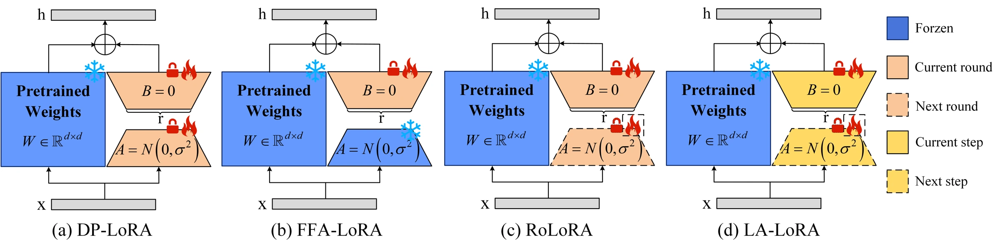
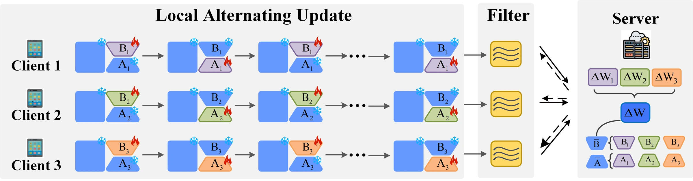

# LA-LoRA：用本地交替与低通滤波改善私有联邦微调

> **一句话总结**：LoRA 减少了可训练参数，却没有自动解决差分隐私噪声在两个相乘因子之间的传播。LA-LoRA 在客户端内部按步交替更新两个因子，并对已经裁剪、加噪的梯度做低通滤波，以改善私有联邦微调的稳定性。在论文报告的 Swin-B、Tiny-ImageNet、$\epsilon=1$ 设置中，准确率从 RoLoRA 的 **43.85% 提高到 60.68%**，相差 **16.83 个百分点**。这是一项有较强视觉实验支持的优化策略，但本地交替不等于精确聚合，单步避免新噪声相乘也不等于整个训练没有噪声交互。

## 论文信息

| 项目 | 内容 |
| --- | --- |
| 原文标题 | Rethinking LoRA for Privacy-Preserving Federated Learning in Large Models |
| 作者 | Jin Liu、Yinbin Miao、Ning Xi、Junkang Liu |
| 机构 | 西安电子科技大学网络与信息安全学院、天津大学智能与计算学部 |
| 发表 | ICLR 2026（arXiv 期刊参考信息） |
| 主版本 | arXiv:2602.19926v1，2026-02-23 |
| 官方入口 | [论文页](https://arxiv.org/abs/2602.19926v1) · [PDF](https://arxiv.org/pdf/2602.19926v1) · [HTML 全文](https://arxiv.org/html/2602.19926v1) |
| 作者提供的代码入口 | [匿名仓库状态页](https://anonymous.4open.science/status/LA-LORA-50E5/)（本文未进行训练复现） |

<!-- 作者自检：2026-11-02取得36页PDF，正文及附录A–G以v1为准。研读包、提取文本、原图提取与例子验算脚本保存在本地原稿目录。当前模型不支持图像视觉输入；图1、5保留完整嵌入图，按图注与正文解释，不估读曲线或小字。 -->

## 1. 全文概览：减少参数之后，还要管理更新的相互作用

在联邦学习中，各客户端用自己的数据训练，服务器接收参数更新并合并。差分隐私进一步要求：限制单个样本的梯度贡献，再注入噪声，使输出不至于过度依赖某一个训练样本。

LoRA 把权重增量写成两个小矩阵的乘积。这样既省参数，又带来三个相互关联的问题：

1. **梯度耦合**：更新一个因子的方向取决于另一个因子的当前状态。两侧同时改变，尤其在异质数据与噪声下，容易使配合失稳。
2. **噪声乘积**：两侧同时加入新噪声后，完整权重增量中出现噪声与噪声的乘积。
3. **聚合后的敏感性**：客户端的低秩方向不同，分别平均因子后得到的模型，可能落在更尖锐、对扰动更敏感的区域。

LA-LoRA 的流程很短：

```text
服务器广播 A、B
    ↓
客户端：更新 B → 更新 A → 更新 B → 更新 A → ……
每步：逐样本梯度 → 裁剪 → 加噪 → 低通滤波 → 更新当前因子
    ↓
客户端上传本轮最终 A、B
    ↓
服务器分别平均 A、B，进入下一轮
```

它把“频繁协调两个因子”放在客户端内部完成，不必每切换一次都通信。代价是每轮结束时两侧都已经成为本地版本，因此仍要面对因子聚合的不一致；滤波也会改变有用梯度，不能被理解为只去掉噪声、完全不碰信号。

## 2. 背景：一对低秩因子为什么会放大困难

### 2.1 先固定符号与隐私目标

本文采用列向量输入记号：

$$
h=(W_0+sBA)x,\qquad
A\in\mathbb R^{r\times n},\quad
B\in\mathbb R^{m\times r},\quad s=\alpha/r.
$$

$W_0\in\mathbb R^{m\times n}$ 是冻结的预训练权重；$A$ 把输入压到 $r$ 维，$B$ 把它映射到输出空间，且 $r\ll\min(m,n)$。训练结束后，可以保留这条低秩分支，也可以合并成 $W_0+sBA$。

论文的隐私单位是**单个训练样本**，不是整个客户端的数据集。客户端能看到本地样本与标签；服务器收到适配器参数。数据不上传本身不构成差分隐私，真正的机制是逐样本裁剪、加噪与多次访问的隐私记账。

### 2.2 梯度为什么相互依赖

令 $G=\nabla_W\mathcal L\in\mathbb R^{m\times n}$，则：

$$
\nabla_B\mathcal L=sGA^\top,
\qquad
\nabla_A\mathcal L=sB^\top G.
$$

这意味着 $B$ 学到的方向由当前 $A$ 决定，而 $A$ 的学习信号又由当前 $B$ 决定。标准初始化采用随机 $A$、全零 $B$，于是最初 $A$ 的数据梯度为零。先更新 $B$，再基于新的模型计算 $A$ 的梯度，比同时使用旧状态更直接地让两侧配合。

但“交替”只是固定一侧后更新另一侧，**不让两个梯度变成统计独立变量**。第二步使用的状态已经包含第一步的学习结果和噪声。

### 2.3 噪声为什么不能只按参数个数理解

将噪声折算为因子上的扰动，暂时省略缩放与学习率，普通联合更新具有：

$$
(B+N_B)(A+N_A)
=BA+BN_A+N_BA+N_BN_A.
$$

前两项对新噪声是线性的，最后一项是乘法交互。当两侧独立零均值高斯扰动的尺度都为 $\tau$ 时，乘积项的幅度具有二次尺度，其方差则具有四次尺度。零均值并不代表没有额外方差。

只更新 $B$ 的一个本地步则是：

$$
(B+N_B)A=BA+N_BA.
$$

**条件于当前历史状态**，本步只有一种新噪声，避免了同一步同时注入两侧新噪声的乘积。下一步更新 $A$ 时，$B$ 已经含有历史噪声，所以不能进一步推断“最终的 $BA$ 完全没有跨步噪声交互”。这是理解原文式（6）适用范围的关键。

这里的加性扰动展开直接解释 SGD 式更新；语言实验采用 AdamW，其二阶矩归一化会非线性地改变步长。“每步只活动一侧”仍成立，但参数扰动不再直接等同于注入的高斯梯度噪声。

## 3. 贡献与场景：交替发生在哪里，决定解决什么问题

[](https://arxiv.org/pdf/2602.19926v1#page=2)

*论文原图1：四种方法如何安排两个因子的更新与通信。点击可查看原稿。*

沿图比较时，重点看“哪一侧冻结”和“在什么时候与服务器同步”，而不是只看它们是否都用了 LoRA。

| 方法 | 本地训练安排 | 一轮上传的适配器 | 主要取舍 |
| --- | --- | --- | --- |
| DP-LoRA | 两侧同时训练、私有化 | $A,B$ | 灵活，但两侧的新扰动同时进入乘积 |
| FFA-LoRA | 全程固定 $A$，只训练 $B$ | $B$ | 更新线性、方向固定，可能限制表达能力 |
| RoLoRA | 一轮训练 $B$，下一轮训练 $A$，中间同步 | 当前活动因子 | 每轮共享冻结因子，具有乘积平均的一致性 |
| LA-LoRA | 一轮内部按步交替 $B,A$ | $A,B$ | 更频繁刷新另一侧状态，但不能直接继承精确聚合性质 |

### 3.1 贡献一：把私有低秩训练的困难定位到计算过程

在视觉模型的强隐私微调中，仅说“噪声太大”不足以解释为什么不同 LoRA 训练方式差距很大。论文把梯度相互依赖、噪声乘积和聚合后曲率联系起来，分别用梯度行为、扰动范数和损失几何进行诊断。

其中噪声放大并非本文首次提出，FFA-LoRA 已讨论过相关问题；本文的价值在于把这些现象组织成一个面向本地更新策略的分析框架。相关曲线和 Hessian 结果提供机制证据，但不是对三个因素的完全独立因果分解。

### 3.2 贡献二：用本地交替缩短两侧互相等待的时间

对于每轮做很多本地步的客户端，RoLoRA 在整轮内冻结一侧，另一侧要到下一通信轮才更新。LA-LoRA 则让下一本地步就使用刚更新的因子。

这既保留了两侧都可学习的容量，又使每步只对当前活动侧执行梯度私有化。无滤波版本的实验也优于若干轮间交替基线，说明收益不全来自额外滤波；不过它改变了通信内容和本地轨迹，不能仅靠一个准确率差值证明所有预算下都更优。

### 3.3 贡献三：在加噪之后加入轻量的梯度平滑

本地交替改变更新时序，滤波则改变更新的空间分布。论文在输入或输出特征轴上做短核卷积，减少相邻坐标的剧烈波动，而不混合不同低秩分量。

它的优势是轻量、容易接入，而且对已私有化梯度的固定后处理不增加隐私损失。代价是引入了一个结构偏好：相邻特征坐标的梯度应该适合被平滑。这对任意神经网络通道顺序并非天然成立，值得单独检验。

## 4. 方法详解：从私有样本到全局适配器

### 4.1 一轮训练的状态流

[](https://arxiv.org/pdf/2602.19926v1#page=6)

*论文原图5：客户端内交替更新、梯度处理和服务器聚合构成一个通信轮。*

服务器在第 $t$ 轮选出客户端集合 $\mathcal C_t$，广播同一组 $A^{t-1},B^{t-1}$。每个客户端从这组参数出发，执行 $K$ 个本地优化步。**这里一个步只更新一侧**；默认 $K=20$ 相当于两侧各更新 10 次，而不是 20 对更新。

按原文第 4.3 节，奇数步更新 $B$，偶数步更新 $A$。以 $B$ 步为例，先对批内每条样本 $j$ 计算当前活动参数的梯度 $g_{ij}$，然后裁剪：

$$
\bar g_{ij}
=\frac{g_{ij}}{\max(1,\|g_{ij}\|_2/C)}.
$$

若批大小为 $M$，私有梯度为：

$$
\widetilde g_i
=\frac1M\left(\sum_{j=1}^M\bar g_{ij}+z_i\right),
\qquad z_i\sim\mathcal N(0,C^2\sigma^2I).
$$

$C$ 控制单样本最大贡献，$\sigma$ 是用于隐私记账的噪声乘子。噪声先加到裁剪梯度之和，再除以 $M$，因此平均梯度的噪声标准差为 $C\sigma/M$。

随后施加固定滤波算子 $H$，更新：

$$
B_{i,k+1}=B_{i,k}-\eta_B H(\widetilde g_i),
\qquad A_{i,k+1}=A_{i,k}.
$$

下一步重新前向、反向传播，基于**更新后的 $B$**计算 $A$ 的梯度，再做同样的裁剪、加噪、滤波与更新。不能把联合更新时已经算好的旧 $A$ 梯度直接拿来用，那会失去刷新状态的关键作用。

### 4.2 滤波处理的是哪个维度

原文第 4.2 节使用五点核：

$$
G_s=\frac1{16}[1,4,6,4,1].
$$

对 $A\in\mathbb R^{r\times n}$，逐行沿输入维 $n$ 卷积；对 $B\in\mathbb R^{m\times r}$，逐列沿输出维 $m$ 卷积。边界采用对称填充。低秩索引对应的 $r$ 个分量不互相混合。

用一个局部数值例子说明：某个内部位置附近的已加噪梯度为 $[0,0,16,0,0]$，滤波后中心值为 $6$，尖峰的一部分被分散到相邻位置。恒定信号则在归一化核下保持不变。

如果五个内部输入位置的噪声独立、方差都为 $v$，该输出位置的噪声方差是：

$$
v\sum_\ell G_s[\ell]^2
=\frac{1+16+36+16+1}{256}v
=\frac{70}{256}v\approx0.2734v.
$$

这是对固定卷积的说明性推导，**不是完整训练噪声下降到 27.34% 的实验结论**：相邻输出会相关，边界会重复使用输入，真实信号也会受到平滑。

原文附录还扫描一个平滑参数 $\sigma_s$，但没有清楚说明它与正文固定五点核的关系。因此这里讲解已明确定义的卷积，不额外补造该参数的实现方式。

### 4.3 为什么滤波不会额外花费隐私预算

顺序必须是：**裁剪 → 加噪 → 固定滤波**。对一个已经满足 DP 的输出施加不再访问私有数据的后处理，原有 DP 保证仍然成立。后处理可以改变误差、噪声相关性和优化效果，但不会自动获得一个更小的 $\epsilon$。

这里也有一个实际复现缺口：主方法用固定阈值 $C$ 解释机制，附录 A.2 却描述逐层中位数裁剪阈值，B.2 说明语言实验也沿用该策略。若阈值从原始私有梯度直接计算，它本身的数据依赖也需要纳入隐私分析；现有文字没有交代估计与记账过程。因此，本文引用的是**作者报告的隐私预算**，不是独立复核过的端到端隐私实现。

上述流程只展开 LoRA 分支。视觉实验还训练分类头，但论文未明确其更新时序，以及如何纳入裁剪、加噪、聚合与隐私记账；完整视觉模型的端到端保证还需要覆盖这一部分。

### 4.4 用两个客户端走完一轮

下面构造一个可手算的标量回归例子，解释状态刷新与聚合，不模拟真实模型性能。取 $W_0=0,s=1,x=1$，预测为 $BA$，损失为 $\ell=\tfrac12(BA-y)^2$。甲、乙两端目标分别为 1 和 3，初值均为 $A=1,B=0$。

取学习率 $\eta=0.5$、裁剪界 $C=2$、每批一个样本。标量特征轴上的对称填充滤波等价于恒等变换，因此先用这个特例看清交替；真实高维滤波的作用见上一节。以下噪声数值是人为指定的单次实现值，不是由某个真实隐私预算校准的训练结果。

**第一步更新 $B$。** 因为 $\nabla_B\ell=(BA-y)A$：

| 操作 | 客户端甲 | 客户端乙 |
| --- | ---: | ---: |
| 原始 $B$ 梯度 | −1 | −3 |
| 裁剪后梯度 | −1 | −2 |
| 加入的噪声 | +0.2 | −0.2 |
| 私有梯度 | −0.8 | −2.2 |
| 更新后的 $B$ | 0.4 | 1.1 |

**第二步更新 $A$。** 必须使用新的 $B$，此时 $\nabla_A\ell=(BA-y)B$：

| 操作 | 客户端甲 | 客户端乙 |
| --- | ---: | ---: |
| 原始 $A$ 梯度 | $(0.4-1)0.4=-0.24$ | $(1.1-3)1.1=-2.09$ |
| 裁剪后梯度 | −0.24 | −2 |
| 加入的噪声 | +0.1 | −0.1 |
| 更新后的 $A$ | 1.07 | 2.05 |
| 本地乘积 $BA$ | 0.428 | 2.255 |

对照联合更新：最初 $B=0$，两端的旧 $A$ 数据梯度都为零；若使用相同的 $A$ 噪声，则那一次 $A$ 更新只反映噪声，得到 0.95 与 1.05。交替让 $A$ 获得了新模型上的数据梯度。不过，联合一步与交替两步访问数据的次数不同，**这个对照只解释计算依赖，不是等计算、等隐私预算的胜负比较**。

完成这两个本地步后，服务器分别平均因子：

$$
\bar A=(1.07+2.05)/2=1.56,
\qquad \bar B=(0.4+1.1)/2=0.75.
$$

最终全局模型对 $x=1$ 的预测为 $\bar B\bar A=1.17$。而本地预测的平均是 $(0.428+2.255)/2=1.3415$，两者相差 **0.1715**。

这不是算错了平均，而是 LA-LoRA 本来就分别聚合两侧。一般地：

$$
\frac1N\sum_iB_iA_i-\bar B\bar A
=\frac1N\sum_i(B_i-\bar B)(A_i-\bar A).
$$

只要两侧都在客户端发生偏移，右侧就不一定为零。相比之下，RoLoRA 每轮固定的是**共同的全局因子**，可以把它从求和中提出；LA-LoRA 的优势不能解释成“同时继承了这种精确聚合”。

<!-- 作者自检：verify_examples.py验证逐步梯度、裁剪、噪声、均值、乘积差以及滤波方差；标量例子不将设定噪声冒充校准DP机制。 -->

### 4.5 推理与服务器可见信息

训练完成后，适配器分支使用最终 $A^T,B^T$，完整分类模型还需要相应分类头；推理时没有交替流程，也不需要访问客户端。服务器在训练中接收到两侧参数，原始样本仍在本地。

隐私强度还与观察者有关。原文定理 1 分别给出第三方与服务器的预算，并写出：

$$
\epsilon_s=\epsilon\sqrt{N/q},
\qquad
\delta_s=\frac\delta2(1/q+1).
$$

$N$ 是客户端数，$q$ 是客户端采样率。例如视觉设置 $N=8,q=0.5$，该式中的 $\epsilon_s=4\epsilon$。因此，不应直接把表格的“$\epsilon=1$”解读成对看到客户端上传的服务器同样具有 $(1,\delta)$ 保证；更不能把样本级保护改写为客户端级保护。

## 5. 理论：有帮助的投影视角，以及不能跳过的前提

### 5.1 一个明确的几何结论：更新被限制在哪个子空间

固定 $A$，若希望 $s\Delta BA$ 尽量接近完整梯度 $G$，可解：

$$
\min_{\Delta B}\|s\Delta BA-G\|_F^2.
$$

当 $A$ 满行秩时，唯一解为：

$$
\Delta B=\frac1sGA^\top(AA^\top)^{-1}
=\frac1{s^2}\nabla_B\mathcal L(AA^\top)^{-1}.
$$

乘回 $sA$ 后，完整更新就是 $GP_A$，其中：

$$
P_A=A^\top(AA^\top)^{-1}A.
$$

它是投向 $A$ **行空间**的正交投影。固定更新后的 $B_+$，另一半步则对应左乘投影 $P_{B_+}=B_+(B_+^\top B_+)^{-1}B_+^\top$，投向 $B_+$ 的**列空间**。这解释了为什么交替可以理解为依次调整两个低秩方向。

这里有两项重要区别：

- 该推导使用 Gram 矩阵逆，即**预条件后的梯度**。第 4.3 节给出的裁剪、加噪、滤波训练流程没有显式写出这一步，不能把投影公式直接当作普通 SGD 或 AdamW 的等价实现。
- 标准 $B=0$ 初始化不满足满列秩。使用伪逆可以定义某些退化情形下的解，却不能不加说明地继承“满秩下唯一解”的全部结论。

### 5.2 收敛分析说明了什么

附录 E.4 在过参数化两层 ReLU 的平方损失模型中，采用无动量、带预条件的交替更新，借助低秩限制等距性质（RIP）和跨块相关性条件，报告几何收缩形式的结果。证明思路是先控制每个半步的下降，再用梯度范数与损失的关系合并两次下降。

这不是针对异质客户端、随机参与、逐样本裁剪、持续 DP 噪声和滤波全部同时存在的统一收敛证明。定理中的分块索引也不能直接解释为客户端索引。

此外，该版本的下降界有一处影响结论的推导缺口：式（38）对将被减去的量给出了一个上界，但式（39）使用相应的最大梯度项作为下降量；仅由该上界不能推出这一更强下降结论。因此本文把线性收敛视为**作者报告、仍需进一步澄清的理论主张**，不据此承诺实际私有大模型训练会线性收敛。

<!-- 作者自检：E.4 Eq32 Gram转置位置也与定义维度不一致；Eq38 T2为eta sum_i norm²，上界eta P max_i norm²不能用于L+T1−T2的下降上界。E.5 RoLoRA投影方向与E.3不同且未显式包含服务器同步，因此不采用其余项作为协议优劣定理。 -->

## 6. 实验：视觉收益大，语言收益更温和

### 6.1 比较条件

主实验使用 100 个通信轮、每轮 20 个本地步、批大小 16，并搜索各方法的学习率。

| 项目 | 视觉实验 | 语言实验 |
| --- | --- | --- |
| 模型 | Swin-T、Swin-B | RoBERTa-Base；附录增加 Llama-2-7B |
| 任务 | CIFAR-100、Tiny-ImageNet 分类 | SST-2、QNLI、QQP、MNLI 分类 |
| 客户端 | 8，每轮参与 4 | 20，每轮参与 4 |
| 默认 Dirichlet 参数 | $\beta=0.1$ | $\beta=0.8$ |
| LoRA 秩与缩放参数 | $r=\alpha=16$ | $r=\alpha=8$ |
| 优化器 | SGD | AdamW |
| 分类头 | 训练 | 冻结 |

主文称视觉重复 3 次、语言重复 15 次。语言分类头如何获得预先训练的标签映射、部分任务实际使用哪个评估 split，以及调参使用的独立验证集，文字披露不够充分，复现时需要确认。

视觉的 $\delta=10^{-5}$；语言中 SST-2、QNLI 为 $10^{-5}$，QQP、MNLI 为 $10^{-6}$。不同数据集的采样率和噪声乘子不同，不能把“同为 $\epsilon=1$”理解成加入了同样尺度的噪声。

### 6.2 主结果：不能把所有任务都概括成提升十几个点

以下为原文表 3、4 的 $\epsilon=1$ 准确率百分数，保留均值便于比较：

| 模型与任务 | DP-LoRA | FFA-LoRA | RoLoRA | LA-LoRA |
| --- | ---: | ---: | ---: | ---: |
| Swin-T / CIFAR-100 | 45.58 | 50.75 | 54.88 | **56.68** |
| Swin-B / CIFAR-100 | 55.98 | 61.94 | 67.88 | **74.56** |
| Swin-B / Tiny-ImageNet | 30.20 | 39.33 | 43.85 | **60.68** |
| RoBERTa / QNLI | 84.07 | 85.08 | 86.25 | **88.73** |
| RoBERTa / MNLI | 79.87 | 81.14 | 81.54 | **82.35** |

<p class="paper-caption">论文原表3、4：视觉与语言任务准确率摘录，仅保留均值。</p>

Swin-B / Tiny-ImageNet 原表报告 LA-LoRA 为 **60.68±0.55**，RoLoRA 为 **43.85±0.60**。二者差 16.83 个百分点；若计算相对准确率提升，则约为 38.38%。摘要中的“16.83%”使用的是直接相减的口径。

语言任务的差距更小：QNLI 对 RoLoRA 为 **2.48 个百分点**，MNLI 为 **0.81 个百分点**。附录 Llama-2-7B 的四项 GLUE 平均分为 89.36，对照 RoLoRA 88.66，相差 0.70 个百分点。这些是分类任务证据，不能外推为开放生成、长上下文或推理能力获得相同改善。

### 6.3 消融：交替与滤波各有贡献

表 5 在 $\epsilon=3$ 下提供四种组合。这里选 Swin-B / Tiny-ImageNet：

| 方法 | 准确率（%） | 对应变化 |
| --- | ---: | --- |
| DP-LoRA | 30.64 | 联合更新，不滤波 |
| DP-LoRA + filter | 49.85 | 只增加滤波 |
| LA-LoRA − filter | 53.07 | 只改为本地交替 |
| LA-LoRA | 61.97 | 两者组合 |

<p class="paper-caption">论文原表5：本地交替与梯度滤波的消融结果摘录。</p>

相对 DP-LoRA，单独本地交替提高 **22.43 个百分点**；在本地交替上再加滤波，又提高 **8.90 个百分点**。两种机制都能产生收益，完整方法不是仅靠一项改变。

同配置 RoLoRA 为 44.18，无滤波 LA-LoRA 为 53.07，差 **8.89 个百分点**。这个对照比“完整 LA 对 RoLoRA”更接近更新时序的比较，但仍不应把两个方法不同的通信内容忽略掉。

表 6 将本地节奏改成每侧连续更新 1、2 或 5 步，在所测四个视觉配置中，策略之间的准确率跨度最大为 0.61 个百分点，说明不必把“每一步切换”看成唯一有效节奏。另一方面，表 17 增加本地总步数 $K$ 时固定了噪声乘子而非最终隐私预算，所以其性能增长不是免费的等隐私改进。

<!-- 作者自检：不用表16语言epsilon1条目（与表13无DP结果重合）；不用表2/16标签冲突的64.77作为完整LA曲率。表18sigma_s0与表7去滤波结果不同，不拼接。语言增益采用主表逐项相减，不采用B.3错误差值。 -->

### 6.4 成本：比联合训练快，不代表比轮间交替更省通信

原文表 7 的 Swin-B / Tiny-ImageNet、$\epsilon=1$：

| 方法 | 每轮时间（秒） | 表列内存成本（MB） | 准确率（%） |
| --- | ---: | ---: | ---: |
| DP-LoRA | 28.02 | 3524 | 30.20 |
| RoLoRA | **16.32** | 1762 | 43.85 |
| LA-LoRA − filter | 17.16 | 1762 | 52.72 |
| LA-LoRA | 17.23 | 1762 | 60.68 |

<p class="paper-caption">论文原表7：每轮时间、内存成本与准确率摘录。</p>

LA-LoRA 相比 DP-LoRA 每轮时间减少约 **38.51%**，而相比 RoLoRA 慢约 **5.58%**。加滤波只比无滤波 LA 多 0.07 秒，说明在该配置中额外耗时很小。表中“内存成本”没有充分说明是否等于整机 GPU 峰值占用，不宜直接承诺部署显存减半。

对于一层 $m\times n$ 权重，LA 每轮上传两侧共 $r(m+n)$ 个适配器参数；RoLoRA 每轮只上传活动侧，分别为 $mr$ 或 $rn$。对于方形层，前者是后者单轮适配器上行参数量的两倍。论文没有给出实测通信字节与网络耗时，因此**更快的本地更新不等于更低的通信成本**。

## 7. 总结与知识联系：把三个问题分开思考

与本站的 [RoLoRA 研读](./2026-11-02-rolora) 和 [FedSVD 研读](./2026-10-21-fedsvd) 放在一起，可以形成三个不同视角：

| 要解决的问题 | 代表机制 | 不应混淆的结论 |
| --- | --- | --- |
| 因子平均是否对应完整更新平均 | RoLoRA：轮间交替与共享冻结因子 | 精确聚合不消除所有客户端漂移 |
| 私有训练中两个因子如何及时配合 | LA-LoRA：本地交替与已加噪梯度滤波 | 单步线性化不消除全部历史噪声交互 |
| 当前因子的坐标、尺度是否适合优化 | FedSVD：正交重参数化 | 保持乘积的重分解不等于从数据学习新方向 |

LA-LoRA 最值得借鉴的是：**参数化、更新时序与隐私机制必须一起设计**。少训练一些参数不保证噪声影响更小；频繁协调两个模块不保证通信聚合精确；降低噪声方差也不保证没有引入信号偏差。

本文的主要判断来自可核算的更新结构与主表、消融实验。理论投影视角帮助解释机制，但其满秩、预条件与简化目标假设不能被悄悄省略。

## 8. 两个值得继续验证的方向

以下是基于论文边界提出的研究设想，并非已有结果。

### 8.1 优先验证：滤波收益是否依赖特征坐标顺序

固定短核把相邻坐标当作适合平滑的邻居，但 Transformer 特征索引未必对应自然的一维邻接关系。可检验的假设是：部分收益来自一般方差压缩，而非特定通道顺序的语义。

最小实验在 Swin-B / CIFAR-100 上比较无滤波、原顺序滤波，以及**固定随机置换 → 滤波 → 逆置换**，其余采样、裁剪、噪声和训练预算一致。置换只作用于已加噪梯度，固定后不访问私有数据。

报告多种子准确率、梯度信号偏差、每轮时间，并在公开或合成校准数据上检查滤波行为。可预先约定：随机置换版本与原版差距小于 0.5 个百分点且远好于无滤波，则“特定邻接顺序是收益关键”的解释受到挑战；若大幅下降，则进一步研究哪些坐标结构真正重要。它值得优先做，因为不需要改通信协议，主要成本是增加几组训练。

### 8.2 在同通信、同隐私预算下比较交替粒度

LA 与 RoLoRA 分别强调本地协调和轮间同步。可比较每步切换、每若干步切换、每轮切换，并同时记录：任务准确率、完整乘积平均与因子聚合的残差、总收发字节、端到端时间。

关键是先固定 $(\epsilon,\delta)$，对任何新增的数据访问重新校准噪声，再对齐通信字节预算，而不是只固定轮数。一个可证伪目标是：中间粒度能否在相同隐私与字节上限内，比两端方案取得更高准确率，同时减小聚合残差。主要风险是更多同步抵消本地优化收益；即使结果为负，也能澄清 LA 的优势究竟来自什么预算分配。

## 9. 延伸阅读

| 顺序 | 材料 | 带着什么问题读 |
| --- | --- | --- |
| 前置知识 | [LoRA: Low-Rank Adaptation of Large Language Models](https://arxiv.org/abs/2106.09685) | 两个因子的初始化、缩放和梯度为何不对称？ |
| 直接基线 | [Improving LoRA in Privacy-preserving Federated Learning](https://arxiv.org/abs/2403.12313) | 冻结输入投影如何减少噪声交互，又限制了什么？ |
| 交替与聚合 | [Robust Federated Finetuning of LLMs via Alternating Optimization of LoRA](https://arxiv.org/abs/2502.01755) · [本站研读](./2026-11-02-rolora) | 为什么同步点的位置决定乘积平均是否一致？ |
| 相邻路线 | [FedSVD: Adaptive Orthogonalization for Private Federated Learning with LoRA](https://arxiv.org/abs/2505.12805) · [本站研读](./2026-10-21-fedsvd) | 如何区分坐标重整、方向学习和私有优化几何？ |

### 图源与改动说明

图 1、图 5 来自 Jin Liu、Yinbin Miao、Ning Xi、Junkang Liu 的[论文 arXiv v1](https://arxiv.org/abs/2602.19926v1)，依据该版本标注的 [CC BY 4.0](https://creativecommons.org/licenses/by/4.0/) 使用。配图提取自 PDF 完整嵌入图，缩放并转换为 WebP，未改写图内标签与数据；正文另配中文解释。
