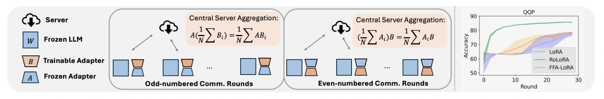
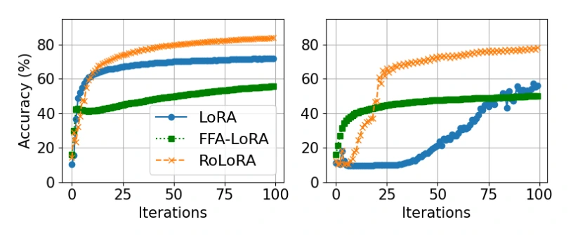
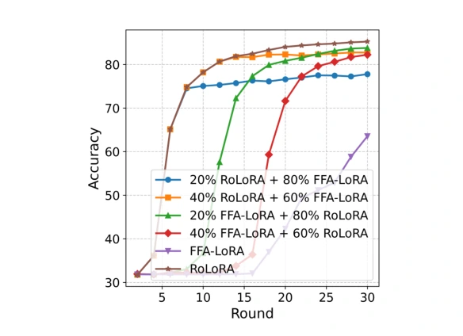
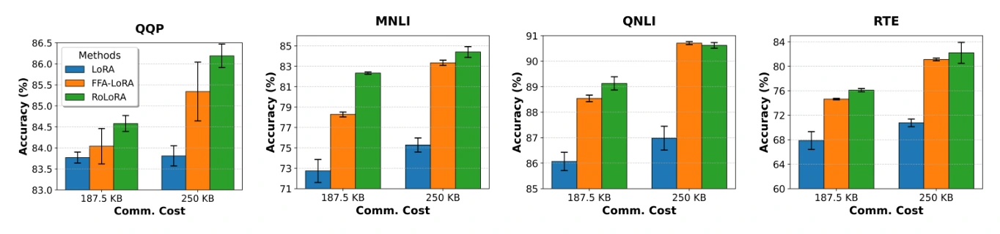

# RoLoRA：交替优化如何兼顾联邦 LoRA 的精确聚合与表达能力

> **一句话总结**：联邦 LoRA 有一个容易忽略的矛盾：两个低秩因子分别取平均，通常不等于完整权重更新的平均；永久冻结其中一个因子虽然让聚合变得精确，却限制了可学习的投影。RoLoRA 的解法是**按通信轮次交替训练、聚合、同步两个因子**：每轮只改变一侧，跨轮又允许两侧都学习。在 RoBERTa-Large、50 个客户端、rank 4 的 MNLI 实验中，准确率为 **82.98±3.36%**，对照 LoRA 为 52.64±15.07%、FFA-LoRA 为 69.97±5.57%；同一配置下，每客户端每轮收发消息量约为普通联邦 LoRA 的一半。收益尤其体现在受限训练预算和较多客户端的设置，而线性模型的全局收敛结论有严格前提，不能直接推广成真实 LLM 的全局最优保证。

## 论文信息

| 项目 | 内容 |
| --- | --- |
| 原文标题 | Robust Federated Finetuning of LLMs via Alternating Optimization of LoRA |
| 作者 | Shuangyi Chen、Yuanxin Guo、Yue Ju、Hardik Dalal、Zhongwen Zhu、Ashish Khisti |
| 机构 | University of Toronto、Ericsson-GAIA Montréal |
| 发表 | NeurIPS 2025 |
| 官方入口 | [arXiv](https://arxiv.org/abs/2502.01755) · [本文采用的 v4 PDF](https://arxiv.org/pdf/2502.01755v4) · [同版本 HTML](https://arxiv.org/html/2502.01755v4) · [OpenReview](https://openreview.net/forum?id=e8DrPuJekZ) |
| 研究主题 | 联邦参数高效微调、低秩因子聚合、表示学习与交替优化 |

<!--
作者自检：主版本 arXiv:2502.01755v4，2025-10-11 修订，2026-11-02 下载，共53页。
正文p1–10，参考文献p11–14，附录算法p16，线性分析p17–35，非凸分析p36–40，补充实验p41–46。
作者姓名采用PDF首页的Hardik，arXiv元数据为Harik。未核实官方代码地址，不添加猜测的实现链接。
原稿、提取文本、研读包与数值验算位于被忽略的原稿目录。配图按PDF图像边界裁剪，模型环境不能直接识别图像，不从曲线估读数值。
-->

## 1. 全文概览：让每一轮线性，让整个训练过程可学习

LoRA 把一块大的权重增量拆成两个小矩阵的乘积。集中训练时，两者由同一个优化过程协调；进入联邦学习后，各客户端会分别改变这两个因子，服务器却往往分别平均它们。**本地训练的对象是乘积，服务器合并的对象是因子**，两者之间出现了不一致。

已有两类直接解法：

- 先恢复各端的完整乘积再合并，必要时重新低秩分解，但需要额外计算或更大的中间表示。
- 像 FFA-LoRA 那样全程固定输入投影，只学习输出投影，让乘积对可训练参数保持线性，但可能损失表达能力。

RoLoRA 把“全程固定”改成了“本轮固定”：

```text
共享 A、B
   ↓
第一个通信轮：固定共享 A → 各端训练 B → 聚合并广播新 B
   ↓
第二个通信轮：固定新 B → 各端训练 A → 聚合并广播新 A
   ↓
重复上述两轮，最终得到共享的 LoRA 适配器
```

真正重要的是中间的**聚合与同步**。如果只在客户端内部先更新 $B$、再更新 $A$，等两者都变成各自的局部版本后才统一上传，原来的乘积不一致仍可能存在。

论文的证据分成三个层次：秩为 1 的线性模型解释为什么需要学习投影；非线性小网络验证这种现象并非只在纯线性模型里出现；语言模型实验检验受限预算下的效果与成本。三个层次互相补充，证明范围并不相同。

## 2. 背景与问题场景：为什么“平均一下”会出错

### 2.1 任务与符号：原始数据留在本地，模型要共享

设多个机构拥有不同分布的带标签文本，希望共同微调一个共享模型。输入是分散在客户端的训练数据，输出是一套所有客户端可使用的全局适配器。训练时客户端访问自己的文本和标签，服务器接收参数并聚合。

本文沿用 RoLoRA 正文的**行向量输入**记号：

$$
h=x(W_0+\alpha AB),
\qquad
A\in\mathbb R^{d\times r},
\quad
B\in\mathbb R^{r\times d}.
$$

$x\in\mathbb R^{1\times d}$ 先经 $A$ 降到 $r$ 维，再经 $B$ 返回 $d$ 维。$W_0$ 冻结，只有小矩阵参与微调。原论文主要考虑方形权重层；以下为突出机制省略公共缩放 $\alpha$，它不改变聚合恒等式。

这与常见的列向量写法 $(W_0+BA)x$ 是转置约定的差异。读公式时应跟随维度和运算次序，不能直接把两套记号混用。

### 2.2 分别平均两个因子，会产生什么误差

对 $N$ 个等权客户端，希望合并的完整增量为：

$$
\overline{\Delta W}=\frac1N\sum_{i=1}^N A_iB_i.
$$

分别聚合因子后，得到的却是：

$$
\bar A\bar B
=\left(\frac1N\sum_i A_i\right)
 \left(\frac1N\sum_j B_j\right).
$$

后式包含 $i\ne j$ 的跨客户端组合。用最简单的标量反例：客户端甲的两个因子都是 1，乙的两个因子都是 3。完整更新的平均为 $(1+9)/2=5$，因子平均后的乘积为 $2\times2=4$。

下面的等价展开更能说明问题来自哪里：

$$
\frac1N\sum_i A_iB_i-\bar A\bar B
=\frac1N\sum_i(A_i-\bar A)(B_i-\bar B).
$$

这是对原文式（1）—（2）的代数整理：**误差由两侧因子的联合偏离决定**。数据异质性和多步本地训练会影响这些偏离，但“客户端更多”本身并不是误差必然单调增大的代数定理。

### 2.3 贯穿例子：两个客户端，需要学习同一个输入方向

下面使用一组说明性的二维、rank 1 回归参数，帮助把聚合、表达能力和后续更新连起来；它不是语言模型实测。

设输入 $x$ 的总体协方差为单位阵，两端目标分别为：

$$
y_i=x a^*(b_i^*)^\top,
\qquad
a^*=\begin{bmatrix}1\\0\end{bmatrix},
\quad
b_1^*=\begin{bmatrix}1\\0\end{bmatrix},
\quad
b_2^*=\begin{bmatrix}3\\0\end{bmatrix}.
$$

两个机构都应从输入的第一个方向提取特征，但期望的输出强度不同。共享模型面对的目标强度是 $\bar b^*=(2,0)^\top$。

初始化为：

$$
a^0=\begin{bmatrix}0.8\\0.6\end{bmatrix},
\qquad b^0=0.
$$

这个输入投影混入了不需要的第二维。对于 $x=(0,1)$，两端目标输出都应为零，但一旦只靠训练 $b$ 来放大当前投影，这个错误方向也会被放大。后面将看到，冻结投影可以精确聚合，却无法把这个方向旋转回去。

## 3. 核心贡献：改变的是更新与通信的组织方式

### 3.1 用轮间交替，化解精确聚合与表达能力的冲突

对需要共享模型的机构，FFA-LoRA 的瓶颈不是“不会平均”，而是始终只能使用初始输入投影。RoLoRA 保留每轮共享一个冻结因子的优势，又通过下一轮学习这个因子来放开约束。

因此，这项贡献不是交替优化这个通用思想本身，而是**把 LoRA 两个因子的本地优化和服务器聚合一起交替安排**。直接证据是原文式（3）—（4）与算法 1；成本是两侧都更新一次需要两个通信轮，并且切换时必须同步到同一版本。

### 3.2 将“投影应该学习”落实为可比较的误差

在前面的双客户端场景中，固定 $a^0$ 后，训练 $b$ 只能调整当前方向上的系数，无法消除与 $a^*$ 的夹角。论文用线性模型给出冻结投影的残差，并证明特定交替求解算法可以逐步缩小这个夹角。

这比仅报告“最终准确率更高”多回答了一层问题：**究竟是哪一类误差，需要通过学习输入投影才能去掉？** 不过，严格全局恢复结果针对简化线性回归和专门的求解步骤，不能当成真实 Transformer 的同等保证。

### 3.3 在参数预算、客户端数量与通信预算下检验收益

当适配层很少、秩很低，固定随机投影造成的限制更容易显露；当客户端更多、训练预算有限，聚合与优化效率也更重要。论文围绕这些场景提供了 GLUE、常识推理、代码与知识评估，以及局部步数和更新节奏消融。

结果并非“所有任务都大幅提升”：少客户端时 RoLoRA 与普通 LoRA 接近，HumanEval 与 MMLU 的收益很小。这些差异恰好帮助确定它的适用场景，而不是削弱方法解释。

## 4. 方法详解：一对通信轮怎样执行

### 4.1 从原图看更新、冻结与同步

[](https://arxiv.org/pdf/2502.01755v4#page=2)

*论文原图1：左侧为交替优化框架，右侧为 QQP 上的性能比较。*

本文配图可点击跳转到原文对应页，便于放大查看图内标注。

阅读左侧框架时，重点追踪当前轮哪一侧保持共享、哪一侧在各端变成本地版本，以及聚合后哪一侧被广播回去。右侧用通信轮次连接模型质量，说明论文关注的是给定训练过程中的收敛效率，而不只是适配器最终能表示什么。

对一层适配器，服务器持有 $A^t,B^t$，客户端持有同版本初值与自己的数据。论文实验默认每轮全部客户端参与，服务器采用等权平均；下面按这一设定展开。

### 4.2 第一轮：固定输入投影，只训练输出投影

客户端 $i$ 从共享的 $B^t$ 出发，在固定 $A^t$ 的条件下做本地梯度更新：

$$
B_{i,k+1}=B_{i,k}
-\eta_B\nabla_B\ell_i(A^t,B_{i,k};\xi_{i,k}),
\qquad B_{i,0}=B^t.
$$

$\xi_{i,k}$ 是本地训练批次。完成本轮局部更新后，只上传 $B_i^{t+1}$。服务器计算并广播：

$$
B^{t+1}=\frac1N\sum_i B_i^{t+1}.
$$

因为所有客户端使用**同一个** $A^t$：

$$
A^tB^{t+1}
=\frac1N\sum_i A^tB_i^{t+1}.
$$

所以这一轮只平均小矩阵，就精确得到各端完整适配器乘积的平均。这里的“精确”指这一代数关系，不代表等价于集中式训练。

### 4.3 第二轮：先同步输出投影，再训练输入投影

所有客户端收到新的 $B^{t+1}$ 后，将它固定，从 $A^t$ 开始训练：

$$
A_{i,k+1}=A_{i,k}
-\eta_A\nabla_A\ell_i(A_{i,k},B^{t+1};\xi_{i,k}),
\qquad A_{i,0}=A^t.
$$

服务器聚合并广播：

$$
A^{t+1}=\frac1N\sum_i A_i^{t+1},
\qquad
A^{t+1}B^{t+1}
=\frac1N\sum_i A_i^{t+1}B^{t+1}.
$$

**冻结的必须是共同的全局版本。** 如果客户端甲冻结的是自己的 $B_1$，乙冻结的是自己的 $B_2$，就无法把同一个右因子从求和中提出去。

上述两个等式对归一化权重 $p_i$ 也成立，只需把平均替换为 $\sum_i p_i(\cdot)$。这是线性关系的自然推广，不表示论文已经验证了任意采样与异步协议。

### 4.4 为什么通常先训练 $B$

标准初始化为随机非零的 $A$、全零的 $B$，使初始适配器不改变预训练模型。设完整权重梯度为 $G$，省略缩放后：

$$
\nabla_B\ell=A^\top G,
\qquad
\nabla_A\ell=GB^\top.
$$

当 $B=0$ 时，$A$ 的梯度也是零。先更新 $B$，才会为下一轮学习 $A$ 提供信号。这也解释了为什么“两个因子都要学习”不等于“它们在每个时刻的角色完全对称”。

### 4.5 用贯穿例子走通一对通信轮

为了手算，下面采用论文线性分析的算法 2：$b$ 直接求局部最优，$a$ 做一次梯度更新并在服务器端归一化。**实际语言模型算法 1 使用本地梯度更新，并没有要求这一归一化步骤。**

**第一轮：学习 $b$。** 固定单位向量 $a^0$ 后，总体平方损失的局部最优为：

$$
b_i=(a^{0\top}a^*)b_i^*=0.8b_i^*.
$$

于是两端上传 $(0.8,0)^\top$、$(2.4,0)^\top$，服务器得到：

$$
\bar b=(1.6,0)^\top.
$$

此时共享模型的权重增量是：

$$
a^0\bar b^\top
=\begin{bmatrix}1.28&0\\0.96&0\end{bmatrix}.
$$

对于 $x=(0,1)$，输出为 $(0.96,0)$，而目标为 $(0,0)$。如果接下来一直冻结 $a^0$，只要 $b$ 已经达到最优，再延长训练也无法纠正这个输入方向。

**第二轮：同步 $\bar b$，学习 $a$。** 两端的总体损失为 $\ell_i(a,b)=\|a^*(b_i^*)^\top-ab^\top\|_F^2$，相应梯度：

$$
\nabla_a\ell_i
=2\left(a\|\bar b\|^2-a^*(b_i^{*\top}\bar b)\right).
$$

取说明性步长 $\eta=1/8$：

| 状态 | 客户端甲 | 客户端乙 |
| --- | --- | --- |
| $a$ 的梯度 | $(0.896,\ 3.072)^\top$ | $(-5.504,\ 3.072)^\top$ |
| 本地更新后的 $a_i$ | $(0.688,\ 0.216)^\top$ | $(1.488,\ 0.216)^\top$ |

服务器先平均，再按算法 2 归一化：

$$
\tilde a=(1.088,0.216)^\top,
\qquad
a^1=\frac{\tilde a}{\|\tilde a\|}
\approx(0.980857,0.194729)^\top.
$$

与正确方向的夹角正弦从 **0.6 降到约 0.194729**。继续使用 $\bar b$ 时，$x=(0,1)$ 的输出已由 $(0.96,0)$ 降到约 $(0.311566,0)$；下一次重新拟合 $b$，又可得到 $(1.961714,0)^\top$。

用全局总体损失总结这段过程：

| 阶段 | 全局平均平方损失 |
| --- | ---: |
| 固定初始 $a^0$，$b$ 已拟合到最优 | 2.440000 |
| 更新并归一化 $a$，暂用旧 $\bar b$ | 1.282515 |
| 对新 $a^1$ 再拟合 $b$ | 1.151678 |
| 这个异质场景的共享模型最优值 | 1.000000 |

最后一行为什么不是零？因为两端想要的强度分别是 1 和 3，单个共享模型只能折中。RoLoRA 可以减少投影错误，却不能让同一模型同时等于两个不同的目标。

<!-- 作者自检：例子为各向同性总体回归，使用算法2的局部解析解与服务器归一化；未把它伪装为算法1的LLM训练轨迹。梯度、局部值、乘积平均恒等式、损失和预测已用verify_examples.py验算。 -->

### 4.6 训练结束后，推理不需要交替

训练结束得到的是共享的 $A,B$。推理时使用 $xW_0+\alpha(xA)B$，或先把增量合并进权重，得到 $W_0+\alpha AB$。交替是训练协议，不是每次回答问题都要访问多个客户端。

服务器处理的是参数，不直接需要本地标签和文本；但上传参数仍可能泄露信息。RoLoRA 本身并不因此获得差分隐私、抗投毒或抵抗恶意服务器的保证。标题中的 robust，主要对应论文测试的参数受限、客户端数量和数据异质性下的训练稳定性。

## 5. 理论分析：固定方向留下什么误差

### 5.1 固定投影的下限，是一个几何问题

先看同质客户端、单位向量 $a$、各向同性总体输入的情形。固定 $a$ 后，最优系数是 $b=(a^\top a^*)b^*$。代回得到：

$$
\min_b\|a^*b^{*\top}-ab^\top\|_F^2
=\|b^*\|^2\underbrace{\left[1-(a^\top a^*)^2\right]}_{\delta^2},
$$

其中 $\delta=|\sin\theta(a,a^*)|$。这是解释用的总体投影推导；原文命题 4.6 进一步给出有限高斯样本、局部最小化再平均后的期望损失：$(1+\tilde c)\|b^*\|^2(\delta^0)^2$，其中修正项随样本与客户端数变化。

核心直觉是：**再准确地学习一个错误方向上的系数，也不能自动学到缺失的方向。** 这不表示所有固定随机投影在实际任务中都不够用；当秩与适配层足够多，表达瓶颈可能缓和，实验中也确实观察到了这一点。

### 5.2 交替学习为什么能缩小夹角

原文引理 4.3 给出的收缩形式为：

$$
\delta^{t+1}
\leq\delta^t
\sqrt{1-\eta\left(1-(\delta^0)^2\right)\|b^*\|^2}.
$$

只要根号内对应一个严格小于 1 的有效收缩因子，反复应用就得到几何下降。证明主线是：

1. 固定 $a$，把各端 $b_i$ 的解析解与理想投影系数进行比较。
2. 用高斯设计的集中性质控制有限样本误差和梯度偏差。
3. 将更新后的 $a$ 分解为平行、正交于 $a^*$ 的部分，证明归一化后的角距离缩小。

定理 4.5 的重要前提包括：**rank 1、无噪声线性目标、高斯设计、共同目标、足够样本、非正交初始化、受控步长、局部精确求解 $b$，以及对 $a$ 的归一化更新**。因此，“线性模型可恢复全局目标”和“语言模型采用交替训练有效”是不同强度的结论。

### 5.3 异质客户端：减少方向误差，不消除目标冲突

附录 A3.5 允许各端有不同 $b_i^*$，但仍共享同一个 $a^*$，并改用总体损失分析。定义：

$$
\bar b^*=\frac1N\sum_i b_i^*,
\qquad
\gamma^2=\frac1N\sum_i\|b_i^*-\bar b^*\|^2.
$$

在相应最优系数下，全局损失分为：

$$
L=\underbrace{\gamma^2}_{\text{共享模型的目标冲突}}
+\underbrace{\|\bar b^*\|^2\delta^2}_{\text{投影方向错误}}.
$$

贯穿例子中，$\gamma^2=1$、$\|\bar b^*\|^2=4$，所以固定初始投影时 $L=1+4\times0.6^2=2.44$；转动投影后可逐步接近 1。

这一结果仍不是任意 non-IID 的统一定理：各端共享的正确输入方向是关键结构。如果 $\bar b^*=0$，收缩式中的共同信号也会退化，不能继续声称一定恢复该方向。

### 5.4 非线性证据与一般非凸结论，需要分开看

[](https://arxiv.org/pdf/2502.01755v4#page=7)

*论文原图2：MNIST 两层网络上的方法比较。*

小网络为 $f_i(x)=\operatorname{ReLU}(xAB)W_{\mathrm{out}}$，其中 $d=784,r=16$、输出类别数为 10，只训练 $A,B$，固定输出层。左侧设置为 5 个客户端、每端两个标签；右侧为 10 个客户端、每端一个标签。本地训练 5 个 epoch，批大小 64。正文报告 FFA-LoRA 在两种设置下都停留在约 55% 附近，RoLoRA 更稳健。

这说明学习投影的价值可以在一个非线性实例中出现，但不是该实例的全局收敛证明。

附录 A4 另外给出一般非凸情形的 $O(T^{-1/2})$ 驻点收敛主张。除了平滑性和随机梯度有界，它还要求因子范数受控，以及**低秩因子与当前梯度之间具有足够的对齐程度**；这比“矩阵非零”更强，标准的 $B=0$ 初始化也不会自动满足正的对齐下界。

此外，该版本的收敛率推导有一处需要补充解释：其 $D_A,D_B$ 含有 $O(\eta)$ 项，却在最终界中选择 $D\eta^2\geq D_A+D_B$，再令 $\eta\propto T^{-1/2}$。按这些显示公式，尚不能直接把 $D$ 视为与步长无关的常数来推出所述速率。因此，这里保留为**作者报告的理论主张**；本文对方法的主要判断依赖精确聚合恒等式、范围明确的线性分析及实验。

<!-- 作者自检：附录A4定理式255、式299–302；同版本HTML确认D_A含(1/2)ηG²而非G²/(2η)。D至少需随1/η增大，故Dη项不能直接按常数D处理。此问题影响非凸速率解释，故在正文说明，不藏入注释。 -->

## 6. 实验简析：在哪些约束下，差距最明显

### 6.1 先理解比较预算与评估方式

语言模型实验基于 FederatedScope-LLM，使用 RoBERTa-Large（355M）与 Llama-2-7B，设备为 RTX 4090 或 NVIDIA A40。主要基线包括直接分别平均因子的 LoRA、固定 $A$ 的 FFA-LoRA，以及 FlexLoRA、FLoRA。

理解结果需要保留四个条件：

- **每轮全客户端参与。** 这些结果不能直接代表大规模终端随机上线的 cross-device 联邦系统。
- 同一客户端数量下，方法比较使用相同通信轮数；增加客户端时又按比例减少轮数，以控制文中所述的训练样本预算。因此表 1 强调的是该预算下的效果，并非所有方法无限训练后的上限。
- 各方法搜索学习率，正文表述为报告测试集上的最好表现，再对多个种子取平均。这不等同于独立验证集选参后的最终盲测，性能差值需要在这种评估方式下理解。
- “适配器总参数”“每轮可训练参数”“消息字节数”和“本地优化工作量”并非同一预算。

<!-- 作者自检：正文§5 p7明确best performance on test set与学习率集合；Table6给3客户端500轮（RTE200）、Local Epochs20。不同实验中local steps/epochs命名不完全一致，不自行补出精确样本访问量。 -->

### 6.2 客户端变多时，RoLoRA 更能保持质量

下面选取原文表 1 的 rank 4 配置。表中为准确率百分数，$\pm$ 为论文报告的跨种子标准差；适配层为表 7 的 query/value 投影子集。

| 客户端数与任务 | LoRA | FFA-LoRA | RoLoRA |
| --- | ---: | ---: | ---: |
| 3，MNLI | 86.20±0.05 | 84.58±0.21 | 85.70±0.04 |
| 3，QQP | 86.13±0.10 | 85.50±0.25 | 86.14±0.06 |
| 20，MNLI | 78.55±7.31 | 80.99±1.74 | 85.28±1.04 |
| 50，MNLI | 52.64±15.07 | 69.97±5.57 | 82.98±3.36 |
| 50，QQP | 77.60±1.47 | 78.44±0.41 | 85.71±0.18 |

<p class="paper-caption">论文原表1：rank 4 下不同客户端数量的准确率摘录。</p>

少客户端时，普通 LoRA 在 MNLI 上还略高，QQP 基本持平。真正突出的变化发生在客户端较多的预算受限设置：50 客户端 MNLI 中，RoLoRA 相比 LoRA 高 **30.34 个百分点**，相比 FFA-LoRA 高 **13.01 个百分点**。

这支持“该训练协议在这些设置下更有效”，不能把全部差距单独归因于一个机制：不同方法的表达空间、训练轨迹和达到充分收敛所需预算都不相同。附录也说明 FLoRA 在更长训练下可以继续提升。

原文表 2 另测了 Dirichlet 标签分布，例如 10 客户端、Dirichlet(0.5) 的 MNLI：RoLoRA 为 82.60±0.69%，LoRA 为 81.19±0.23%。但另一配置同时改成 15 客户端、Dirichlet(1.0)，不能只根据两组之间的变化断言标签异质性参数的独立作用。

<!-- 作者自检：表1 rank8块中LoRA Avg64.03与五列均值72.214不符，FFA Avg72.46与均值74.744不符，不使用这些平均值。表10 QQP95.25缺乏可确认解释，不据此扩展结论。正文选取逐列可核实的rank4结果。 -->

### 6.3 参数少时，学习输入投影尤其有价值

图 4 和附录通过改变适配层数量、秩来调节容量。其结论是：适配器较多时，FFA-LoRA 可以接近另外两种方法；适配器变少时，其退化通常更明显。

一个更直接的控制在附录表 13：集中式 MNLI、仅 8 个适配器、训练 50,000 次迭代，rank 1 时 FFA-LoRA 为 80.66%，RoLoRA 为 83.93%；rank 64 时分别为 83.32%、85.79%。增加秩可以缩小差距，但在这组配置里没有完全消除它。

这与固定投影的几何解释相容：可用方向更多，随机特征的限制可能缓和。不过，它也提示我们应同时比较“多学一个因子”与“增加固定特征容量”的成本。

### 6.4 消融：早期学方向、适度本地训练

[](https://arxiv.org/pdf/2502.01755v4#page=9)

*论文原图5：MNLI 上学习与冻结输入投影的比较。*

图中混合策略先用一部分轮次执行 RoLoRA，再切换为 FFA-LoRA。例如“20% RoLoRA + 80% FFA-LoRA”表示前 20% 轮次允许输入投影学习，后续冻结。正文观察到，学习 $A$，尤其在训练早期，有助于更快收敛和更高最终准确率。这支持“先形成更合适的投影”这一解释，但没有给出可普遍采用的最佳冻结时机。

图 6 比较了平衡交替、偏重 $B$ 的 `B,B,B,A`、偏重 $A$ 的 `B,A,A,A` 和不同学习率。平衡交替在这些已测方案中最好，并不能据此排除所有自适应非对称调度。

表 4 则固定“本地步数 × 总轮数”为 600，对比 50 客户端、rank 4 下的本地训练量分配：

| MNLI 方法 | 每轮 1 步、600 轮 | 每轮 5 步、120 轮 | 每轮 20 步、30 轮 |
| --- | ---: | ---: | ---: |
| FFA-LoRA | 72.52±0.68 | 71.73±1.17 | 69.97±5.57 |
| RoLoRA | 84.39±0.34 | 84.96±0.18 | 82.98±3.36 |

<p class="paper-caption">论文原表4：固定总训练步数时，本地步数与通信轮数的比较摘录。</p>

更多本地工作仍会改变 RoLoRA 的结果，只是它在这组实验中保持了较高水平。**精确聚合消除的是因子平均的乘积不一致，不是所有客户端漂移。**

### 6.5 Llama-2-7B：常识任务改善大，其他评估改善小

常识推理表 3 使用 50 客户端、rank 8、10 个通信轮，batch size 为 1、本地 30 个 epoch，对最后 6 层的 query/key/value/output 投影添加适配器，报告 3 次试验的均值与标准差：

| 任务 | LoRA | FFA-LoRA | RoLoRA |
| --- | ---: | ---: | ---: |
| BoolQ | 61.42±0.29 | 53.43±4.30 | 61.83±0.22 |
| PIQA | 33.19±9.80 | 35.49±9.55 | 61.26±3.30 |
| HellaSwag | 21.23±2.82 | 11.81±4.53 | 27.49±2.34 |

<p class="paper-caption">论文原表3：Llama-2-7B 常识推理结果摘录。</p>

优势幅度因任务而异，部分基线还出现很大的种子方差。它支持该配置下的训练稳健性，不能被概括为 Llama-2-7B 通用能力提升了同样幅度。

附录表 18 的另一组实验使用 CodeAlpaca、Alpaca 微调，50 客户端、100 轮、5 个种子，最后 8 层添加适配器。以下沿用该表报告的百分数分数：

- HumanEval：LoRA **12.96±0.37**，RoLoRA **13.45±0.28**，差 **0.49 个百分点**。
- MMLU 总体：45.81±0.03 对 45.93±0.01，差 **0.12 个百分点**。
- MMLU STEM：37.10±0.03 对 37.05±0.02，RoLoRA 并未更高。

因此，更准确的总体判断是：RoLoRA 在某些困难的联邦训练配置中优势突出，但不是每个能力指标都大幅改善。

### 6.6 成本：省一半消息，不等于端到端快一倍

对方形 $d\times d$ 投影层，普通 LoRA 每轮训练、传输两侧共 $2dr$ 个因子参数；RoLoRA 每轮只有一侧的 $dr$ 个参数。这是“一半”的主要来源。若层为非方形，两侧大小不同，应分别核算，不能机械套用每轮恰好减半。

原文表 19 的 MNLI、50 客户端配置给出：

| 方法 | 每客户端每轮收发消息总量 | 每轮服务器平均聚合时间 |
| --- | ---: | ---: |
| LoRA | 1500.8 KB | 0.0415 s |
| FFA-LoRA | 750.4 KB | 0.0163 s |
| FlexLoRA | 1500.8 KB | 2.2520 s |
| RoLoRA | 750.4 KB | 0.0182 s |

<p class="paper-caption">论文原表19：每客户端通信量与服务器聚合时间摘录。</p>

通信量包括发送和接收，时间是服务器聚合、在 30 次测量上取平均，**不包括客户端训练、网络等待和完整训练耗时**。冻结参数可以减少部分梯度与优化器工作，但前向和反向传播仍有其他成本，不能从参数数目直接推出 FLOPs 或显存减半。

[](https://arxiv.org/pdf/2502.01755v4#page=45)

*论文原图12：3 客户端、rank 4、对齐上行通信预算后的比较。*

图 12 进一步比较固定上行消息预算：为了让一侧训练的方法用满相同消息量，论文给 FFA-LoRA、RoLoRA 配置了更多适配层。横向比较连接了通信量与准确率，也意味着模型容量发生变化。这是“同消息预算能获得什么模型”的问题，而不是严格同容量消融。

附录还在 3 客户端、$\epsilon=10,\delta=10^{-6}$ 的 NbAFL 扩展中报告了 MNLI、QQP 结果。它说明方法可以与一种隐私训练机制组合，不能替代针对其他噪声机制、参与率和隐私粒度的单独分析。

## 7. 总结与知识联系：子空间学习和坐标重整是两回事

### 7.1 与块坐标下降、表示学习的关系

RoLoRA 可以看成一种带同步点的分布式块坐标优化。特殊之处在于：给定一侧因子，乘积对另一侧是线性的，于是**优化分块与聚合分块恰好一致**。

在 row-input 记号里，$A$ 学习低维输入表示，$B$ 学习如何使用它。这与 FedRep 一类共享表示学习有联系，但 RoLoRA 的两侧最终都聚合成全局模型；FedRep 的个性化头则保留在本地，不能将二者视为同一算法。

### 7.2 与 FedSVD 的区别：真正转动方向，还是重新整理已有坐标

此前的 [FedSVD 研读](./2026-10-21-fedsvd) 讨论了客户端单边私有训练和服务器 SVD 重参数化。它与 RoLoRA 都关注两个因子的角色，却处理不同的问题：

| 机制 | RoLoRA | FedSVD |
| --- | --- | --- |
| 客户端如何训练 | 跨轮交替训练输入、输出投影 | 单边训练输出因子，私有设置用 DP-SGD |
| 输入投影如何改变 | 用本地数据的梯度学习 | 对已有聚合乘积做 SVD 重表示 |
| 关键作用 | 学习新的投影方向，同时保持每轮聚合一致 | 保持当前乘积，整理方向与尺度，改变后续优化几何 |
| 核心分析侧重 | 固定投影的表达瓶颈 | 私有训练的参数化与裁剪、噪声几何 |

精确重分解当前低秩乘积，并不自动产生旧乘积之外的新输入信息；RoLoRA 则显式使用数据梯度更新输入投影。反过来，RoLoRA 的方向学习也不自动提供 FedSVD 所讨论的正交参数化优势。

因此，读完本文最值得带走的不是“交替一定更好”，而是三个独立的问题：

1. 聚合后的参数，是否真对应想合并的模型更新？
2. 当前参数化，是否允许学习任务需要的方向？
3. 在给定通信与优化预算下，训练过程是否能有效到达这些方向？

## 8. 两个值得继续验证的方向

以下是基于论文边界提出的研究设想，不是已经取得的结果。

### 8.1 优先尝试：按投影稳定程度决定何时冻结

图 5 提示早期学习 $A$ 很重要，但固定比例切换可能过早或过晚。可检验的假设是：**当输入投影子空间连续多轮变化很小时，转为单边训练可以保留大部分质量，并减少后续输入投影更新开销。**

最小实验可在 RoBERTa-Large 的 MNLI、QQP 上，选择 20/50 客户端和 rank 4；比较 FFA-LoRA、持续 RoLoRA、固定 warm-up 切换和自适应切换。用 $P_A=A(A^\top A)^\dagger A^\top$ 衡量输入子空间，监控 $\|P_{A^t}-P_{A^{t-1}}\|_F$，避免单纯因子缩放造成误判。

在独立验证集选阈值，最终报告准确率、跨种子方差、实际收发字节与端到端耗时。一个预先约定的成功标准可以是：相对持续 RoLoRA，准确率下降不超过 0.5 个百分点，同时减少至少 20% 的输入投影更新轮。主要风险是方向变化虽小，尺度或下游配合仍在改善；该监控量不能单独当作停止学习的充分条件。它值得优先做，因为只改变调度，不必先引入更大的模型或服务器分解。

### 8.2 部分参与与掉线：精确恒等式还能覆盖多少部署问题

若本轮仅有部分客户端参与，只要它们都使用同一个冻结因子，参与集合上的乘积平均关系仍成立。但掉线客户端之后回来，若沿用旧的冻结因子，版本不一致就可能破坏这一前提；即使版本一致，采样偏差也仍存在。

最小修改是为两侧参数标注版本，要求客户端开始更新前获取本阶段所需的共享因子。可在相同数据划分下比较每轮 10%/25%/100% 参与率，并额外注入延迟或掉线；对照朴素交替和版本一致的交替协议。

除任务准确率、达到目标质量的字节数与时间外，还应记录完整乘积平均与因子聚合结果的相对残差。假设若成立，版本一致方案应把该残差压到数值精度附近；若模型质量仍下降，就能进一步区分同步问题与统计采样问题。主要成本是补同步流量，以及晚到更新的处理延迟。

## 9. 延伸阅读

| 阅读顺序 | 材料 | 带着什么问题读 |
| --- | --- | --- |
| 前置知识 | [LoRA: Low-Rank Adaptation of Large Language Models](https://arxiv.org/abs/2106.09685) | 低秩约束限制的是哪类权重更新？初始化与缩放怎样影响训练？ |
| 直接基线 | [Improving LoRA in Privacy-preserving Federated Learning（FFA-LoRA）](https://arxiv.org/abs/2403.12313) | 为什么固定输入投影能改善聚合与隐私噪声问题，又付出什么表达代价？ |
| 理论联系 | [Exploiting Shared Representations for Personalized Federated Learning（FedRep）](https://proceedings.mlr.press/v139/collins21a.html) | 共享表示、个性化头与交替求解的关系是什么？哪些参数应该聚合？ |
| 相邻路线 | [Towards Robust and Efficient Federated Low-Rank Adaptation with Heterogeneous Clients（LoRA-A²）](https://arxiv.org/abs/2410.22815) | 交替冻结与自适应秩选择如何结合？它与本文纯交替机制分别解决什么约束？ |
| 本站联系 | [FedSVD：用正交重参数化稳定差分隐私联邦 LoRA](./2026-10-21-fedsvd) | 如何区分可学习子空间变化、因子坐标变化和私有优化的几何改善？ |

### 图源与改动说明

本文图 1、2、5、12 均来自 Shuangyi Chen、Yuanxin Guo、Yue Ju、Hardik Dalal、Zhongwen Zhu、Ashish Khisti 的[论文 arXiv v4](https://arxiv.org/abs/2502.01755v4)。配图依据该版本 arXiv 页面标注的 [CC BY 4.0](https://creativecommons.org/licenses/by/4.0/) 使用，已裁剪版面、转换为 WebP，并在正文另配中文解释，未改写图内数据。PDF 文末 checklist 另有 CC BY-NC-SA 4.0 表述；此处明确以 arXiv v4 页面展示的授权为来源依据。
