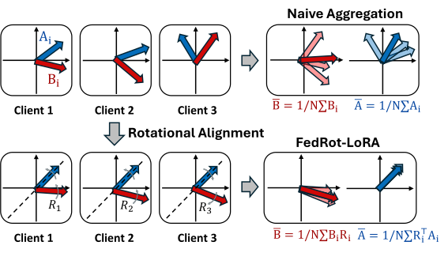
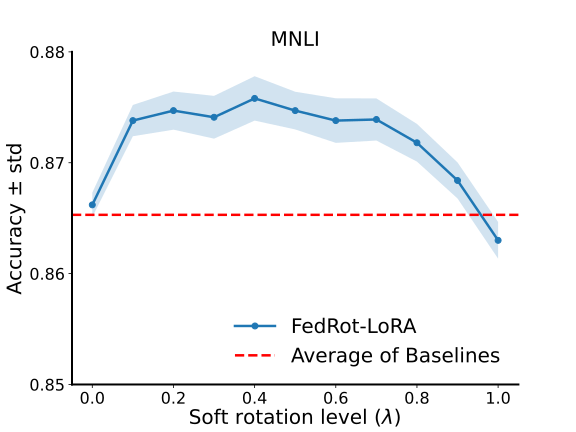
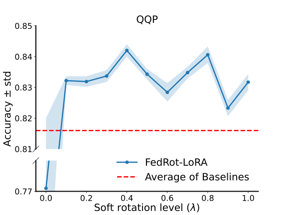

# FedRot-LoRA：先对齐低秩坐标，再聚合联邦更新

> **一句话总结**：两个客户端即使学到了相同的完整权重更新，也可能用不同的 LoRA 因子坐标表示它；直接平均因子会让正确更新相互抵消。FedRot-LoRA 在上传前，将客户端因子朝上一轮全局适配器做正交 Procrustes 对齐，并用软旋转减弱过度修正。在论文的 RoBERTa-Large、50 客户端、秩为 4、Dirichlet 参数为 0.5 的五项 GLUE 实验中，平均准确率由 RoLoRA 的 **82.44% 提高至 87.34%**。它保留两侧本地训练和固定低秩通信，但只是缓解聚合误差，并不使任意客户端更新都能精确平均。

## 论文信息

| 项目 | 内容 |
| --- | --- |
| 原文标题 | FedRot-LoRA: Mitigating Rotational Misalignment in Federated LoRA |
| 作者 | Haoran Zhang、Dongjun Kim、Seohyeon Cha、Haris Vikalo |
| 机构 | The University of Texas at Austin，Chandra Department of Electrical and Computer Engineering |
| 发表 | ICML 2026 |
| 主版本 | arXiv:2602.23638v3，2026-06-11 |
| 官方全文 | [论文页](https://arxiv.org/abs/2602.23638v3) · [PDF](https://arxiv.org/pdf/2602.23638v3) · [HTML](https://arxiv.org/html/2602.23638v3) |
| 作者实现 | [haoran-zh/FedRot-LoRA](https://github.com/haoran-zh/FedRot-LoRA) |

<!-- 作者自检：2026-11-16下载v3，23页，正文1–6与附录A、B为同一主版本。原稿、提取文本、metadata、reading-pack与例子验算保存在本地原稿目录。实现核对至70bfdc7ec6f8cddfd3bb87cb2b71b154041d27b1；未执行大模型训练复现。当前模型不能视觉读取图片；引用同版本完整SVG，不估读曲线点值。 -->

## 1. 全文概览：问题不只在乘法，还在“用什么坐标做平均”

联邦 LoRA 希望同时保住三件事：客户端可以训练两个低秩因子，服务器合并不同客户端的知识，每轮又只交换固定大小的适配器。然而，“平均乘积”与“相乘后的两个平均”通常不同。

已有路线主要在改变训练或通信方式：冻结一侧让聚合变成线性运算；先合并完整更新再做低秩分解；或者传输额外残差、堆叠更多低秩分量。FedRot-LoRA 问的是另一件事：**在接受因子平均这个操作之前，能否先把表示同一更新的不同坐标尽量统一？**

它的执行链是：

```text
广播上一轮全局 A、B
    ↓
客户端在本地联合训练 A、B
    ↓
按轮次选择对齐目标 A 或 B，求一个 r×r 旋转
    ↓
在“不旋转”和“完全对齐”之间插值，并恢复正交性
    ↓
成对变换 A、B，保持本地 BA 不变
    ↓
上传两侧因子，服务器分别平均
```

主要实验支持它在所测语言任务中兼顾准确率与稳定性；额外工作是客户端上的小矩阵运算，而不是服务器对完整权重反复分解。需要一起记住的边界是：它不能消除数据异质性，也没有新增差分隐私或安全聚合机制。原始数据留在本地，不自动构成形式化隐私保证。

## 2. 背景与贯穿场景：同一个更新，为何会平均错

### 2.1 先把要平均的对象写清楚

对一层权重，记冻结主干为 $W_0\in\mathbb R^{m\times n}$，LoRA 增量为：

$$
\Delta W=BA,\qquad
B\in\mathbb R^{m\times r},\quad A\in\mathbb R^{r\times n}.
$$

$A$ 把输入投到 $r$ 维潜在坐标，$B$ 将其映射回输出。为突出聚合，省略所有客户端共享的 LoRA 缩放系数；论文主要采用 $m=n=d$ 的记法。

论文以 $N$ 个客户端等权为例。完整更新的理想平均是：

$$
\Delta W_{\mathrm{ideal}}=\frac1N\sum_i B_iA_i.
$$

它的秩可能超过 $r$。若改为分别平均因子：

$$
\bar B=\frac1N\sum_iB_i,\qquad
\bar A=\frac1N\sum_iA_i,\qquad
\Delta W_{\mathrm{naive}}=\bar B\bar A,
$$

就始终保持秩不超过 $r$，却会引入交叉项 $B_iA_j$。聚合误差为：

$$
E=\bar B\bar A-\frac1N\sum_iB_iA_i
=-\frac1N\sum_i(B_i-\bar B)(A_i-\bar A).
$$

后一式是等价展开：**两侧客户端偏移的耦合**决定了误差，不能仅凭某一侧“平均很接近”就保证乘积正确。

### 2.2 一个可以贯穿方法的双客户端例子

下面用人为构造的秩为 2 的线性层解释机制，不模拟实际训练表现。取 $m=n=3$，令：

$$
P=\begin{bmatrix}1&0\\0&1\\0&0\end{bmatrix},\qquad
Q=\begin{bmatrix}0&-1\\1&0\end{bmatrix},\qquad
D=PP^\top=\operatorname{diag}(1,1,0).
$$

$Q$ 是潜在二维坐标中的 $90^\circ$ 旋转。两个客户端的因子为：

$$
B_1=P,\quad A_1=P^\top;
\qquad
B_2=PQ,\quad A_2=Q^\top P^\top.
$$

两端的实际权重增量完全相同：

$$
B_1A_1=B_2A_2=D.
$$

因此理想输出是 $D$。但直接平均因子会得到：

$$
\bar B\bar A
=\frac14P(I+Q)(I+Q^\top)P^\top
=\frac12D,
$$

因为 $Q+Q^\top=0$。对输入 $x=(1,2,3)^\top$，两端都输出 $(1,2,0)^\top$，聚合后却变成 $(0.5,1,0)^\top$。

**这里没有相互矛盾的本地知识，丢失只来自因子坐标不一致。** 这正是论文想单独处理的误差来源。

## 3. 核心贡献：在训练自由度与聚合忠实度之间增加一步对齐

### 3.1 从“非线性平均有误差”进一步定位到表示冗余

对任意正交矩阵 $R\in\mathbb R^{r\times r}$：

$$
(B_iR)(R^\top A_i)=B_iA_i.
$$

同一完整增量有许多等价因子表示。客户端各自在异质数据上更新后，潜在分量的排列、方向和组合可能不同，因子平均却把第 $k$ 个坐标当作已经对应。

在贯穿例子中，只需为客户端 2 选 $R_2=Q^\top$，就能把它恢复成客户端 1 的坐标，完全不改变其本地预测。论文的贡献在于将这种表示冗余作为一个可干预的聚合环节，并用任务结果和聚合残差提供证据；它并没有证明所有联邦 LoRA 误差都源于旋转。

### 3.2 联合训练照常进行，上传前再做小矩阵对齐

与整轮固定一个因子的方案相比，FedRot-LoRA 在本地训练阶段仍可更新两侧，随后才改变坐标。这对需要两侧共同适应任务、又希望每轮继续交换固定秩适配器的场景更直接。

它复用已经广播的上一轮适配器作为参考，不再额外收集某个客户端的更新作为公共基准。额外代价主要是构造相关矩阵与做 $r\times r$ SVD；没有把旋转矩阵另行上传。

### 3.3 软旋转与交替目标：让参考不可靠时少纠正一些

上一轮全局模型不一定是好坐标基准，尤其在训练早期。把每个本地因子强行尽量靠近它，可能损害另一侧的一致性。论文因此引入软旋转，并在不同轮次交替选择 $A$、$B$ 作为对齐目标。

注意这里交替的是**对齐目标**，不是**可训练因子**。即使当前按 $A$ 求旋转，最终也必须同时变换 $A$ 和 $B$，才能保持 $BA$ 不变。单侧对齐消融和软旋转扫描支持这两项设计，但没有把整个系统的增益完全分解成相互独立的因果贡献。

## 4. 方法详解：从全局参考到新的全局适配器

### 4.1 沿原图理解数据流

[](https://arxiv.org/pdf/2602.23638v3#page=2)

*论文原图1：上传前对齐客户端低秩坐标，减少因子平均造成的破坏性干扰。*

原图上半部分对应直接平均：各客户端的 $A_i,B_i$ 尚未统一潜在坐标，就流向全局聚合。下半部分在上传路径上增加客户端专属的 $R_i$：先得到 $\tilde A_i,\tilde B_i$，再进行相同的因子平均。图中最重要的区别是**聚合前是否完成配对变换**，不是给本地完整更新再加一个旋转后的新任务目标。

具体到第 $t$ 轮，每端从广播的 $\bar A^{t-1},\bar B^{t-1}$ 初始化，在自己的数据上训练，产生 $A_i^t,B_i^t$。随后使用：

$$
A_{\mathrm{ref}}=\bar A^{t-1},\qquad
B_{\mathrm{ref}}=\bar B^{t-1}.
$$

客户端看到本地数据和全局参考；服务器接收对齐后的因子。该步骤不需要其他客户端的原始样本、标签或单独的验证数据。

### 4.2 按轮选择对齐目标

按主文式（3）的轮次记法，奇数轮以 $A$ 为目标，偶数轮以 $B$ 为目标：

$$
\begin{aligned}
\min_{R\in\mathrm{SO}(r)}\;&\|R^\top A_i^t-A_{\mathrm{ref}}\|_F^2,
&&t\bmod2=1,\\
\min_{R\in\mathrm{SO}(r)}\;&\|B_i^tR-B_{\mathrm{ref}}\|_F^2,
&&t\bmod2=0.
\end{aligned}
$$

$\mathrm{SO}(r)$ 表示 $R^\top R=I_r$、$\det R=1$ 的旋转矩阵集合；$\|\cdot\|_F$ 是 Frobenius 范数。行列式约束排除了反射，因而比允许所有正交矩阵的对齐更受限。

每轮只优化当前一侧到参考的距离，不是同时最小化两侧距离之和。但另一个因子仍会跟随同一旋转改变，所以“当前目标更接近”不等于“两侧都必然更接近”。这也是后面理论需要权衡收益与代价的原因。

附录 B.2 和客户端实现还说明：**第一轮本地训练后不执行旋转，从后续轮次开始对齐**，以避开零增量初始化的退化情况。主文算法是概括流程，落地时要保留这一初始化处理。

### 4.3 为什么只需一个小 SVD

以 $A$ 对齐为例，展开距离：

$$
\|R^\top A_i-A_{\mathrm{ref}}\|_F^2
=\|A_i\|_F^2+\|A_{\mathrm{ref}}\|_F^2
-2\operatorname{tr}(R^\top A_iA_{\mathrm{ref}}^\top).
$$

前两项不随 $R$ 改变，问题等价于最大化最后的相关性。为与论文式（4）一致，构造：

$$
M=
\begin{cases}
A_{\mathrm{ref}}A_i^\top,& A\text{ 对齐},\\
B_{\mathrm{ref}}^\top B_i,& B\text{ 对齐}.
\end{cases}
\qquad M=U\Sigma V^\top.
$$

$M$ 两边都是低秩索引，形状仅为 $r\times r$。最优旋转为：

$$
R^*=V\,\operatorname{diag}(1,\ldots,1,\det(UV^\top))\,U^\top.
$$

最后一个对角元素用来修正行列式。作者代码构造的是上述 $M$ 的转置，因此对应写成 $UDV^\top$；只要相关矩阵定义与乘法顺序一起转置，两种写法等价。

正交限制有三个直接好处：变换可逆，不改变因子奇异值和范数，且可闭式求解。它也意味着能力有限：只能重新组合现有低秩坐标，不能补出一个本来不存在的方向。

### 4.4 软旋转：插值后必须恢复正交性

设对齐强度 $\lambda\in[0,1]$，先构造：

$$
C=(1-\lambda)I_r+\lambda R^*.
$$

直接把 $C$ 用于 $(B_iC,C^\top A_i)$ 通常会改变 $B_iA_i$，因为 $CC^\top$ 未必等于单位阵。于是还要解：

$$
R_{\mathrm{soft}}
=\arg\min_{Q\in\mathrm{SO}(r)}\|Q-C\|_F^2.
$$

若 $C=U_s\Sigma_sV_s^\top$，这一最近旋转投影为：

$$
R_{\mathrm{soft}}
=U_s\operatorname{diag}(1,\ldots,1,\det(U_sV_s^\top))V_s^\top.
$$

这里需要说明原文的一处实现相关差异：**主文式（5）后的投影表达式把上述乘法顺序写成了转置方向，而附录 A.2 定义的是到 $C$ 的最近旋转；作者软旋转代码使用 `U_s @ Vh_s`，与最近正交投影方向一致。** 本文按附录的优化定义解释，并使用相应的最近旋转公式。若照抄主文那一行，在 $\lambda=1$ 时一般会得到 $(R^*)^\top$，而不是其所声称的 $R^*$。

<!-- 作者自检：rotation_align_optimization_soft lines127–172；硬旋转先修正det，软投影代码直接UsVhs。一般SO投影公式保留det修正以覆盖退化/奇异情况。lambda=1代码跳过第二次SVD。不能把主文式4的Procrustes相关矩阵求解器与到C的最近矩阵投影混用。 -->

因此，$\lambda=0$ 表示不对齐，$\lambda=1$ 表示完全采用求得的对齐。中间值控制的是插值后再投影的旋转，**不等于旋转角度直接乘以 $\lambda$**，也不是对最终权重增量做线性混合。

### 4.5 配对变换、上传与聚合

对每一对 LoRA 层因子执行：

$$
\tilde B_i=B_iR_{\mathrm{soft}},\qquad
\tilde A_i=R_{\mathrm{soft}}^\top A_i.
$$

由于 $R_{\mathrm{soft}}R_{\mathrm{soft}}^\top=I$：

$$
\tilde B_i\tilde A_i=B_iA_i.
$$

本地函数在精确算术下保持不变，改变的是服务器将要平均的表示。服务器仍做：

$$
\bar B^t=\frac1N\sum_i\tilde B_i^t,
\qquad
\bar A^t=\frac1N\sum_i\tilde A_i^t.
$$

这里没有再次训练服务器模型，也没有求完整 $\sum_iB_iA_i$ 的高维 SVD。推理时使用最终 $W_0+\bar B^T\bar A^T$，可以将适配器合并进主干，不执行客户端对齐流程。

### 4.6 用同一个例子走到最终输出

沿用双客户端例子，取参考 $A_{\mathrm{ref}}=P^\top$。以 $A$ 为对齐目标时，客户端 1 的最优旋转为 $I$；客户端 2 的最优旋转为 $Q^\top$，因为：

$$
(Q^\top)^\top A_2=QQ^\top P^\top=P^\top.
$$

完全对齐后，客户端 2 的另一侧同时变成：

$$
\tilde B_2=PQ Q^\top=P.
$$

这样两端上传相同的 $P,P^\top$，平均后正好恢复 $D$。

软旋转也能手算。取 $\lambda=0.5$，客户端 2 的插值矩阵是：

$$
C=\frac12(I+Q^\top)
=\begin{bmatrix}0.5&0.5\\-0.5&0.5\end{bmatrix}.
$$

它本身不是正交矩阵；最近旋转为：

$$
R_{\mathrm{soft}}=
\begin{bmatrix}
1/\sqrt2&1/\sqrt2\\
-1/\sqrt2&1/\sqrt2
\end{bmatrix}.
$$

这使客户端 2 的坐标差从 $90^\circ$ 降到 $45^\circ$，本地乘积仍为 $D$。汇总结果如下：

| 对齐强度 | 因子平均后的完整增量 | 对 $x=(1,2,3)^\top$ 的输出 | 聚合误差 $\|E\|_F$ |
| --- | --- | --- | ---: |
| $\lambda=0$ | $0.5D$ | $(0.5,1,0)^\top$ | 0.7071 |
| $\lambda=0.5$ | $\frac{2+\sqrt2}{4}D\approx0.8536D$ | $(0.8536,1.7071,0)^\top$ | 0.2071 |
| $\lambda=1$ | $D$ | $(1,2,0)^\top$ | 0 |

<p class="paper-caption">说明性计算：参考准确、两端更新完全等价时，逐步消除坐标差可以恢复被因子平均削弱的输出。</p>

这是一个特意选择的理想例子，所以完全对齐最好。真实客户端往往既有表示差异，又有真实更新差异，且参考并不准确；不能从这个表推出真实训练中总该选 $\lambda=1$。

<!-- 作者自检：verify_examples.py校验本地乘积不变、三个lambda的聚合矩阵与误差，以及主文软投影转置反例。P使rank2严格小于权重维度3；该例没有r=1缩放与SO(1)混淆。 -->

### 4.7 对齐究竟能改变什么

“子空间对齐”容易让人误解为它能将两个不同的任务子空间旋转成同一个。事实上，对可逆 $R$：

$$
\operatorname{col}(B_iR)=\operatorname{col}(B_i),\qquad
\operatorname{row}(R^\top A_i)=\operatorname{row}(A_i).
$$

因此，它改变的是**既有空间内部的基与坐标对应**，不改变 $B_i$ 在输出空间的列空间或 $A_i$ 在输入空间的行空间。两端学到的真实方向不同、奇异值不同或尺度不同，正交旋转都不能全部修复。

一般的分解还具有 $(BS)(S^{-1}A)=BA$ 的可逆变换自由度；本文只处理其中较稳定、容易求解的旋转部分。尤其在 $r=1$ 且限定 $\det R=1$ 时，唯一旋转就是 $R=1$，没有非平凡对齐能力。论文图 2 的标量演示采用**重缩放**，它是动机示例，不能当作同一个高秩正交算法在 $r=1$ 下的执行轨迹。

## 5. 理论：更紧的上界，需要哪些条件

### 5.1 将聚合残差放进非凸驻点界

定理 4.4 假设全局目标 $L$-光滑、相关随机梯度无偏且有界，以及因子范数乘积有界。其报告的界可写成以下同义结构：

$$
\begin{aligned}
\min_t\mathbb E[\|\nabla_A f(W^t)\|_F^2+\|\nabla_B f(W^t)\|_F^2]
\leq{}&\frac{f(W^0)-f^*}{\eta T}\\
&+\frac{3L\eta^2+2}{2T\eta^3}
\sum_t\mathbb E\|E^{t+1}\|_F^2+\mathcal O(\eta).
\end{aligned}
$$

三部分分别是初始目标差、累计聚合误差与学习率相关项。证明主线是把实际聚合结果与理想乘积平均分开，利用光滑性控制这段偏差，再对下降关系求和。

它表达的是因子参数空间的驻点性质，不是全局最优保证，也不是准确率保证。减少误差项可以改善这类上界，但不代表真实任务损失必然按相同比例下降。

### 5.2 主动侧的收益，必须覆盖另一侧的代价

以对齐 $A$ 的轮次为例，定义到参考的平均离散程度：

$$
\Phi(\lambda)=\frac1N\sum_i
\|\tilde A_i(\lambda)-A_{\mathrm{ref}}\|_F^2,
\qquad
\alpha(\lambda)=1-\frac{\Phi(\lambda)}{\Phi(0)}.
$$

理论进一步要求：

- 对齐收益具有正的线性下包络 $\alpha(\lambda)\geq c_0\lambda$；
- 客户端与参考保持非零距离，下界为 $\delta_A,\delta_B>0$；
- 所需旋转幅度受偏移距离控制，例如 $\|R_i^*-I\|_F\leq\kappa\|A_i-A_{\mathrm{ref}}\|_F$。

这些不是仅凭“数据非 IID”就自动成立的性质。已对齐、只有尺度差、参考退化等情形都可能破坏其中的正收益或控制条件。附录图 5–7 在 SST-2、3 客户端上给出经验诊断，但有限的观测并不证明所有轮次、所有数据和连续 $\lambda$ 都满足假设。

定理 4.8 的关键增益形式是：

$$
\Gamma(\lambda)=
\left(c_0-\frac{4\sqrt\tau\kappa\eta G_B}{\delta_A}\right)\lambda
-4\kappa^2\tau\lambda^2.
$$

$\tau$ 控制因子范数乘积，$G_B$ 是相应梯度界。正的线性项表示主动侧对齐的收益，负项控制另一侧伴随旋转可能增加的偏移。当学习率足够小、$\lambda$ 落在一个非空范围内使 $\Gamma>0$ 时，作者报告相对于未对齐的**离散度上界更紧**。

这里有两层限制需要保留：

1. 更紧的是分析中的上界，不是逐轮 $\|E_{\mathrm{aligned}}\|<\|E_{\mathrm{naive}}\|$ 的无条件定理。
2. 附录推导使用一步梯度更新控制客户端漂移，并借助因子平衡重缩放论证单侧范数有界。实际多步本地训练、显式旋转后的全局更新，以及不同客户端不能任意独立平衡而保持因子平均不变，都还需要更完整的衔接。本文将它视为条件化的机制分析，不据此宣称已证明完整实验协议必然更快收敛。

<!-- 作者自检：A.1 Eq24按未旋转的一步因子平均展开；A.2 Eq71共同c可保持均值乘积，但Eq72为各端平衡所需c通常不同，且相同参考也难同时平衡。Eq76单步漂移不直接覆盖K步。正文保留影响保证范围的核心限制，不罗列Eq78/82等排版问题。 -->

## 6. 实验：收益在哪里，证据有多强

### 6.1 比较设置与预算

主实验采用 FederatedScope-LLM，硬件为 RTX 6000 Ada 和 GH200，报告 3 个随机种子的均值与标准差。分类模型是 RoBERTa-Large，生成模型是 Llama 3-8B。

| 实验 | 数据与任务 | 客户端和秩 | 数据分布 |
| --- | --- | --- | --- |
| GLUE 主表 | SST-2、QNLI、QQP、RTE、MNLI-m；准确率越高越好 | $N=3,10,50$，$r=4$ | Dirichlet $h=0.5$ |
| 代码生成 | CodeSearchNet 训练，HumanEval 评估；pass@1 越高越好 | $N=6,r=8$ | 按不同编程语言划分客户端 |
| 数学推理 | GSM8K；exact match 越高越好 | $N=3,r=8$ | IID |

论文对各方法分别搜索学习率，对 FedRot-LoRA 还搜索 $\lambda$，依验证表现选配置。主文报告分类 250 轮、生成 200 轮，并将本地训练量称为 20/30 个 local epochs；公开分类配置却使用 `batch_or_epoch: batch`，运行目录也按 local step 命名，因此复现时需要核实实际本地工作量，不能直接将其换算成确定的完整数据遍历次数。

比较对象包括：联合训练并直接平均因子的 FedIT、冻结 $A$ 的 FFA-LoRA、轮间交替训练的 RoLoRA，以及完整更新聚合后分解的 FlexLoRA。相同轮数不等于相同通信量：RoLoRA 每轮可只传活动因子，而 FedRot-LoRA 要传两侧。

### 6.2 GLUE：规模扩大后差距更明显，但不是逐任务全胜

下表为五项分类准确率的算术平均，转成百分数：

| 客户端数 | FedIT | FlexLoRA | FFA-LoRA | RoLoRA | FedRot-LoRA |
| --- | ---: | ---: | ---: | ---: | ---: |
| 3 | 87.12 | 86.98 | 84.48 | 88.62 | **89.32** |
| 10 | 83.62 | 79.66 | 82.58 | 87.86 | **88.18** |
| 50 | 76.80 | 70.66 | 77.18 | 82.44 | **87.34** |

<p class="paper-caption">论文原表1：RoBERTa-Large 在五项 GLUE 任务上的平均准确率（%）摘录。</p>

相对 RoLoRA，三个规模分别增加 **0.70、0.32、4.90 个百分点**。50 客户端时，FedRot-LoRA 的五项单任务均为表中最高；但 10 客户端 RTE 上，RoLoRA 是 $80.5\pm0.7\%$，FedRot-LoRA 为 $79.8\pm0.5\%$，所以不能把“平均最好”写成“所有任务都最好”。

较大客户端规模下，RoLoRA 部分条目的标准差较大。例如 50 客户端 SST-2 为 $85.1\pm17.6\%$，FedRot-LoRA 为 $94.7\pm0.4\%$。这些重复实验支持稳定性的观察，但只有 3 个种子，不能替代更充分的统计比较。

### 6.3 聚合残差：直接机制证据，也有测量口径缺口

| 任务 | FedIT 聚合误差 | FedRot-LoRA 聚合误差 |
| --- | ---: | ---: |
| SST-2 | $7.49\times10^{-3}$ | $4.72\times10^{-4}$ |
| QQP | $1.04\times10^{-2}$ | $8.70\times10^{-4}$ |
| MNLI | $3.98\times10^{-3}$ | $1.48\times10^{-4}$ |

<p class="paper-caption">论文原表2：因子聚合误差的部分报告值。</p>

MNLI 的报告值减少约 **96.28%**，比仅比较准确率更直接地对应本文机制。不过，表 2 同时列出五个任务，附录 B.2 的测量说明却笼统称其来自 MNLI，并说明跨层求和、跨轮与种子取平均；各任务具体测量与归一化口径仍需进一步澄清。因此这些值用于支持“所测聚合残差明显减小”，不把不同任务的数值当成严格可比的统一尺度，也不据此断言相同百分比的任务收益。

### 6.4 生成任务：比最强基线的提升比只对 RoLoRA 更温和

| 方法 | HumanEval pass@1（%） | GSM8K exact match（%） |
| --- | ---: | ---: |
| FedIT | $28.77\pm1.70$ | $42.93\pm1.80$ |
| FlexLoRA | $29.30\pm4.80$ | $35.15\pm12.60$ |
| FFA-LoRA | $38.51\pm0.90$ | $43.61\pm0.10$ |
| RoLoRA | $29.51\pm8.10$ | $34.44\pm17.20$ |
| FedRot-LoRA | **$40.88\pm1.20$** | **$44.37\pm0.90$** |

<p class="paper-caption">论文原表5：Llama 3-8B 的代码生成与数学推理结果，转换为百分数。</p>

这里最强基线是 FFA-LoRA。FedRot-LoRA 相对它提高 **2.37** 与 **0.76 个百分点**，这是比只对波动较大的 RoLoRA 更合适的效果概括。GSM8K 使用 IID 划分，也说明作者的经验收益不限于标签异质性；但这并不能反过来证明异质性分析中的全部理论条件成立。

### 6.5 秩、异质性与对齐消融

**更高秩没有自动带来更高准确率。** 表 3 在 MNLI、3 客户端、$h=0.5$ 下，FedRot-LoRA 在 $r=2,4,8,16,24$ 的准确率分别为 87.7%、87.6%、87.7%、86.5%、87.2%。它在这些配置都优于表中基线，但自身随秩变化并非单调上升；秩为 16 时反而低于秩为 2。

**更强异质性也没有形成严格单调曲线。** 表 4 中，FedRot-LoRA 在 $h=100,1,0.5$ 时为 $88.4\pm0.1\%$、$87.3\pm0.1\%$、$87.6\pm0.2\%$。大 $h$ 近似更均匀，小 $h$ 更偏斜。结果支持它在所测三档均有竞争力，不能简单描述为“异质性每增强一档就下降多少”。

**只对齐一侧不如交替目标。** 表 6 的 MNLI 中，只对齐 $A$ 为 $86.1\pm0.1\%$，只对齐 $B$ 为 $86.2\pm1.7\%$，完整方法为 $87.6\pm0.2\%$。QNLI 上只对齐 $B$ 的波动更大，达到 $80.6\pm14.9\%$，而完整方法为 $92.6\pm0.2\%$。这支持交替目标对稳定性的作用，而不是证明两侧距离每轮都下降。

**保持本地函数不变还不够。** 附录表 11 的随机旋转也保持每端 $BA$，却得到 MNLI $31.8\pm0.0\%$，完整方法为 $87.6\pm0.2\%$。随机改变坐标可能让客户端彼此更不对应；收益来自朝公共参考的有目的对齐，不是“旋转本身有益”。

[](https://arxiv.org/pdf/2602.23638v3#page=9)

[](https://arxiv.org/pdf/2602.23638v3#page=9)

*论文原图3：MNLI 与 QQP 的软旋转强度扫描，两个子图分别保留。*

两个子图分别比较 MNLI 和 QQP；横轴是 $\lambda$，纵轴是任务表现，红色虚线表示基线方法的平均准确率。按第 5.4 节的文字结论，中间强度通常更好，过小没有充分消除错位，过大又可能过度依赖参考。该虚线不是“每个 $\lambda$ 都超过最强单个基线”的证明；本文也不从曲线图估读某个未报告的精确最佳点。

### 6.6 成本：通信形状不变，不等于没有成本

对 $m\times n$ 的一层，FedRot-LoRA 和普通双侧联邦 LoRA 都上传 $r(m+n)$ 个因子参数，并接收同形状的全局因子。旋转在客户端内部计算，无需额外上传 $r\times r$ 矩阵。

方形 $d\times d$ 层上，相关矩阵构造与应用旋转需要 $\mathcal O(dr^2)$，小 SVD 为 $\mathcal O(r^3)$；软旋转再加一次同阶小 SVD。总的每层每轮对齐开销为：

$$
\mathcal O(dr^2+r^3).
$$

这比对完整 $d\times d$ 更新做稠密 SVD 的常见实现轻得多，但仍要对所有 LoRA 层重复。论文没有给出完整的每轮耗时、端到端通信延迟或峰值显存对比，故可确认的是**适配器通信参数量不增加、额外计算维度较小**，而非已实测所有部署场景都更快。

## 7. 总结与知识联系：坐标修复、精确聚合与优化时序是三件事

与本站已读的几篇联邦 LoRA 论文放在一起，更容易看清本文的位置：

| 方法 | 关键操作 | 解决的主要问题 | 不能顺带推断什么 |
| --- | --- | --- | --- |
| [RoLoRA](./2026-11-02-rolora) | 每轮共享冻结因子，交替训练另一侧 | 让该轮因子聚合与乘积平均一致 | 不代表永久固定可学习空间，也不消除所有客户端漂移 |
| [LA-LoRA](./2026-11-02-la-lora) | 客户端内部按步交替，并平滑已私有化梯度 | 两侧状态刷新与隐私噪声传播 | 不自动继承精确聚合 |
| [FedSVD](./2026-10-21-fedsvd) | 服务器对当前增量重分解、重整坐标与尺度 | 单边私有训练的优化几何 | 重分解不是从数据新增任务方向 |
| FedRot-LoRA | 上传前朝公共参考做成对正交变换 | 等价因子表示导致的跨端坐标错位 | 不是高维更新的无损秩压缩，也不是隐私机制 |

最值得带走的是：**如果聚合操作直接作用于参数表示，而参数表示又不唯一，那么等价表示的选择会成为算法本身的一部分。** 同一个本地函数，换一组等价因子，就可能产生不同的全局平均。

另一面也同样重要：当理想完整平均的秩本就大于 $r$ 时，任何保持全局秩不超过 $r$ 的方案都无法精确表示它。旋转可以去掉不必要的表示抵消，却不能突破这一表达上限。

## 8. 两个值得继续验证的方向

以下是基于本文机制提出的研究设想，尚未执行。

### 8.1 优先做：用聚合前诊断决定是否旋转

固定 $\lambda$ 无法区分“主要是坐标错位”与“主要是真实任务差异”。一个可证伪假设是：**只有参考对齐确实改善坐标一致性的层才旋转，可以避免弱参考下的负收益。**

最小实验先在 RoBERTa-Large / MNLI-m、$N=3,r=4,h=0.5$ 上比较：不对齐、验证集选出的固定 $\lambda$，以及按本地当前因子和公共参考计算的残差改善门控。门控只使用已经可见的因子，不额外查询私有样本。初版可以仅在硬对齐对当前目标几乎无改善时跳过旋转，保留原有软强度。

报告多种子准确率、真实乘积平均与因子平均的误差、另一侧偏移变化和每轮时间。成功标准应是：相同轮数、相同字节与本地训练量下，门控在故意使用较旧参考时减少负收益，同时不明显牺牲正常参考的表现。主要风险是单侧残差改善与最终聚合误差不一致；这恰好能检验论文代理目标的可靠程度。它值得优先做，因为无需增加新通信消息。

### 8.2 分开测量“基错位”与“真子空间差异”

贯穿例子只有基错位，理想平均仍是秩 2；真实任务则可能具有更高秩平均。可构造受控矩阵任务：分别改变等价旋转、奇异值尺度以及客户端行/列空间的主角度，比较 FedIT、FedRot-LoRA、只做尺度校正，以及理想完整平均的最佳秩 $r$ 近似。

核心指标是聚合误差与最佳秩 $r$ 近似误差之间的差距。若 FedRot-LoRA 仅在表示旋转增大时明显有效、而真实子空间分离时收益消失，就能更准确地刻画其适用域。小矩阵实验成本低，主要风险是它不能代替语言模型验证；后续应在真实客户端更新上记录同类几何指标，检验这些指标能否解释任务效果。

## 9. 延伸阅读

| 顺序 | 材料 | 带着什么问题读 |
| --- | --- | --- |
| 前置知识 | [LoRA: Low-Rank Adaptation of Large Language Models](https://arxiv.org/abs/2106.09685) | 低秩分支如何初始化、缩放、训练和合并？ |
| 直接基线 | [Robust Federated Finetuning of LLMs via Alternating Optimization of LoRA](https://arxiv.org/abs/2502.01755v4) · [本站研读](./2026-11-02-rolora) | 为什么共享冻结因子可以使平均精确？其代价发生在每轮哪一阶段？ |
| 相邻路线 | [FedSVD: Adaptive Orthogonalization for Private Federated Learning with LoRA](https://arxiv.org/abs/2505.12805v2) · [本站研读](./2026-10-21-fedsvd) | 朝参考对齐与对当前乘积重新分解，分别改变什么？ |
| 方法与实现 | [本文 v3 的方法及附录](https://arxiv.org/html/2602.23638v3#S3) · [官方旋转工具代码](https://github.com/haoran-zh/FedRot-LoRA/blob/70bfdc7ec6f8cddfd3bb87cb2b71b154041d27b1/federatedscope/rotation_alignment_tools.py) | SVD 的相关矩阵约定、行列式修正和软投影方向能否逐项对应？ |

### 图源与改动说明

图 1、图 3 来自 Haoran Zhang、Dongjun Kim、Seohyeon Cha、Haris Vikalo 的 [FedRot-LoRA，arXiv v3](https://arxiv.org/abs/2602.23638v3)，依据该版本的 [CC BY 4.0](https://creativecommons.org/licenses/by/4.0/) 许可引用。采用同版本 HTML 提供的完整 SVG；图 3 的两个子图分别展示，未改写图内标签或数据，中文解释由本文补充。
