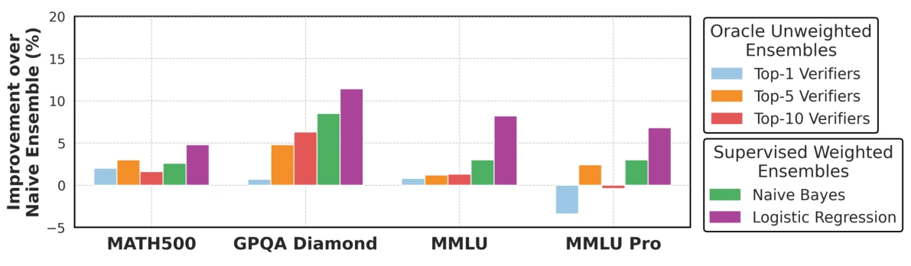
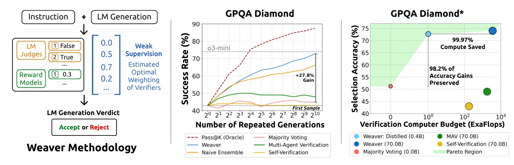
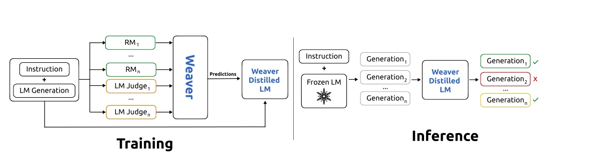
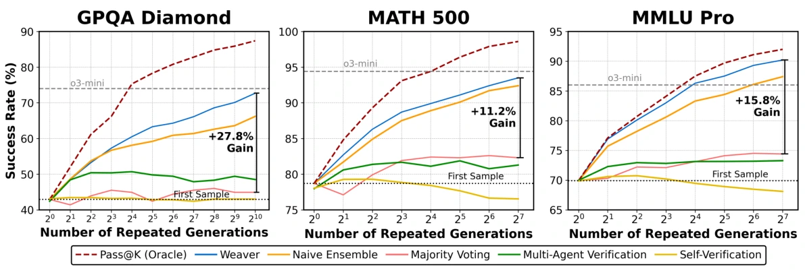
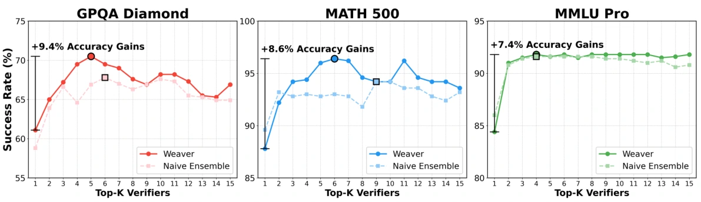
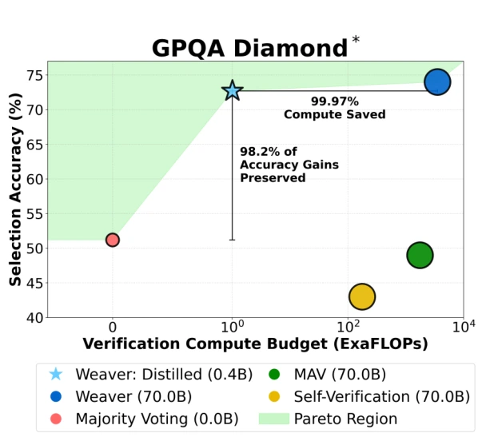

# Weaver：把多个弱验证器织成可靠的答案筛选器

> **一句话总结**：Weaver 针对「模型已经生成了正确答案，却无法把它选出来」的问题，把多个奖励模型和 LLM Judge 的判断视为带噪声的弱标签，通过少量标注校准、验证器过滤和弱监督矩匹配估计各验证器的可靠性，再用后验正确概率选择答案。以 Llama 3.3 70B 为生成器、每题生成 100 个候选时，四项任务平均成功率为 **86.2%**，高于多数投票的 **72.2%**。作者进一步将集成判断蒸馏到约 400M 的 Cross-Encoder，以降低在线验证成本。

## 论文信息

| 项目 | 内容 |
| --- | --- |
| 论文标题 | Weaver: Shrinking the Generation-Verification Gap by Scaling Compute for Verification |
| 作者 | Jon Saad-Falcon、E. Kelly Buchanan、Mayee F. Chen 等，Christopher Ré 等共同参与 |
| 机构 | Stanford University、Together AI、University of Wisconsin–Madison |
| 发表 | NeurIPS 2025，Poster |
| 原文 | [OpenReview 讨论页](https://openreview.net/forum?id=dRjt4vlYVQ) · [PDF](https://openreview.net/pdf?id=dRjt4vlYVQ) · [NeurIPS 页面](https://neurips.cc/virtual/2025/poster/117007) |
| 相关预印本 | [arXiv:2506.18203](https://arxiv.org/abs/2506.18203) |
| 主要方向 | 推理时计算、Best-of-N、弱监督、验证器集成与蒸馏 |

本文重点回答三个问题：**为什么不能简单平均多个裁判？没有大量标签，怎样知道该相信谁？怎样让昂贵的验证集成变得可部署？**

<!--
作者自检：文献来源与版本口径，不作为正文展示。

- 研读版本：2026-10-16 下载的 OpenReview PDF，共 45 页；图号、表号和页码均以此版本为准。
- OpenReview 页面标题使用 by Scaling Compute for Verification；PDF 内标题为 WEAVER: Shrinking the Generation-Verification Gap with Weak Verifiers，arXiv 题名为 Shrinking the Generation-Verification Gap with Weak Verifiers。
- 主表取 OpenReview 表 1：Weaver 平均 86.2%，GPQA Diamond 66.4%；arXiv v3 为 87.7% 和 72.1%，不得混用。
- 原文结果、个人分析、说明性例子及研究设想须分清；示例和后续设想不是论文已验证结果。
- 未定位到可核实的 Weaver 官方实现入口。流程与公式解释依据正文、附录和作者在 OpenReview 的答辩，不宣称还原了官方代码。
- 蒸馏准确率保留比例与 FLOPs 口径另有文内差异，核对记录放在第 6.5 节注释中。
-->

## 1. 全文概览：把生成能力转化为最终正确率

### 1.1 解决什么问题

一个模型回答一次可能出错，但回答 100 次时，正确答案可能已经出现在某一条候选中。此时系统面临两个不同的能力瓶颈：

1. **生成覆盖不足**：所有候选都错了，再好的筛选器也没有正确答案可选。
2. **验证选择不足**：候选中有正确答案，但筛选器选中了一个「看起来更合理」的错误答案。

Weaver 主要解决第二个问题。它既不修改生成器的参数，也不负责重新推导或修正答案，而是在已有候选中做选择。

### 1.2 采用什么方法

完整链路可以概括为：

```text
同一问题生成 K 个候选
        ↓
多个 RM / LLM Judge 分别评价每个「问题—候选」对
        ↓
分数归一化 → 二值化 → 过滤低信号验证器
        ↓
少量标注估计先验与校准参数，大量无标签投票用于矩匹配
        ↓
估计每个验证器的真阳性率、真阴性率
        ↓
计算候选的后验正确概率 → 每题选择概率最高的一条
        ↓（可选扩展）
用后验概率作伪标签，训练小型 Cross-Encoder 替代在线大集成
```

这里的「加权」不是人为指定「模型 A 占 70%，模型 B 占 30%」，而是通过概率模型，让可靠性不同的正反判断贡献不同的证据。

### 1.3 取得什么效果，付出什么代价

主实验中，Llama 3.3 70B Instruct 每题生成 100 个候选，默认验证池包含 33 个奖励模型和 Judge。

<!-- 结果来源：OpenReview PDF 表 1。 -->

- 第一条答案：平均 **68.4%**。
- 多数投票：平均 **72.2%**。
- Weaver：平均 **86.2%**。
- 理想验证器对应的 Pass@100：平均 **91.9%**。

按表中汇总值计算，Weaver 比第一条答案高 **17.8 个百分点**，比多数投票高 **14.0 个百分点**，仍距候选覆盖上限 **5.7 个百分点**。

代价也直接：如果每题 100 个候选都由 33 个验证器评价，过滤前就是 **3,300 次验证器评价**。这还没有算生成候选的成本，也没有算准备蒸馏数据和训练学生的成本。因此，「验证有效」和「整套系统划算」需要分别讨论。

## 2. 背景与问题场景：会做出来，不等于会选出来

### 2.1 三个指标分别在衡量什么

设第 $i$ 个问题为 $q_i$，生成的第 $j$ 个回答为 $r_{ij}$，真实正确性为 $y_{ij}\in\{0,1\}$。每题有 $K$ 个回答，共 $n$ 道题。

**Pass@1** 衡量直接使用一次生成时的正确率。

**Pass@K** 衡量每题的 $K$ 个候选里是否至少有一个正确答案：

$$
\operatorname{Pass@K}
=\frac{1}{n}\sum_{i=1}^{n}
\mathbf{1}\left\{\exists j\in\{1,\ldots,K\}:y_{ij}=1\right\}.
$$

这个指标使用真实标签来检查覆盖，不代表线上系统真的能够找到那条答案。

给定实际筛选函数 $f$，最终选择为：

$$
\hat j_i=\arg\max_j f(q_i,r_{ij}),\qquad
\operatorname{Success}(f)=\frac{1}{n}\sum_i y_{i\hat j_i}.
$$

论文定义的**生成—验证差距**是：

$$
\operatorname{Gap}(f,K)=\operatorname{Pass@K}-\operatorname{Success}(f).
$$

例如 100 道题里，90 道题的候选中存在正确答案，而最终只答对 70 道，差距就是 20 个百分点。它衡量的是没有兑现的候选能力，不是生成器自身的单次错误率。

<!-- 原文定位：§3，PDF p.4。 -->

### 2.2 一个贯穿全文的说明性例子

考虑问题：

> 求实数范围内方程 $\sqrt{x+6}=x$ 的解。

正确过程是先注意右侧必须非负，再平方：

$$
x^2=x+6\Rightarrow(x-3)(x+2)=0.
$$

两个代数根为 $3$ 和 $-2$，但 $-2$ 不满足原方程，所以唯一解是 $x=3$。

假设采样得到三类回答：

| 候选 | 推理与结论 | 是否正确 |
| --- | --- | --- |
| A | 解出两个代数根，代回原式排除 $-2$，回答 $x=3$ | 正确 |
| B | 平方后得到两个根，没有检查符号约束，回答 $x=3$ 或 $x=-2$ | 错误 |
| C | 因式分解或计算出错，回答 $x=2$ | 错误 |

如果生成 6 次，A 出现 1 次、B 出现 3 次、C 出现 2 次，那么：

- **Pass@6 已经成功**：正确回答 A 存在。
- **多数投票仍然失败**：最常见的最终答案来自 B。
- **单一 Judge 也可能失败**：一个偏爱完整推导格式、但不检查定义域的 Judge，可能认为 B 比简洁的 A 更可信。

<!-- 例子自检：这道方程仅用于说明系统性错误与表面质量偏差，不是论文实验或模型失败案例。论文实际验证的是更复杂的数学与科学推理任务。 -->

### 2.3 为什么多个裁判直接平均也不够

对 A 和 B，设三个已经放到可比尺度上的验证器给分如下：

| 验证器 | 检查倾向 | A | B |
| --- | --- | --- | --- |
| $v_1$ | 关注约束和代回验证 | 0.90 | 0.20 |
| $v_2$ | 粗粒度数学合理性 | 0.60 | 0.80 |
| $v_3$ | 容易受流畅性影响 | 0.30 | 0.90 |
| 简单平均 | 每个验证器权重相同 | 0.60 | 约 0.63 |

平均后反而选择 B。问题不是少一个裁判，而是**不同裁判的错误率和误报模式没有被区分**。

此外，奖励模型的分数可能是无界 Logit、某个训练目标下的效用值，Judge 却输出 0/1；即使全部缩放到 $[0,1]$，0.8 也不自动表示「80% 的概率正确」。统一数值范围只能解决尺度问题，不能完成概率校准。

## 3. 核心贡献：分别解决三个不同的障碍

### 3.1 贡献一：证明验证器的组合方式值得认真设计

**对应场景**：已经有若干现成 RM 和 Judge，可以增加推理预算，但不确定是换更大裁判、多次询问同一裁判，还是组合不同裁判。

论文首先使用充足真实标签，比较简单平均、选择较好验证器及学习加权组合。这一步的作用是验证一个前提：**验证器强弱有差异，合理组合可以比「所有人一票同权」更好。**


*图 2：简单集成、优选验证器与监督加权集成。*

<!-- 图源：Jon Saad-Falcon 等，Weaver，OpenReview PDF p.5，CC BY 4.0；截取图面并转为 WebP。完整署名与链接统一放在文末。 -->

阅读这张图时，应关注三种策略的差别：

1. **Naive Ensemble**：直接合并现有验证器，没有区分其可靠性。
2. **Top-K Verifiers**：利用已知表现保留较好的验证器，等价于把被丢弃者的权重设为零。
3. **监督加权集成**：使用真实正确性标签，学习怎样解释不同验证器的分数。

监督加权集成相对简单集成最多高 11.2 个百分点。由于这里使用了完整真实标签，它是展示组合潜力的 **oracle 对照**；接下来要解决的，是如何在少量标签下学到有效的组合。

<!-- 结果来源：§4.1。图 2 的监督加权结果不可当作无标签部署结果。 -->

**与例子的联系**：如果 $v_1$ 确实更擅长识别定义域错误，学习系统应该让它对 B 的否定具有更大影响，而不是让两个风格偏好的裁判以数量优势覆盖它。

**个人理解**：这项贡献主要是实证问题定位。重要的不是重新发明集成学习，而是指出，重复采样的收益会被错误的验证聚合方式浪费。

### 3.2 贡献二：把弱监督适配到异构验证器上

**对应场景**：新领域只有很少专家标注，但手里有大量未标注的「问题—回答」对，以及多个现成验证器的评价。

如果直接用 1% 的样本训练一个监督分类器，可能不足以稳定学习几十个验证器的作用。Weaver 改为利用所有未标注样本中验证器之间的**一致、分歧和正例比例**，在潜变量模型下估计各验证器的可靠性。

但这不能只靠「大家是否同意」：

- 大家都同意某个错误答案，仍然可能是共享偏差。
- 一个几乎永远输出 1 的裁判，虽然总能与某些人一致，却不提供区分度。
- 连续分数的尺度不同，会让一致性统计失真。

因此，论文把**分数处理、低信号过滤、少量标注校准和弱监督估计**组成一个完整流程，而不是把所有原始分数直接塞进弱监督算法。

<!-- 原文定位：§4.2、附录 B。 -->

**与例子的联系**：面对一批不同方程，$v_1$ 与其他人在哪些回答上分歧、每个裁判多常判对，以及这些模式是否能被「存在一个未知真实标签」解释，共同提供估计依据。这个依据来自整个样本集合，不是仅看 A、B、C 三个回答就能知道谁更可靠。

**贡献边界**：这是带假设的统计推断。论文并没有证明，只要凑够若干弱裁判，就一定能在无标签条件下恢复真实答案。

### 3.3 贡献三：把昂贵的验证集成蒸馏成小模型

**对应场景**：离线筛选可以调用几十个验证器，但线上每个问题都这样做，显存、延迟和成本难以承受。

Weaver 先产生每个候选的后验正确概率，再让一个小型 Cross-Encoder 直接从「问题 + 回答」预测这个分数。学生学到后，线上不再逐一调用原来的大验证器。

**与例子的联系**：教师告诉学生 A 更可信、B 因缺少约束检查而可疑。学生训练时读的是问题和回答的文本，推理时也直接评价文本，不需要先召集 $v_1,v_2,v_3$ 再投票。

**个人理解**：这一步把「昂贵系统的决策」变成了「便宜模型的训练数据」。它既连接弱监督与知识蒸馏，也说明教师可以是一个统计集成系统，不一定是某个更大的单模型。

## 4. 方法详解：从候选分数到后验正确概率

### 4.1 先看总体框架图


*图 1：从弱验证器组合到高效蒸馏验证器。*

<!-- 图源：Jon Saad-Falcon 等，Weaver，OpenReview PDF p.3，CC BY 4.0；截取图面并转为 WebP。 -->

这张图将方法与效果放在一起：

- **左侧是方法**：Instruction 和 LM Generation 共同交给 RM 与 LM Judge。不同验证器提供不同格式的信号，经弱监督模块估计可靠性后形成回答判定。
- **中间是重复采样效果**：横轴是生成次数，纵轴是成功率。要比较的不是单纯「多采样是否更好」，而是增加候选后，不同选择器能否跟上候选覆盖的增长。
- **右侧是蒸馏取舍**：横轴改为验证计算预算，纵轴是选择准确率，展示大集成与蒸馏学生的质量—成本关系。

图中的示意权重只用于说明验证器的影响不同。真正计算时，Weaver 使用条件概率及其乘积形成后验，不是照着图中的几个数字做固定加权平均。

### 4.2 数据与符号：模型究竟看到了什么

| 符号 | 含义 | 形状或范围 |
| --- | --- | --- |
| $n,K,m$ | 问题数、每题候选数、验证器数 | 正整数 |
| $y_{ij}$ | 第 $i$ 题第 $j$ 条回答是否正确 | $\{0,1\}$，大部分不可见 |
| $s_{ijk}$ | 验证器 $k$ 对该回答的原始分数 | 实数或二值 |
| $\bar s_{ijk}$ | 处理后的二值判断 | $\{0,1\}$ |
| $\pi$ | 一条候选回答正确的先验概率 | $P(Y=1)$ |
| $\alpha_k$ | 验证器 $k$ 的真阳性率 | $P(S_k=1\mid Y=1)$ |
| $\beta_k$ | 验证器 $k$ 的真阴性率 | $P(S_k=0\mid Y=0)$ |

这里将论文的 $w_{k,1}$、$w_{k,0}$ 分别记作 $\alpha_k$、$\beta_k$，便于区分。**它们不是直接相加的集成权重，也不是一个笼统的准确率。**

为什么要分开建模？因为一个「很宽松」的验证器可能几乎不漏掉正确答案，但也会接受很多错误答案，即 $\alpha_k$ 高、$\beta_k$ 低。一个「很严格」的验证器则可能相反。在候选选择中，这两种行为需要不同解释。

过滤前的原始分数张量为 $n\times K\times m$。弱监督把每个「问题—候选」对作为一条样本，将其展平成 $N\times m$ 的投票矩阵，其中 $N=nK$。

### 4.3 第一步：生成候选并收集异构分数

对每个问题，从同一个生成器以非零温度采样 $K$ 条回答，然后让每个验证器分别读取问题和候选。

- **RM** 返回标量分数，其训练目标可能是偏好排序、正确性分类或过程奖励。
- **LM Judge** 根据提示词评价候选，输出二值判断，解码采用温度 0。

<!-- 模型设置来源：附录 C.1。 -->

此处不要求验证器生成新的答案，也不是让多个 Agent 相互辩论。每个验证器对同一个候选给出评价，聚合器再处理这些评价。

### 4.4 第二步：归一化与二值化

**归一化的目标是让分数尺度可比。** 论文采用稳健分位数，将低 5% 分位映射到 0，高 95% 分位映射到 1。

一种对应的线性映射可写为：

$$
\tilde s_{ijk}
=\operatorname{clip}\left(
\frac{s_{ijk}-Q_{0.05,k}}{Q_{0.95,k}-Q_{0.05,k}},0,1
\right).
$$

这里 $Q_{p,k}$ 是验证器 $k$ 的分数分布的 $p$ 分位数，截断操作限制了极端分数的影响。

<!-- 公式与实现自检：依据 OpenReview 附录 C.1 的文字展开，非原文直接给出的公式。分位数统计范围、常数分数的退化处理未充分说明；arXiv 修订版另有 min-max 描述，复现时须固定版本。 -->

**二值化的目标是适配二元弱监督模型。** 对连续分数选定阈值 $t_k$：

$$
\bar s_{ijk}=\mathbf{1}\{\tilde s_{ijk}\geq t_k\}.
$$

阈值和先验 $\pi$ 通过少量有标签开发样本确定，论文提到约 5～10 个标注问题；具体比例的效果由消融实验讨论。

<!-- 原文定位：附录 B.2.2。 -->

需要理解三个细节：

1. **阈值不是默认都取 0.5 就合理。** 两个 RM 即使都缩放到 $[0,1]$，其分布仍可能完全不同。
2. **二值化会丢失信息。** 0.51 与 0.99 可能被变成同一个判断；这是为了更稳定地使用二元标签模型作出的取舍，不是连续信息无用的证明。
3. **少量标签仍然重要。** Weaver 的准确描述是标签高效，而不是整个流程完全不使用真实标签。

如果一个标注问题对应 100 条生成回答，那么「5 个标注问题」也不等于「只知道 5 个候选的对错」。对有标准答案的任务，可以用标准答案评判该题的多个候选，但这些候选之间又不是完全独立的问题样本。

### 4.5 第三步：过滤近乎常数、低信号的验证器

记二值化后验证器的正判率为：

$$
\hat p_k=\frac{1}{nK}\sum_{i,j}\bar s_{ijk}.
$$

根据估计的候选正确比例，论文采用以下过滤规则：

<!-- 过滤规则来源：附录 B.2.2，PDF p.27。 -->

| 候选真实正确比例的估计 | 过滤规则 |
| --- | --- |
| 介于 20% 与 80% | 丢弃正判率低于 20% 或高于 80% 的验证器 |
| 低于 20% | 丢弃正判率高于 80% 的验证器 |
| 高于 80% | 丢弃正判率低于 20% 的验证器 |

为什么不能无条件丢掉「99% 都判对」的裁判？如果候选本来就有 99% 正确，这种偏斜可能符合任务分布；如果候选只有一半正确，几乎全判 1 就没有多少区分信息。

**说明性场景**：在一批包含大量定义域错误的方程回答中，某个 Judge 只看格式，100 次有 99 次判对。它不能帮助区分 A 与 B，还可能让后续估计更不稳定。

**个人理解**：正判率只能识别部分低信号模式，不能证明保留下来的裁判可靠。两个验证器可以有完全正常的正判率，却在同一批错误答案上一起犯错；极端边缘过滤也不等价于完整的相关性建模。

### 4.6 第四步：建立隐藏真实标签的生成模型

我们只能看到 $S_1,\ldots,S_m$，看不到大部分真实标签 $Y$。论文将真实正确性视为潜变量：

$$
Y\sim\operatorname{Bernoulli}(\pi),
$$

$$
S_k\mid Y=1\sim\operatorname{Bernoulli}(\alpha_k),\qquad
S_k\mid Y=0\sim\operatorname{Bernoulli}(1-\beta_k).
$$

在已知 $Y$ 时，假设各验证器输出条件独立：

$$
P(S_1,\ldots,S_m\mid Y)=\prod_{k=1}^{m}P(S_k\mid Y).
$$

这不是说验证器在整个数据集上完全不相关。它们当然可能因为答案确实正确而一起接受；假设排除的是**在控制正确性后仍然存在的额外共同错误模式**。

例如，两个使用类似训练数据的 Judge 都偏爱较长回答，即使已知某条回答是错误的，它们仍可能一起给高分，这就违反了条件独立假设。该假设换来了参数量从指数级降至线性级和更易计算的推断，但也形成了方法的重要边界。

<!-- 原文定位：附录 B.1。 -->

### 4.7 第五步：利用无标签的一阶、二阶统计估计可靠性

关键问题是：**没有 $Y$，怎样估计 $\alpha_k$ 和 $\beta_k$？**

先看可以直接从投票矩阵数出来的量：

- 每个验证器有多常输出 1：$P(S_k=1)$。
- 每对验证器有多常同时输出某个组合：$P(S_k=a,S_\ell=b)$。

由全概率公式，一阶统计满足：

$$
P(S_k=1)=\pi\alpha_k+(1-\pi)(1-\beta_k).
$$

由条件独立假设，二阶统计满足：

$$
\begin{aligned}
P(S_k=a,S_\ell=b)
={}&\pi P(S_k=a\mid Y=1)P(S_\ell=b\mid Y=1)\\
&+(1-\pi)P(S_k=a\mid Y=0)P(S_\ell=b\mid Y=0),\quad k\ne\ell.
\end{aligned}
$$

例如，两者都输出 1 的比例满足：

$$
P(S_k=1,S_\ell=1)
=\pi\alpha_k\alpha_\ell
 +(1-\pi)(1-\beta_k)(1-\beta_\ell).
$$

左边可从无标签数据观察，右边的 $\pi$ 用少量标注估计，剩下的是未知可靠性参数。对所有验证器和所有二值组合建立这样的关系，就得到一组需要共同满足的约束。

**一个统计量例子**：假设 $\pi=0.4$，两个验证器的 $(\alpha,\beta)$ 分别为 $(0.9,0.9)$ 和 $(0.8,0.65)$。模型预测它们的正判率分别为 $0.42$、$0.53$，共同判为 1 的比例为 $0.309$。这些比例可以从大量未标注投票中计数，再反过来约束未知参数；但不能仅凭这一对验证器的几个比例，就保证把所有可靠性参数唯一恢复出来。

**矩匹配**做的事情，是寻找一组可靠性参数，使模型预测的这些比例尽量接近真实观察到的比例。它不是给每条未标注答案凭空制造真实标签，也不是把「同意最多数」直接认定为正确。

#### 用矩阵形式理解原文目标函数

对每条样本，将每个验证器的输出变成二元 One-Hot，再拼接成 $2m$ 维向量。由这些向量的共现构造矩阵 $O\in\mathbb{R}^{2m\times2m}$：

- 验证器 $k$ 自己对应的 $2\times2$ 对角块保存 $P(S_k=0)$ 和 $P(S_k=1)$，块内其余项为 0。
- 不同验证器的非对角块保存四种联合输出概率。

再构造条件概率矩阵 $\mu\in\mathbb{R}^{2m\times2}$，每个验证器占两行：

$$
\mu_{[k]}=
\begin{bmatrix}
\beta_k & 1-\alpha_k\\
1-\beta_k & \alpha_k
\end{bmatrix},\qquad
P=\operatorname{diag}(1-\pi,\pi).
$$

两列分别对应 $Y=0$、$Y=1$；每个验证器对应的每列概率和为 1。原文式 (5) 可写为：

$$
\min_{\mu}
\left\|\operatorname{offblock}(O-\mu P\mu^\top)\right\|_F^2
+\left\|\operatorname{diag}(O)-\mu P\mathbf{1}_2\right\|_2^2.
$$

其中 $\mathbf{1}_2$ 是两维全 1 列向量，$\operatorname{offblock}$ 指排除整个 $2\times2$ 块对角区域。

- **第一项**匹配不同验证器之间的共现关系。
- **第二项**匹配各验证器自己的正反判断比例。
- **不能把自己与自己也按两个独立验证器来匹配**，因此要排除块对角区域。

论文使用梯度下降求解。这里优化的是少量统计参数，原有 RM 和生成器保持冻结。

<!-- 优化自检：复现还需确认概率约束、初始化、停止条件及潜在非唯一解的处理，不能仅凭正文的梯度下降描述补全实现。 -->

这一估计还要求多数弱源具有优于随机的正向信号。否则只看共识，可能无法分清「多数人判断正确」与「多数人一致判断反了」。过滤低信号验证器有助于估计，但没有把可辨识性问题变成无条件保证。

<!-- 假设来源：附录 B.2。 -->

### 4.8 第六步：根据正反证据计算后验并选择候选

对某个候选的二值向量 $\bar{\boldsymbol s}$，先计算两种解释的未归一化概率：

$$
A=\pi\prod_k P(S_k=\bar s_k\mid Y=1),\qquad
B=(1-\pi)\prod_k P(S_k=\bar s_k\mid Y=0).
$$

然后得到筛选分数：

$$
f(q,r)=P(Y=1\mid\bar{\boldsymbol s})=\frac{A}{A+B}.
$$

这个分母通过两类模型似然相加得到，不需要在有限样本上直接估计 $2^m$ 种投票组合各自的频率。

<!-- 原文定位：正文式 (1)、附录式 (7)。 -->

为避免多个小概率连乘导致数值下溢，可以在对数域计算。由上式整理得到：

$$
\log\frac{f}{1-f}
=\log\frac{\pi}{1-\pi}
+\sum_k\left[
\bar s_k\log\frac{\alpha_k}{1-\beta_k}
+(1-\bar s_k)\log\frac{1-\alpha_k}{\beta_k}
\right].
$$

这使「加权证据」更直观：

- 经常误报的验证器说「正确」，提供的正面证据有限。
- 很擅长排除错误答案的验证器说「错误」，可能提供很强的反面证据。
- 没有区分度的验证器，其正反输出都难以改变后验。

如果进一步把对数优势写成对二值投票的仿射函数，单个投票的系数为：

$$
w_k^{\mathrm{vote}}
=\log\frac{\alpha_k\beta_k}{(1-\alpha_k)(1-\beta_k)}.
$$

从形式上看，这相当于对二值投票做逻辑回归；区别在于参数主要由无标签矩匹配估计，而不是直接用大量标签拟合分类损失。

<!-- 推导自检：对数优势与投票系数是本文对原文概率模型的代数展开，不是另一个官方训练目标。 -->

同一问题的候选使用相同参数与先验时，先验项本身不会改变候选排序；但 $\pi$ 还参与可靠性估计和前面的处理步骤，所以不能因此把校准省掉。

最后，每道题取分数最高的候选。

<!-- 复现自检：二值化可能造成并列；原文未充分说明并列处理规则，复现时需明确记录。 -->

### 4.9 一个可以手算的端到端筛选过程

继续使用前面的方程，假设整个校准与估计流程已经得到以下参数：

| 验证器 | $\alpha_k$：正确回答被接受的概率 | $\beta_k$：错误回答被拒绝的概率 |
| --- | --- | --- |
| $v_1$ | 0.90 | 0.90 |
| $v_2$ | 0.80 | 0.65 |
| $v_3$ | 0.75 | 0.60 |

再取候选正确先验 $\pi=0.4$，用这组说明性参数演示后验计算。

<!-- 例子自检：参数为手算构造，不是论文模型参数；可靠性和先验不能由这三条候选本身估计出来。 -->

候选投票为：A 得到 $(1,1,0)$，B 得到 $(0,1,1)$，C 得到 $(0,0,0)$。A 和 B 都有两票支持，简单计票分不出高下。

对 A：

$$
A_A=0.4\times0.9\times0.8\times(1-0.75)=0.072,
$$

$$
B_A=0.6\times(1-0.9)\times(1-0.65)\times0.6=0.0126,
$$

$$
f(A)=\frac{0.072}{0.072+0.0126}\approx0.8511.
$$

同样计算 B 与 C：

| 候选 | 投票 | $A$：正确类解释 | $B$：错误类解释 | 后验分数 |
| --- | --- | --- | --- | --- |
| A | $(1,1,0)$ | 0.0720 | 0.0126 | 约 0.8511 |
| B | $(0,1,1)$ | 0.0240 | 0.0756 | 约 0.2410 |
| C | $(0,0,0)$ | 0.0020 | 0.2106 | 约 0.0094 |

最终选择 A。关键不是「A 获得更多赞同」，而是 **A 得到了更可靠的支持，B 得到了更可靠的反对**。

完整的数据变化可以这样回看：

| 阶段 | 输入 | 输出 |
| --- | --- | --- |
| 重复生成 | 问题文本 | 多条推理与最终答案 |
| 多验证器评价 | 每个问题—候选对 | 原始分数向量 |
| 预处理 | 全部候选的分数、少量开发标签 | 可用验证器集合与二值矩阵 |
| 弱监督估计 | 二值矩阵的一阶、二阶统计与 $\hat\pi$ | 各验证器的 $\hat\alpha_k,\hat\beta_k$ |
| 后验推断 | 某条候选的二值向量与已估计参数 | 后验正确分数 |
| 每题选择 | 同题的全部候选分数 | 得分最高的一条回答 |

这些后验是模型假设下的估计值。如果条件独立不成立或任务分布发生变化，0.85 不保证对应真实世界中恰好 85% 的正确率。

## 5. 蒸馏详解：从多模型投票到单模型文本评分

### 5.1 原图中的训练与推理分工


*图 15：离线用集成产生监督，在线由学生评分。*

<!-- 图源：Jon Saad-Falcon 等，Weaver，OpenReview 附录 C.6，PDF p.41，CC BY 4.0；截取图面并转为 WebP。 -->

这张图应沿两部分理解：

1. **训练阶段**：同一个问题—回答对交给多个 RM 和 Judge，Weaver 聚合成 Predictions，作为蒸馏学生的训练目标。
2. **推理阶段**：Frozen LM 生成多条回答，蒸馏后的模型逐条打分，选择其中一条。原验证集成不再逐次在线参与。

与直接学习投票矩阵不同，学生输入是完整文本。原来的统计教师解决「这些裁判的组合说明什么」，学生学习「什么样的问题—回答组合会得到这种判断」。

### 5.2 Cross-Encoder 怎样得到分数

论文选择 **ModernBERT-Large，396M 参数**，大致称为 400M。将问题和回答拼接输入编码器，二者在同一个 Transformer 中进行交互；这与分别编码后计算向量相似度的 Bi-Encoder 不同。

取 `[CLS]` 的最终隐状态，经过 Dropout 和一个线性分类层，可示意为：

$$
h_{ij}=\operatorname{Encoder}_{\theta}([q_i;r_{ij}])_{\mathrm{CLS}},
\qquad
p_{\theta,ij}=\sigma\left(W\operatorname{Dropout}(h_{ij})+b\right).
$$

<!-- 架构与公式自检：依据附录 C.6 整理。拼接方式仅作示意，实际特殊 Token、最大长度与截断策略仍需核实。 -->

令教师后验为 $z_{ij}$。以软概率作为蒸馏目标时，交叉熵可写作：

$$
\mathcal L(\theta)
=-\frac1N\sum_{i,j}\left[
z_{ij}\log p_{\theta,ij}+(1-z_{ij})\log(1-p_{\theta,ij})
\right].
$$

<!-- 损失自检：公式依据 §6「使用后验伪标签和交叉熵」的表述展开。原文未充分交代所有实验是否保留软概率、部分配置是否硬化；这是软标签情形的解释，不宣称还原官方训练代码。 -->

它不是让学生预测教师的下一个 Token，也不是让学生模仿一整段教师推理；它蒸馏的是**回答正确性的评分能力**。

### 5.3 训练细节与数据边界

训练配置为：Dropout 0.1，Adam 优化器，学习率 $5\times10^{-6}$，Batch Size 64，采用线性 Warmup 与线性衰减，并通过 Sentence-Transformers 实现训练。

蒸馏实验采用 **80:20 的训练/评估划分**，训练对与评估对不重叠。

<!-- 数据与配置自检：训练配置取附录 C.6；80:20 标注见图 6、图 16，问答对不重叠由作者答辩说明。是否严格按 query 分组仍待确认，不可将问答对不重复表述为问题完全未见。附录学习率为 5e-6，答辩举例为 3e-6，本文采用附录值。 -->

**个人理解**：学生容量可以小于教师系统，因为它只需学习一个特定评分任务，而不需要继承全部生成能力。但它也会继承教师的错误，且能否泛化到新学科、不同生成器或更长推理，不能由同分布的蒸馏效果自动推出。

## 6. 实验简析：选择效果与计算代价

### 6.1 设置与主结果

主表涵盖 MATH500、GPQA Diamond、MMLU College 和 MMLU Pro。MMLU College 选择大学层次的生物、化学、物理、数学、计算机与医学题；MMLU Pro 随机抽取 500 题。

下表比较各方法的选择成功率，越高越好：

<!-- 数据来源：OpenReview 表 1、附录 C.1；平均列沿用原文，未混入 arXiv 修订版结果。 -->

| 方法 | 候选数 | MATH500 | GPQA Diamond | MMLU College | MMLU Pro | 平均 |
| --- | --- | --- | --- | --- | --- | --- |
| 第一条回答 | 1 | 78.0% | 42.9% | 82.6% | 69.9% | 68.4% |
| 多数投票 | 100 | 83.0% | 47.4% | 84.1% | 74.4% | 72.2% |
| RewardBench 上最高分的 RM | 100 | 78.2% | 49.7% | 86.0% | 77.0% | 72.7% |
| RewardBench Top-10 RM 简单集成 | 100 | 75.4% | 41.3% | 88.1% | 71.4% | 69.1% |
| **Weaver** | **100** | **93.4%** | **66.4%** | **94.9%** | **90.2%** | **86.2%** |
| o3-mini，原文引用的对照结果 | 1 | 94.4% | 74.0% | 92.2% | 86.0% | 86.7% |
| Oracle / Pass@100 | 100 | 98.6% | 81.0% | 96.0% | 92.0% | 91.9% |

简要读法：

- **选择能力明显改善**：在候选数相同的情况下，Weaver 明显优于多数投票，特别是 GPQA 的 66.4% 对 47.4%，高 **19.0 个百分点**。
- **优势因任务而异**：平均只落后 o3-mini 0.5 个百分点，但 GPQA 仍落后 7.6 个百分点；MMLU 两项则更高。
- **计算预算并不相同**：o3-mini 一行是原文引用的单次模型结果，Weaver 则使用 100 个候选和多验证器，二者的延迟与成本需要单独比较。
- **验证池也影响增益**：主表的简单集成使用 Top-10 RM，Weaver 默认使用 33 个混合验证器。图 2 和附录中的同池比较，更适合观察聚合算法本身的作用。

表 1 中，多数投票的平均生成—验证差距为 $91.9-72.2=19.7$ 个百分点；Weaver 降至 $91.9-86.2=5.7$ 个百分点。按汇总值计算，相对多数投票减少了 14.0 个百分点的选择损失。

### 6.2 重复采样与验证器数量的扩展


*图 3：候选数量增加时，不同选择策略的成功率。*

<!-- 图源：Jon Saad-Falcon 等，Weaver，OpenReview PDF p.8，CC BY 4.0；截取图面并转为 WebP。 -->

图 3 的横轴是候选数 $K$，纵轴是成功率。原文研究从 $2^0$ 到 $2^{10}$ 的候选规模，并对照 Pass@K 与其他选择策略。

核心观察是：候选增加带来了更高覆盖，但多数投票等方法更容易饱和；Weaver 更能利用新增候选。图中的 Pass@K 应理解为当前生成器在这些候选上的覆盖上限，而不是可部署方法。

**个人理解**：采样越多，也越可能遇到「错误但得分很高」的回答。因此扩大 $K$ 不只要求生成多样性，也要求验证器控制误报。选择时哪怕只漏掉少量正确回答也可能还有别的正确候选，但把某条错误回答排到第一就会直接失败，这与附录 C.7 强调 Precision 的讨论一致。


*图 4：验证器数量与组合效果的关系。*

<!-- 图源：Jon Saad-Falcon 等，Weaver，OpenReview PDF p.8，CC BY 4.0；截取图面并转为 WebP。Top-K 的 oracle 排序由作者答辩澄清。 -->

图 4 研究增加验证器数量。横轴 Top-K 是在 **oracle 已知单个验证器表现**的条件下，由强到弱加入验证器。因此，这条曲线反映的是优先加入较强验证器时的扩展效果，而非随机扩充验证池的收益。

收益递减也合理：后面加入的模型可能只重复已有偏差。决定价值的是新增信息，而不仅是模型数量。

### 6.3 少量标注与过滤消融

附录表 4 在固定 RM 阈值为 0.5 的设置下，考察类别平衡估计所用开发集；表 5 考察验证器过滤：

| 对照 | 原文平均值变化 | 可以支持的判断 |
| --- | --- | --- |
| 表 4：Naive Threshold 对 1% 开发集 | 79.0% → 84.5% | 少量校准标签已有明显价值 |
| 表 4：1% 对 5% 开发集 | 84.5% → 87.5% | 不宜声称 1% 在所有配置下已经无损 |
| 表 5：不丢弃验证器，对丢弃极端边缘验证器 | 79.4% → 85.2% | 数据适配和过滤是实际效果的重要组成部分 |

附录表 6 的自适应阈值开发集实验报告，1%～100% 均为 87.5%。这是自适应阈值下的另一组实验，说明校准策略也会影响样本效率。

<!-- 消融自检：表 4 与表 6 设置不同，不可合并成一条样本效率曲线。提升按表中数值计算，不直接沿用正文中未统一口径的「8.4%」「12.5%」摘要式表达。 -->

另外，附录表 7 的监督逻辑回归对照中，连续输入优于二值输入，例如 MATH500 为 97.2% 对 93.1%。这支持「二值化是适配弱监督和小标签设置的选择」，而不是「二值化在任何训练条件下都更优」。

### 6.4 转导学习：适合批量筛选的设置

以 500 个问题、1% 开发集为例，实验中的数据分工为：

- 5 个标注问题用于校准。
- 500 个问题的无标签评价共同用于矩匹配。
- 在剩余 495 个非开发问题上评估。

<!-- 设置来源：作者最终答辩说明，https://openreview.net/forum?id=dRjt4vlYVQ&noteId=cD4jOVDdWm 。 -->

这属于**转导式设置**：待处理样本本身的无标签统计参与了估计。对于「离线给手头一整批回答做筛选」的目标是合理设置，但不同于先训练一个聚合器，再不看新分布地服务未来请求。

跨数据集迁移仍会出现性能下降。要把这种批量筛选方式用于未来的独立请求，就需要进一步解决可靠性参数在不同分布间的迁移问题。

### 6.5 蒸馏：用轻量学生降低在线开销


*图 6：蒸馏验证器的选择准确率与验证预算。*

<!-- 图源：Jon Saad-Falcon 等，Weaver，OpenReview PDF p.9，CC BY 4.0；截取图面并转为 WebP。原图训练/评估为 80:20 划分。 -->

图 6 将横轴设为验证预算，体现的直觉很清楚：用文本分类学生替代几十个大模型，能明显降低在线验证开销。学生可以直接读取问题与候选，不再依赖原验证器池逐一打分。

准确率方面，在 80% 蒸馏训练占比下，学生在 MATH500 上为 **91.4%**，对应完整系统为 **93.4%**；在 MMLU Pro 上为 **87.8%**，对应 **90.2%**。也就是说，学生承接了较多教师能力，但仍有一定损失。

<!-- 结果来源：附录表 22，80% 蒸馏训练占比。 -->

**个人理解**：蒸馏的价值在于把昂贵的集成判断转化为可重复使用的轻量评分能力。部署收益还取决于教师产生伪标签和学生训练的一次性成本，能否被后续大量请求摊薄；候选生成成本和实际延迟也需要一起衡量。

<!--
作者自检：蒸馏数字口径，暂不将未统一的比例用于正文结论。

- 准确率保留：摘要写 98.7%，§6 与图 1 写 98.2%，并出现 full accuracy 与 accuracy gains 两种表述。绝对准确率比例和增益保留比例不同，不可混述。
- 验证计算节省：作者多处报告最高 99.97%，但仅凭正文所列成本尚不能复算。
- §6 成本：完整集成 35.35 exaFLOPs，学生 1.01 exaFLOPs；直接比较得到约 97.14% 节省，而非 99.97%。分母、单位或统计范围待核实。
- 表 22 的具体准确率可用于说明蒸馏取舍，不据此宣称完全无损；区分在线评分成本、离线教师与训练成本、候选生成和端到端延迟。
-->

## 7. 总结与知识联系：我从 Weaver 学到了什么

### 7.1 生成、评价、选择是三个可分离的组件

与 [Agent Evaluation、Testing 与 Observability](/notes/agent-engineering/10-agent-evaluation) 联系起来，Weaver 提醒我：不能只看生成器基准分数，也不能把一个 Judge 的高分直接当作最终系统可靠性。

应分别测量：

1. 候选中有没有正确方案。
2. 验证器对正反样本的误报、漏报和相关错误。
3. 选择器是否把正确候选放到第一。
4. 达到该结果花费了多少生成、验证和训练资源。

例如在 Agent 多方案规划中，计划里可能已有可行方案，却被一个偏爱复杂步骤的 Judge 排后；真正要改进的是选择机制，而不一定是把 Planner 换成更大模型。

### 7.2 少量真实标签的价值在于锚定

弱监督不是不需要真实世界信息，而是改变标签的使用方式：少量标签用于估计类别平衡、阈值和方向，大量未标注数据用于估计一致性结构。

这与「只靠多数意见就能找到真相」有本质区别。如果多个验证器共享同一种错误，仅增加无标签样本未必能消除它。

### 7.3 教师可以是系统，学生可以只学一个任务

结合 [知识蒸馏笔记](/daily/2026/10/2026-10-13-daily-knowledge-distillation)，Weaver 给出了很具体的「系统蒸馏」实例：

- 教师：多个冻结模型 + 统计聚合器。
- 教师输出：正确性概率，而非生成答案。
- 学生：问题—回答 Cross-Encoder。
- 部署：固定生成器，替换昂贵评分链路。

这与 [RAG 中的重排序](/notes/agent-engineering/06-rag-engineering) 也有联系：先产生一个覆盖较高的候选集合，再由更精细的评分器排序。不过，RAG 的文档相关性和 Weaver 的回答正确性是不同目标，不能直接共用分数含义。

### 7.4 冻结生成器，不等于最终输出分布没有变化

**个人理解**：Weaver 没有更新生成器参数，保留了原模型作为候选生成源。但从 $K$ 个回答中按验证分数挑选一个，会改变系统最终返回答案的分布。

因此，可以说它实现了「不微调生成器的能力提升」，但不应进一步推成「系统输出分布完全不受干预」。这一区分对分析选择偏差、错误放大以及 RLHF 的后续使用都很重要。

### 7.5 最值得保留的核心认识

> 更多候选只有在验证跟得上时才有用；更多裁判只有在新增信息被正确解释时才有用。Weaver 的价值，是把候选覆盖、可靠性估计和部署成本连接成一条可以分别检验的链路。

## 8. 可行的后续方向：从局限形成可验证的问题

基于上述机制与局限，我更关心以下四个待验证方向。

<!-- 研究设想自检：以下是个人提出或进一步具体化的方案，尚未实施实验。作者结论提到专门验证器、RLHF 和多模态扩展，不将本文设想全部归为作者贡献。 -->

### 8.1 方向一：按错误相关性选裁判，而不只看单体准确率

**依据**：Weaver 的核心依赖条件独立近似，极端边缘过滤却无法识别「正常正判率但错误高度重合」的裁判。

**假设**：在固定验证预算下，选择少量互补验证器，比选择同数量单体最强但高度同质的验证器更有效。

**最小实验**：

1. 固定一批数学问题、每题相同的 16 或 32 个候选，所有方法共用候选。
2. 缓存 4～8 个 Judge/RM 的分数，以小规模标签估计错误共现；无标签相关性只作为辅助，不直接当作错误相关性。
3. 比较随机选、按单体表现选、按「可靠性 + 错误多样性」选，再分别配简单集成与 Weaver。
4. 在按问题留出的评估集上测 Success、Gap、误报率和实际调用成本；重复多个划分，避免小样本偶然性。

**成功判据**：在相同调用预算下稳定降低 Gap，而不是仅在某次验证集上找到更好的组合。主要风险是少量标签估计相关性不稳定，以及选择策略本身过拟合。

### 8.2 方向二：校准感知的分级验证与动态停止

**依据**：完整 Weaver 对所有候选调用全部验证器，成本高；蒸馏学生则可能在难例上不够可靠。

**假设**：学生先评分，再仅对低把握问题或分数接近的候选升级到大集成，可以在接近完整系统质量的同时减少平均验证调用。

**最小实验**：学生先评价全部候选，根据校准后的置信度、前两名分差等特征触发升级。对照学生单独使用、完整集成与固定比例随机升级，在相同预算下比较成功率、平均成本及 P95 延迟。

阈值必须在独立开发集确定；前两名分差大不代表一定正确，如果所有裁判共享错误，也可能「很有把握地选错」。还需保留固定预算抽检来测量这类盲区。

### 8.3 方向三：结合空间推理任务，加入独立的符号验证信号

**依据**：在 [大语言模型空间推理研究](/projects/spatial-reasoning) 中，方向关系可以用坐标或关系代数检查，相比再增加一个同类 Judge，这可能提供更独立的信号。

**说明性场景**：「A 在 B 东侧，B 在 C 北侧，问 A 在 C 哪个方向？」可把 $C=(0,0)$、$B=(0,1)$、$A=(1,1)$，得到东北。候选文本可能逻辑流畅，却把参照方向翻转。

**最小实验**：在保留确定答案的合成数据上，混合 LM Judge、文本约束检查和符号关系验证器；单独报告关系解析出错、推理出错及验证器不可用的情况。

**成功判据**：在更长关系链、关系改写和不同生成器上，固定候选与预算后降低选择错误。符号验证器不能读取评估答案作为输入；如果任务已经可以被完整精确求解，则应把直接符号求解作为基线，检查集成是否还有必要。

这是我最想优先尝试的方向：场景可控、真实标签可自动产生，可以从少量验证器和缓存分数开始，先验证互补信号是否确实有价值。

### 8.4 方向四：面向未见问题和新分布的蒸馏

**依据**：教师依赖批次统计，学生又主要在同分布伪标签上训练，泛化不能由教师拟合优度代替。

**最小实验**：严格按 query 分组，再按学科或任务划分源域与目标域；仅在源域生成教师伪标签和训练学生。比较零目标域校准、少量目标域标签校准，以及允许使用目标域无标签统计的转导设置。

**指标**：最终选择成功率、与教师差距、概率校准误差，以及新生成器和更长回答条件下的变化。需要同时报告教师自己的目标域质量，防止把教师失效误认为单纯的蒸馏失败。

## 9. 延伸阅读：按问题脉络继续读

| 建议顺序 | 材料 | 为什么接着读 | 重点问题 |
| --- | --- | --- | --- |
| 1 | [Large Language Monkeys: Scaling Inference Compute with Repeated Sampling](https://arxiv.org/abs/2407.21787) | 理解多次采样为什么能扩大覆盖，以及没有精确验证器时为什么会饱和 | 覆盖提升与最终正确率提升是什么关系？ |
| 2 | [Snorkel: Rapid Training Data Creation with Weak Supervision](https://arxiv.org/abs/1711.10160) | 补齐多噪声源、标签模型和最终判别模型的基本框架 | 没有大量人工标签，怎样用多个弱信号生成训练监督？ |
| 3 | [Training Complex Models with Multi-Task Weak Supervision](https://arxiv.org/abs/1810.02840) 与 [MeTaL](https://github.com/HazyResearch/metal) | 理解概率矩阵、弱源依赖结构与参数恢复的背景 | 参数在什么假设下可辨识？如何处理依赖？ |
| 4 | [RewardBench: Evaluating Reward Models for Language Modeling](https://arxiv.org/abs/2403.13787) | 看奖励模型到底在评什么，以及排行榜分数的适用边界 | 偏好排序强，是否等于新领域正确性验证强？ |
| 5 | [Scaling LLM Test-Time Compute Optimally can be More Effective than Scaling Model Parameters](https://arxiv.org/abs/2408.03314) | 将 Weaver 的验证轴放回完整推理预算分配问题 | 固定总预算时，什么时候该增加生成，什么时候该增加验证？ |
| 6 | [ModernBERT](https://arxiv.org/abs/2412.13663) 与 [知识蒸馏笔记](/daily/2026/10/2026-10-13-daily-knowledge-distillation) | 理解学生架构、软标签训练与高效评分 | 为什么一个小编码器可以承担专门的文本对评分任务？ |

<!-- 延伸阅读自检：以上包含前置知识和相邻研究路线，并非都是 Weaver 的后续工作。继续查找后续论文时，应核对候选池、标签用量与总预算是否可比。 -->

---

*本文图 1、2、3、4、6、15 引自 Jon Saad-Falcon 等人的 [Weaver](https://openreview.net/pdf?id=dRjt4vlYVQ)（[CC BY 4.0](https://creativecommons.org/licenses/by/4.0/)），经图面裁剪并转为 WebP。*

<!--
作者自检：以下定位与待核实记录保留在源码，不作为文章章节展示。

## 参考定位与待核实项

### 原文定位

- **问题与指标**：OpenReview PDF §3，p.4。
- **加权动机和潜变量模型**：§4.1–4.2，p.4–6，式 (1)–(5)，图 2。
- **主实验与扩展**：§5，p.6–9，表 1–3，图 3–5。
- **蒸馏**：§6，p.9；附录 C.6，p.41–42，图 15–16，表 22。
- **条件概率与矩估计**：附录 B.1，p.24–26。
- **二值化、过滤和消融**：附录 B.2，p.26–28，表 4–7。
- **归一化和模型设置**：附录 C.1，p.28–32。
- **评估划分澄清**：[作者最终说明](https://openreview.net/forum?id=dRjt4vlYVQ&noteId=cD4jOVDdWm)、[关于蒸馏等问题的答辩](https://openreview.net/forum?id=dRjt4vlYVQ&noteId=Sv9apWDE30)。

### 尚需通过实现或补充材料确认

1. 归一化分位数的统计范围、阈值搜索细则、常数分数与并列处理。
2. 弱监督优化的初始化、约束、停止条件，以及相关验证器下的稳定性。
3. 蒸馏是否全程保留软概率；80:20 是否严格按 query 分组；最长输入与截断策略。
4. 正文与答辩的学习率表述不一致：附录写 $5\times10^{-6}$，答辩举例写 $3\times10^{-6}$，本文按附录记录。
5. 蒸馏准确率保留比例与 FLOPs 节省的统一计算口径；主实验、附录表 21 与 arXiv 修订版的不同设置。

研读依据、文件版本与原稿指纹记录在本地原稿库的来源索引中。
-->
